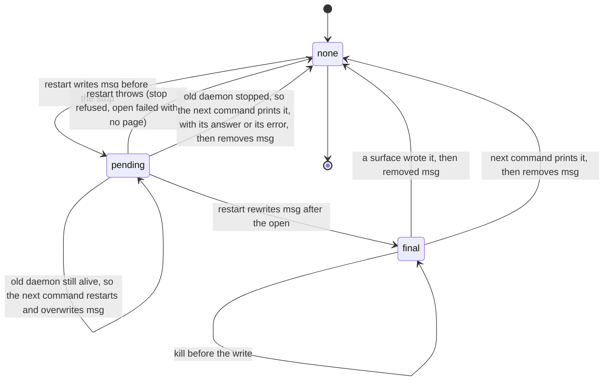

# close waits for an upgrade restart, and its notice survives a kill (ET-32, ET-29, #152)

Amends `2026-10-14-upgrade-restart-design.md` (#145, PR #149), section 1.

## Problem

Two findings of the 2026-10-14 campaign (`docs/superpowers/exploratory-testing/2026-10-14-session-log.md`, #152) show
the restart after an upgrade reporting success while the session is not what the agent was told.

**ET-32 (P2, 7 runs).** `close` started together with the first command after an upgrade answers
`closed session '<name>'`, exit 0, and the session is open afterwards. S1 "close racing the restart": `c1`, `c2`
(`h_cl`) and `c1` to `c3` (`h_cl2`), close at +0, +300 and +600 ms, 5 of 5 runs left a live daemon. S4 "`close --all`
right after an upgrade restart": `ca0`, `ca3`, 2 more runs. For a `--persistent` session (`c2`, `p`) the session came
back on `about:blank` with no `BOWSER_DAEMON_PROFILE` and no `state.json`, behind the notice `page did not reload …
(daemon for session 'c2' did not start in time with --persistent profile …; the browser may not support a persistent
profile here)`. The browser supports the profile; `close` removed the session directory under the starting daemon.

Cause, from the code. `closeOne` (`src/commands/navigation.ts`) never looks at the `upg` lock. Its "was reopened
while closing" guard re-reads the pidfile after `stopDaemon`; if the restart has spawned the new daemon but the
daemon has not written its pid yet, the guard sees nothing and `rm` removes the session directory. `restartSession`
(`src/commands/restart.ts`) holds `upg` from its stop to its open, so `close` and the restart can each stop a daemon
the other one counts on.

**ET-29 (P2, 7 runs, CLI and MCP).** A first command killed during the restart never prints the notice, and nothing
restarts again. S1 "Killed mid-restart": `eph`, `e3` (SIGKILL), `t1` (SIGTERM, rc 143), `t2` (SIGINT, rc 130). In
each, the next `localstorage-get tok` printed nothing, exit 0, no stderr, where `7` was stored before the upgrade.
S2 "Client kills the server mid-handover": `k300T`, `k200T`, `k400K`: the child finished the restart and released
the lock, the reply never reached the client, and a fresh server read `tok` as `null` with no notice.

Cause: the notice lives only in the restarting process's `ctx.notices` array, printed by `src/cli.ts` before the
answer and by `runToolCall` (`src/mcp.ts`) in the tool result. A process killed before that write takes the notice
with it. The next command meets a daemon of its own version, so it has no reason to restart or to say anything.

## Change

Two changes, both in the commands layer. No daemon change.

### 1. `close` holds `upg` while it stops the daemon, and removes it last (ET-32)

`closeOne` claims `<session dir>/upg` before `stopDaemon`, with the claim and wait the restart uses (moved out of
`restartSession` into one function both call): `claimSession(lock, session, undefined, async () => true)`, poll
every 50 ms while a live pid holds it, give up when the op budget (`opTimeoutMs()`) runs out with today's message
`session '<s>' is being restarted by pid <n> (<lock>)`, exit 1, having stopped nothing. Budget 0 waits without a
deadline, as every other wait on `upg` does (lifecycle test "with BOWSER_OP_TIMEOUT_MS=0, a held restart lock is
waited for without a deadline").

- No session directory, before the claim or during it (`tryClaim` writes `upg.<pid>.tmp` there and gets `ENOENT`,
  because another `close` removed it): `close` goes on without the lock, as today, and answers `closed session
  '<s>'`.
- `close` keeps the lock through the stop and the "reopened while closing" guard. It then removes every entry of the
  session directory except `upg`, then `upg`, then the directory with `rmdir`. `ENOTEMPTY` and `ENOENT` from that
  `rmdir` are ignored: a restart claimed `upg` in the gap. Such a restart spawns nothing (below), so what can stay is
  an empty directory, a session never opened: `list` skips it and the next `close --all` removes it.
- On a throw, `close` removes the lock if it still names its own pid, as the restart's `finally` does.
- `close --all` gets this through `closeOne`. `closeLegacy` is unchanged: a legacy name has no restart.

The restart learns that `close` won from one rule: after a restart or a wait for one, nothing spawns a daemon
except the restart's own `cmdOpen`.

- In `restartSession`, a claim that hits `ENOENT`, and a claim after which the session's daemon does not answer at
  all (the "already restarted by the holder" check finds no daemon, where today it goes on to restart), return
  without restarting. Only an `OlderDaemon` answer leads to the stop and the open. Today the `ENOENT` escapes as a
  raw error, and a claim in the gap before `close`'s `rmdir` goes on to `cmdOpen`, which recreates the session.
- `withClient`'s second connect, the one after `restartSession` returns, passes `spawn: false`. With no daemon,
  `connectOrSpawn` throws its generic `no daemon for session '<s>'` Error (`src/daemon/client.ts:291`), before any
  `state.json` check. `withClient` catches that error at this one call and classifies it: if `state.json` exists (a
  restart killed during its stop), it throws `BrowserExited` with `browserExited(session)`'s message (that helper in `src/daemon/client.ts` gets exported), as the first
  connect would (`is not open (its browser exited); run 'bowser open …'`); otherwise it throws a new `UserError`,
  `session '<s>' was closed while this command waited to restart it`, exit 1. Any other error passes through. The
  first connect is unchanged. Today that connect may spawn: once
  `close` has removed `state.json`, `connectOrSpawn` takes the session for a fresh one and starts an ephemeral
  daemon, which is the ET-32 outcome again.

The rule covers both of the restart's paths (`OlderDaemon` and `BrowserExited`), and the gap after the restart
releases `upg` and before its command connects again, in which `close` can run to the end.

The two orders, with the lock:

```mermaid
sequenceDiagram
  participant R as first command (restart)
  participant L as upg lock
  participant C as close
  alt restart claims first
    R->>L: claim
    C->>L: claim: held by a live pid, wait
    R->>R: stop old daemon, open new one, write msg
    R->>L: release
    C->>L: claim
    C->>C: stop the new daemon, remove the entries, then upg, then the directory
    Note over C: closed session, and it is
    Note over R: its command ran before the stop, or fails on the closed socket
  else close claims first
    C->>L: claim
    R->>L: claim: held, wait
    C->>C: stop old daemon, remove the entries, then upg, then the directory
    R->>L: claim: ENOENT, or an empty directory with no daemon
    Note over R: no restart; the connect without spawn finds nothing
    Note over R: "was closed while this command waited to restart it", exit 1, nothing spawned
  end
```

### 2. The notice is a file in the session directory until a surface has written it (ET-29)

One file beside `upg`, `msg`, holds a notice no surface has written yet. Its name fits the path budget
`maxSessionNameLength()` was sized for (`pid.99999.tmp`). It is written to `msg.<pid>.tmp` and renamed into place, so
a reader never sees half a line.

The restart (`restartSession`, holding `upg`):

1. After its "already restarted by the holder I waited for" check and before `stopDaemon`: write `msg` with the
   notice as it would read if the reload never finishes:
   `session '<s>' restarted for bowser <v> (was <w>): page reload at <url> was interrupted; refs cleared, run
   'bowser snapshot'` plus `; cookies and storage were lost (no --persistent)` for a session without a profile. With
   no page: `no page was open` in place of the reload clause.
2. It calls `cmdOpen` with a context that has no `notices`, so the open's own `withClient` reads nothing.
3. After `cmdOpen`, before releasing `upg`: rewrite `msg` with the final text, which is today's notice unchanged.
4. If the restart throws (the stop refused to signal, or an open with no page failed), it removes `msg`: the error
   is the report, as today. Only a killed restart leaves `msg` behind.

The restart no longer pushes to `ctx.notices` itself. The notice is read in one place: `withClient`, once its
connect step has ended, whether it connected or threw (a `BrowserExited` with no live holder included), and only
when `ctx.notices` exists.

- If `upg` names a live pid other than this process, a restart is still running: nothing is read and nothing is
  waited for. That restart, or the command after it, delivers the notice.
- A command that waited for another command's restart (`restartSession` returned without restarting; it now
  returns whether it restarted) reads nothing. The restarter delivers that notice, which keeps today's behaviour of
  exactly one notice between commands started together.
- Every other command reads `msg`: the restarter, and any command whose first connect reached a daemon.
- The text goes to `ctx.notices`, and a delivery callback goes to a new `ctx.acks` (`run(argv, { notices, acks })`).
  The callback removes `msg` if it still holds the text that was read; a missing `msg` is fine (a concurrent command
  delivered it).

The surfaces call the callbacks only after the notice is out:

- CLI (`src/cli.ts`): after the `console.error` of the notices, before printing the answer or the error.
- MCP (`src/mcp.ts`): after the `write` of the response that carries the notice succeeds. A failed write (`send`
  catches it) and an `EPIPE` (`clientGone` exits, F41) leave `msg` in place. A handover child follows the same rule.
  In the S2 runs the client killed the old server 200 to 400 ms after the call, long before the restart finished,
  so the child's later write to its stdout, a pipe whose reader is gone, fails with `EPIPE`. `clientGone` then exits
  before the write resolves, and the callbacks never run. The one loss left is an old server killed after the
  child's write succeeded and before the old server forwarded that line to the client (`startHandover`).

The notice's life, with the kills of S1 and S2:



`close` removes `msg` with the rest of the session directory, so a closed session never prints a stale notice.

What each kill leaves, by step of the restart:

| Killed | Daemon after | What the next command does |
|---|---|---|
| before `msg` is written | the old one, alive | `OlderDaemon`, takes the dead lock, restarts, prints its own notice |
| after `msg` is written, before `shutdown` reaches the old daemon | the old one, alive | the same: it restarts and overwrites `msg`, so one notice, its own |
| during the stop | none | fails as today with `is not open (its browser exited); run 'bowser open …'`, after the "page reload at <url> was interrupted" notice, storage loss included |
| during the open | the new one | prints the "was interrupted" notice, storage loss included, then answers |
| after the open, before `msg` is rewritten | the new one | prints the "was interrupted" notice, though the page did reload; the storage loss it reports is true |
| after `msg` is rewritten, before the surface writes it | the new one | prints the final notice |
| after the surface writes it, before the removal | the new one | prints it again: a duplicate, never a loss |

A command already waiting on `upg` when its holder is killed takes the dead lock. If the old daemon is still alive
(killed before `shutdown` reached it), the waiter gets `OlderDaemon`, becomes the restarter, overwrites `msg` and
prints its own notice; the command after it prints none. Otherwise it finds the new daemon or no daemon, prints
nothing, and either answers or fails as today. The notice then stays in `msg` for the command after it, so it is
late by one command, not lost.

### Stale locks and budget 0

Nothing changes in how a holder is judged: a live pid holds `upg`, a dead one is taken over through `claimSession`
and `removeStale` under its own lock. `close` adopts that rule and the budget rule as they are; the notice read
never waits. `close` inherits ET-35: a reused live pid in `upg` makes it wait out its budget and fail with the
"being restarted" message, and with `BOWSER_OP_TIMEOUT_MS=0` wait without end, as every other command on that
session already does. ET-35's fix (the holder must be a bowser process) covers it. The message names the lock path,
so a person can delete it.

Not handled: a second upgrade restart that lands between a command's read of `msg` and its removal. The removal could
then delete the newer notice unprinted. It needs two upgrades within one command.

### Rejected

- Catching SIGTERM and SIGINT in the restart (the log's other proposal for ET-29). It misses SIGKILL (`eph`, `e3`) and
  the MCP runs, where the restart finished and only the reply was lost.
- The lock beside the session directory (`<sessions root>/<name>.upg`), so `rm` cannot take it. For a name of
  `NAME_MAX` characters, `<name>.upg.99999.tmp` does not fit one path component.
- `close` failing at once when `upg` is held, without waiting. It turns a race the agent did not cause into a failure
  it must retry, where waiting gives the answer the agent asked for.

## Tests

Unit tests with fake daemons (`tests/helpers/fake-daemon.ts`), in `tests/lifecycle.test.ts` unless named otherwise.
Each fails before the change.

- `close waits for a restart in progress, then ends the daemon it started (ET-32)`, for `close` and `close --all`: a
  live pid (`process.ppid`) in `upg` and an old fake daemon; after 300 ms a timer stops the old one, starts a
  current one and removes `upg`. Expect `closed session '<s>'` (`closed 1 session: <s>`), `shutdown` on the current
  daemon, and no `state.json`, `pid` or `sock` left (an empty directory may stay). Today close answers before the timer, and the current daemon gets no `shutdown`.
- `a restart that waited for close fails and starts nothing (ET-32)`, three cases, each with a live pid in `upg` and
  an old fake daemon, a timer at 300 ms stopping the daemon, and `eval 1` expected to fail with `session '<s>' was
  closed while this command waited to restart it`, exit 1, no connect with spawn allowed, and no `state.json`, `pid`
  or `sock` afterwards (an empty directory may stay, and `list` does not show the session):
  - the timer removes the whole directory (`ENOENT` at the claim);
  - the timer removes every entry but `upg`, then `upg`, and leaves the empty directory (the gap before `close`'s
    `rmdir`): the restart claims there and finds no daemon;
  - the `BrowserExited` path: no daemon, `state.json`, the timer removes the directory.
- `a command whose restart finished before close ran does not spawn (ET-32)`: the first connect throws
  `OlderDaemon`; `ctx.restart` is a fake that removes the session directory and returns (the restart released
  `upg`, then `close` ran to the end); the injected connector records its options and, with `spawn: false`, throws
  `no daemon for session '<s>'` as `connectOrSpawn` does. `eval 1` fails with `was closed while this command waited
  to restart it`, exit 1, and no connect had spawn allowed after the restart. A second case keeps `state.json` and
  expects `BrowserExited` with `is not open (its browser exited)`. Today the second connect has spawn allowed.
- `a second close that finds the directory gone during its claim answers closed (ET-32)`: `closeOne` with the
  claim's directory removed between the existence check and `tryClaim` (the claim function injected, as
  `claimSession`'s `pause` is in its tests). Expect `closed session '<s>'`, exit 0. Today there is no claim; the test
  fails on the missing injection point until it exists.
- `a restart that never finishes leaves its notice for the next command (ET-29)`: an ephemeral `upgrade()` session
  whose connector never resolves once the old daemon is down, so `run(["eval", "1"])` hangs in the open, as a killed
  command would stop there. Then `upg` gets a dead pid, a current fake daemon takes the socket, and a second
  `run(["eval", "1"], { notices, acks })` gets the "page reload at <url> was interrupted … cookies and storage were
  lost" notice, once. After its acks run, a third command gets no notice.
- `a command that finds no daemon after a killed restart prints the notice with its error (ET-29)`: `state.json`,
  `msg`, a dead pid in `upg`, no daemon. `run(["localstorage-get", "tok"], { notices, acks })` fails with `is not
  open (its browser exited)` and `notices` holds the `msg` text.
- `a restart prints its notice once and never waits on its own lock (ET-29)`: an `upgrade()` session with
  `BOWSER_OP_TIMEOUT_MS=0`; `eval 1` answers `1` within 2 s and `notices` holds exactly the final line, not the
  "interrupted" one.
- `the CLI marks a notice delivered only once it has printed it (ET-29)`: `msg` in a session served by a current fake
  daemon; the CLI as its own process (`bun src/cli.ts eval 1`) prints the notice on stderr and `msg` is gone; a
  second CLI run prints no notice.
- `a command that waited for another's restart leaves the notice to it (ET-29)`: a live pid in `upg`, `msg` with the
  final text, an old fake daemon. `eval 1` waits; at 300 ms a timer stops the old daemon, starts a current one and
  removes `upg`. The waiter answers `1` with empty `notices`, and `msg` is still there. This one passes today too: it
  keeps the new reader from taking the waiter's notice, which would break `two commands at once`. A second case
  kills the holder before the stop: a dead pid in `upg`, `msg` with the provisional text, the old fake daemon still
  up. `eval 1` (on the `upgrade()` connector) restarts it, and its `notices` hold exactly its own final line; after
  its acks run, the next command gets none. Today it gets the notice from memory, so this case also passes before the
  change; it guards the overwrite.
- `tests/mcp.test.ts`, `a notice whose response could not be written stays for the next call (ET-29)`:
  `createMcpServer` with a fake `run` that pushes a notice and an ack, and a `write` that rejects with an `EPIPE`
  error (`code: "EPIPE"`, as a closed stdout gives); the ack is not called and `msg` is still there. With a `write`
  that resolves, the ack is called once and `msg` is gone.

Changed: the existing unit tests that assert a restart's notice keep their text; the restart now delivers it through
the file. `restart lock: a live holder is waited for` keeps `notices` equal to `[]` (its fake restart writes no
`msg`).

E2E, `tests/e2e-upgrade.test.ts`, only where a real kill or a real spawn is the point:

- `a first command killed during the reload leaves the notice for the next command (ET-29)`: an ephemeral session on
  a page whose reload is delayed 4 s, upgrade, `localstorage-get tok` SIGKILLed at 1200 ms. The next command exits
  0 with the notice on stderr, "cookies and storage were lost" included; the one after has no notice.
- `close during the restart leaves the session closed (ET-32)`: a `--persistent` session, upgrade, `eval 1` and
  `close` started together. Whatever the order, afterwards no daemon runs for the session, `list` does not show it, and its directory holds
  no `state.json`, `pid` or `sock` (it may stay, empty);
  `close` exited 0; `eval` exited 0, or failed with "was closed while this command waited to restart it", or (when
  `close` stops the new daemon after `eval` reconnected) with "daemon for session '<s>' closed the connection".
- `two commands at once restart the session once` is unchanged: exactly one notice between them.

## Out of scope

ET-30, ET-31, ET-33, ET-35, ET-36, ET-37, ET-34 (#152).

ET-44 (observation: of two MCP clients handing over at once, only one sees the notice) stays as it is. A waiting
client can only get a notice the restarter already removed if a second, delivered copy is kept, with a rule for who
reads it, and that is more mechanism than a two-run observation is worth here.

## Definition of Done

- `bun test tests/lifecycle.test.ts -t "ET-32"` passes (today: `regex "ET-32" matched 0 tests`, exit 1).
- `bun test tests/lifecycle.test.ts -t "ET-29"` passes (today: matched 0 tests, exit 1).
- `bun test tests/mcp.test.ts -t "ET-29"` passes (today: matched 0 tests, exit 1).
- `bun run check` passes (typecheck, lint and `bun test`; today: exit 0, 1046 pass, 318 skip, 0 fail).
- `BOWSER_E2E=1 bun test tests/e2e-upgrade.test.ts -t "ET-32"` passes.
- `BOWSER_E2E=1 bun test tests/e2e-upgrade.test.ts -t "ET-29"` passes.
- The whole of `BOWSER_E2E=1 bun test tests/e2e-upgrade.test.ts` passes, `two commands at once` included.
