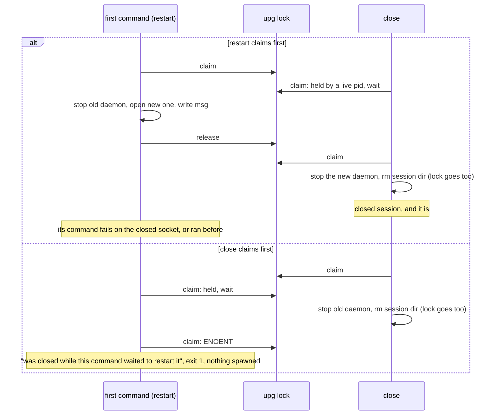
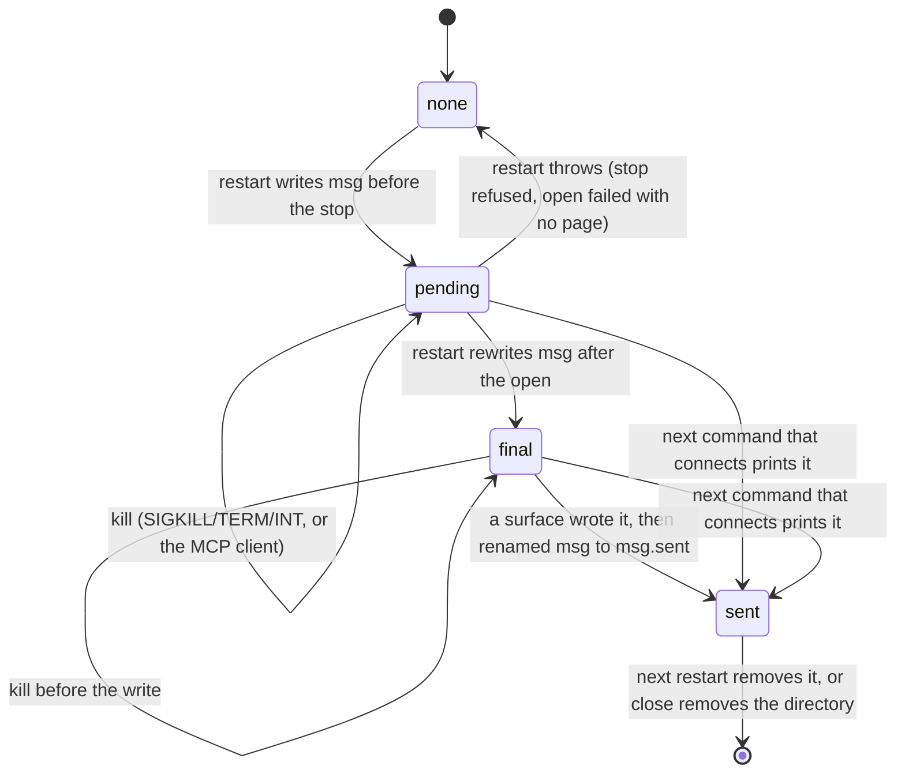

# close waits for an upgrade restart, and its notice survives a kill (ET-32, ET-29, #152)

Amends `2026-10-14-upgrade-restart-design.md` (#145, PR #149), section 1.

## Problem

Two findings of the 2026-10-14 campaign (`docs/superpowers/exploratory-testing/2026-10-14-session-log.md`, #152) show
the restart after an upgrade reporting success while the session is not what the agent was told.

**ET-32 (P2, 7 runs).** `close` started together with the first command after an upgrade answers
`closed session '<name>'`, exit 0, and the session is open afterwards. S1 "close racing the restart": `c1`, `c2`
(`h_cl`) and `c1` to `c3` (`h_cl2`), close at +0, +300 and +600 ms, 5 of 5 runs left a live daemon. S4 "`close --all`
right after an upgrade restart": `ca0`, `ca3`, 2 more runs. For a `--persistent` session (`c2`, `p`) the session came
back on `about:blank` with no `BOWSER_DAEMON_PROFILE` and no `state.json`, behind the notice `page did not reload …
(daemon for session 'c2' did not start in time with --persistent profile …; the browser may not support a persistent
profile here)`. The browser supports the profile; `close` removed the session directory under the starting daemon.

Cause, from the code. `closeOne` (`src/commands/navigation.ts`) never looks at the `upg` lock. Its "was reopened
while closing" guard re-reads the pidfile after `stopDaemon`; if the restart has spawned the new daemon but the
daemon has not written its pid yet, the guard sees nothing and `rm` removes the session directory. `restartSession`
(`src/commands/restart.ts`) holds `upg` from its stop to its open, so `close` and the restart can each stop a daemon
the other one counts on.

**ET-29 (P2, 7 runs, CLI and MCP).** A first command killed during the restart never prints the notice, and nothing
restarts again. S1 "Killed mid-restart": `eph`, `e3` (SIGKILL), `t1` (SIGTERM, rc 143), `t2` (SIGINT, rc 130). In
each, the next `localstorage-get tok` printed nothing, exit 0, no stderr, where `7` was stored before the upgrade.
S2 "Client kills the server mid-handover": `k300T`, `k200T`, `k400K`: the child finished the restart and released
the lock, the reply never reached the client, and a fresh server read `tok` as `null` with no notice.

Cause: the notice lives only in the restarting process's `ctx.notices` array, printed by `src/cli.ts` before the
answer and by `runToolCall` (`src/mcp.ts`) in the tool result. A process killed before that write takes the notice
with it. The next command meets a daemon of its own version, so it has no reason to restart or to say anything.

**ET-44 (observation, 2 runs)** has the same cause: two MCP servers on one ephemeral session hand over at once
(S2 "Two servers", `m1`, `m2`); one client gets "cookies and storage were lost", the other reads `null` with no word.
The losing command waited for the winner's restart and then ran with an empty `notices`.

## Change

Two changes, both in the commands layer. No daemon change.

### 1. `close` holds `upg` while it stops the daemon (ET-32)

`closeOne` claims `<session dir>/upg` before `stopDaemon`, with the same claim and wait the restart uses (moved out
of `restartSession` into one function both call): `claimSession(lock, session, undefined, async () => true)`, poll
every 50 ms while a live pid holds it, give up when the op budget (`opTimeoutMs()`) runs out with today's message
`session '<s>' is being restarted by pid <n> (<lock>)`, exit 1, having stopped nothing. Budget 0 waits without a
deadline, as every other wait on `upg` does (lifecycle test "with BOWSER_OP_TIMEOUT_MS=0, a held restart lock is
waited for without a deadline").

- `close` keeps the lock through the stop, the "reopened while closing" guard and the `rm`. The `rm` of the session
  directory removes the lock with it. On a throw, `close` removes the lock if it still names its own pid, as the
  restart's `finally` does.
- No session directory (never opened, or another `close` removed it while this one waited): `close` skips the lock
  and goes on as today, so a second `close` still answers `closed session '<s>'`.
- `close --all` gets this through `closeOne`. `closeLegacy` is unchanged: a legacy name has no restart.

The restart learns that `close` won:

- In the `OlderDaemon` path, a claim that fails because the session directory is gone (`tryClaim` writes
  `upg.<pid>.tmp` there and gets `ENOENT`) throws `UserError` `session '<s>' was closed while this command waited to
  restart it`, exit 1. It spawns nothing. Today the `ENOENT` escapes as a raw error.
- In the `BrowserExited` path (no daemon, another command restarting), the same error when the wait ends and the
  session directory is gone. Without it, `withClient`'s second connect finds no `state.json` and spawns a fresh
  ephemeral daemon, which is the ET-32 outcome again.

The two orders, with the lock:

### 2. The notice is a file in the session directory until someone prints it (ET-29, ET-44)

Two files beside `upg`, both named to fit the path budget `maxSessionNameLength()` was sized for
(`pid.99999.tmp`): `msg` holds a notice nobody has printed yet, `msg.sent` the last one that was printed. Each is
written to `msg.<pid>.tmp` and renamed into place, so a reader never sees half a line.

The restart (`restartSession`, holding `upg`):

1. After its "already restarted by the holder I waited for" check and before `stopDaemon`: remove `msg.sent`, and
   write `msg` with the notice as it would read if the reload never finishes:
   `session '<s>' restarted for bowser <v> (was <w>): page reload at <url> was interrupted; refs cleared, run
   'bowser snapshot'` plus `; cookies and storage were lost (no --persistent)` for a session without a profile. With
   no page: `no page was open` in place of the reload clause.
2. After `cmdOpen`, before releasing `upg`: rewrite `msg` with the final text, which is today's notice unchanged.
3. If the restart throws (the stop refused to signal, or an open with no page failed), it removes `msg`: the error
   is the report, as today. Only a killed restart leaves `msg` behind.

The restart no longer pushes to `ctx.notices` itself. Every command reads the files in `withClient`, after it has a
connection:

- A command that went through `restartSession` (it restarted, or waited for another command's restart) reads `msg`,
  or `msg.sent` if `msg` is gone. Reading `msg` first and `msg.sent` second always finds one of them, because the
  rename between them is atomic. This is what gives the waiter of ET-44 the notice.
- Any other command reads `msg` only. If `msg` exists and `upg` names a live pid, the restart that wrote it is still
  running: the command waits for the lock with the same deadline rule, then reads as above. If the deadline passes,
  it reads `msg` as it stands. A dead pid in `upg` (a killed restart) is not waited for.
- The text goes to `ctx.notices`, and a delivery callback goes to a new `ctx.acks` (`run(argv, { notices, acks })`).
  The callback renames `msg` to `msg.sent` if `msg` still holds the text that was read; a missing `msg` is fine (a
  concurrent command delivered it).

The surfaces call the callbacks only after the notice is out:

- CLI (`src/cli.ts`): after the `console.error` of the notices, before printing the answer or the error.
- MCP (`src/mcp.ts`): after the `write` of the response that carries the notice succeeds. A failed write (`send`
  catches it) and an `EPIPE` (`clientGone` exits) leave `msg` in place. A child after a handover is covered by the
  same rule: when the old server is gone, the child's write fails.

The notice's life, with the kills of S1 and S2:

What each kill leaves, by step of the restart:

| Killed | Daemon after | What the next command does |
|---|---|---|
| before `msg` is written | the old one, alive | `OlderDaemon`, takes the dead lock, restarts, prints the notice |
| during the stop | none | `is not open (its browser exited); run 'bowser open …'` as today; the `open` that follows prints `msg` |
| during the open | the new one | prints the "page reload at <url> was interrupted" notice, storage loss included |
| after the open, before the write | the new one | prints the final notice |
| after the write, before the rename | the new one | prints it again: a duplicate, never a loss |

A command that took part in a restart prints the notice even when another command printed it first. Two CLI
commands started together therefore both print it (today exactly one does), and so do two MCP clients (ET-44).

### Stale locks and budget 0

Nothing changes in how a holder is judged: a live pid holds `upg`, a dead one is taken over through `claimSession`
and `removeStale` under its own lock. `close` and the notice reader adopt that rule and the budget rule as they are.
They inherit ET-35 too: a reused live pid in `upg` makes `close` wait out its budget and fail with the "being
restarted" message, and with `BOWSER_OP_TIMEOUT_MS=0` wait without end, as every other command on that session
already does. ET-35's fix (the holder must be a bowser process) covers all three waits. The message names the lock
path, so a person can delete it.

Not handled: a second upgrade restart that lands between a command's read of `msg` and its rename. The rename could
then move the newer notice to `msg.sent` unprinted by non-participants. It needs two upgrades within one command.

### Rejected

- Catching SIGTERM and SIGINT in the restart (the log's other proposal for ET-29). It misses SIGKILL (`eph`, `e3`) and
  the MCP runs, where the restart finished and only the reply was lost.
- One file removed by whichever command prints it first (the issue's wording). A command that waited for the restart
  polls every 50 ms and can lose the race to the restarter's own delivery, so ET-44 would stay. `msg.sent` costs one
  rename.
- `close` failing at once when `upg` is held, without waiting. It turns a race the agent did not cause into a failure
  it must retry, where waiting gives the answer the agent asked for.

## Tests

Unit tests with fake daemons (`tests/helpers/fake-daemon.ts`), in `tests/lifecycle.test.ts` unless named otherwise.
Each fails before the change.

- `close waits for a restart in progress, then ends the daemon it started (ET-32)`, for `close` and `close --all`: a
  live pid (`process.ppid`) in `upg` and an old fake daemon; after 300 ms a timer stops the old one, starts a
  current one and removes `upg`. Expect `closed session '<s>'` (`closed 1 session: <s>`), `shutdown` on the current
  daemon, no session directory. Today close answers before the timer, and the current daemon gets no `shutdown`.
- `a restart that waited for close fails and starts nothing (ET-32)`: a live pid in `upg` and an old fake daemon;
  after 300 ms a timer stops the daemon and removes the session directory, as a `close` would. `eval 1` fails with
  `session '<s>' was closed while this command waited to restart it`, exit 1, the `upgrade()` connector spawned no
  daemon, and the session directory does not exist. A second case does the same from the `BrowserExited` path (no
  daemon, `state.json`, a live pid in `upg`).
- `a restart that never finishes leaves its notice for the next command (ET-29)`: an ephemeral `upgrade()` session
  whose connector never resolves once the old daemon is down, so `run(["eval", "1"])` hangs in the open, as a killed
  command would stop there. Then `upg` gets a dead pid, a current fake daemon takes the socket, and a second
  `run(["eval", "1"], { notices, acks })` gets the "page reload at <url> was interrupted … cookies and storage were
  lost" notice. After its acks run, a third command gets no notice.
- `the CLI marks a notice delivered only once it has printed it (ET-29)`: `msg` in a session served by a current fake
  daemon; the CLI as its own process (`bun src/cli.ts eval 1`) prints the notice on stderr, `msg` is gone and
  `msg.sent` holds it; a second CLI run prints no notice.
- `two commands that restart one session at once both print the notice (ET-44)`: two `run(["eval", "1"])` at once
  against one `upgrade()` session. Both `notices` hold the same line, the old daemon got one `shutdown`.
- `tests/mcp.test.ts`, `a notice whose response could not be written stays for the next call (ET-29)`:
  `createMcpServer` with a fake `run` that pushes a notice and an ack, and a `write` that rejects; the ack is not
  called. With a `write` that resolves, it is called once.

Changed: the existing unit tests that assert a restart's notice keep their text; the restart now delivers it through
the file. `restart lock: a live holder is waited for` keeps `notices` equal to `[]` (its fake restart writes no
`msg`).

E2E, `tests/e2e-upgrade.test.ts`, only where a real kill or a real spawn is the point:

- `a first command killed during the reload leaves the notice for the next command (ET-29)`: an ephemeral session on
  a page whose reload is delayed 4 s, upgrade, `localstorage-get tok` SIGKILLed at 1200 ms. The next command exits
  0 with the notice on stderr, "cookies and storage were lost" included; the one after has no notice.
- `close during the restart leaves the session closed (ET-32)`: a `--persistent` session, upgrade, `eval 1` and
  `close` started together. Whatever the order, afterwards no daemon runs for the session and its directory is gone;
  `close` exited 0; `eval` exited 0 or failed with "was closed while this command waited to restart it".
- `two commands at once restart the session once` is renamed `… and both print the notice (ET-44)`: it expects the
  notice in both stderrs, where it now expects exactly one.

## Out of scope

ET-30, ET-31, ET-33, ET-35, ET-36, ET-37, ET-34 (#152).

## Definition of Done

- `bun test tests/lifecycle.test.ts -t "ET-32"` passes (today: `regex "ET-32" matched 0 tests`, exit 1).
- `bun test tests/lifecycle.test.ts -t "ET-29"` passes (today: matched 0 tests, exit 1).
- `bun test tests/lifecycle.test.ts -t "ET-44"` passes (today: matched 0 tests, exit 1).
- `bun test tests/mcp.test.ts -t "ET-29"` passes (today: matched 0 tests, exit 1).
- `bun run check` passes (typecheck, lint and `bun test`; today: exit 0, 1046 pass, 318 skip, 0 fail).
- `BOWSER_E2E=1 bun test tests/e2e-upgrade.test.ts -t "ET-32"` passes.
- `BOWSER_E2E=1 bun test tests/e2e-upgrade.test.ts -t "ET-29"` passes.
- `BOWSER_E2E=1 bun test tests/e2e-upgrade.test.ts -t "ET-44"` passes, and the whole of
  `BOWSER_E2E=1 bun test tests/e2e-upgrade.test.ts` passes.
