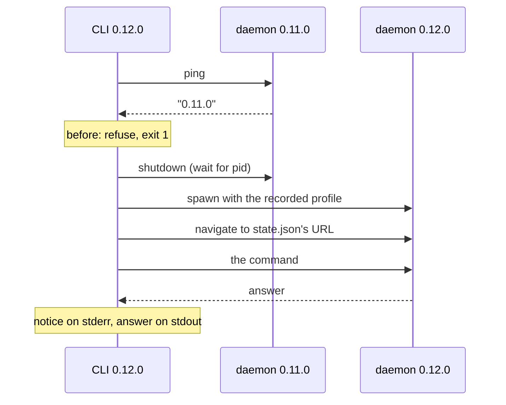

# Upgrade without manual restarts (#145)

## Problem

After `npm i -g @drakulavich/bowser-cli` installs a new version, every open session stops working:

- the new CLI meets the daemon the old version started, and every command but `close` and `list`
  refuses it: "session '<name>' is running bowser <v> (this is <w>); run 'bowser close -s <name>',
  then open it again" (`checked()`, `src/daemon/client.ts:200`, decision F2 in
  `2026-09-27-p2-fixes-design.md`);
- a running `bowser mcp` server keeps the old code in memory, spawns each new daemon from the new
  files on disk, then refuses it: "this bowser (<w>) differs from the installed bowser (<v>);
  restart the MCP server or re-run the command". Closing the session does not help (#79).

An agent in the middle of a task gets a failed command, and a human has to step in. F2 refused on
purpose: restarting quietly would drop the page. The decision for #145 (2026-10-14) is to restart
every session, persistent or not, and to say in the reply what was lost.

## Design

### 1. The CLI restarts a daemon of another version

In `connectOrSpawn`, where `checked()` refuses today, the CLI restarts the session instead, when
both hold:

- the daemon answered `ping` with something other than this CLI's version, and
- this process is the installed bowser (`installedVersion()` equals `pkg.version`, or is undefined).

A process whose own code is older than the files on disk (an MCP server started before the
upgrade) keeps today's refusal; section 2 makes sure it never gets that far. `close` and `list`
keep `anyVersion` and do not restart anything.

The restart:

1. Read `state.json`: the URL and the recorded profile (`openCommand`'s fallback for state without
   a profile record: the default profile directory if it exists).
2. Stop the old daemon the way `close` does (`shutdown`, then wait for its pid, then `term` an
   identified daemon), but keep the session directory and the profile. The stop part of
   `closeOne` moves into a function that both use.
3. Spawn the new daemon with that profile, as `open` does (`reopen: true`).
4. If the URL is a page (not empty, not `about:blank`), `navigate` to it. A failed navigation does
   not fail the restart: the session stays open on `about:blank`, and the notice says so.
5. Save state with the new URL and title, no refs and no `doc`.
6. Run the command as asked on the new daemon. A command with a ref read that ref before it
   connected, so it still finds it, but the ref's document is gone (#105): it fails with "ref 'eN'
   is from a page that is no longer loaded; take a new snapshot", and nothing is clicked.

The reply carries one notice line, before the command's own answer or error:

```
bowser: session 'shop' restarted for bowser 0.12.0 (was 0.11.0): page reloaded at https://example.com/cart; refs cleared, run 'bowser snapshot'
```

A session that kept nothing on disk adds `; cookies and storage were lost (no --persistent)`. A
daemon from 0.7 or older reports no version and reads `(was an older version)`.

Where the notice goes:

- CLI: stderr, so `--json` and piped stdout stay as they are. Agents read both streams.
- MCP: the first line of the tool result's text, on success and on `isError` alike.



### 2. A running MCP server hands over to the installed version

Before each `tools/call`, the server compares `installedVersion()` with its own. While they are
equal, nothing changes. The first time they differ:

1. It spawns `bun <installed package>/src/cli.ts mcp` with the same environment and working
   directory, its stderr inherited.
2. It sends the child the `initialize` request it got from the client (saved at the time, with a
   new id) and `notifications/initialized`, and drops the child's reply to that `initialize`.
3. From then on it forwards every line from stdin to the child, this `tools/call` first, and every
   line from the child's stdout to its own stdout. Calls already running in the old server finish
   there and answer as before.
4. When stdin closes, it closes the child's stdin and exits with the child's code once the child
   has exited and its own calls have answered.

The child then meets the old daemon and restarts it as in section 1, and its notice reaches the
agent in the tool result.

The handover keeps the client's tool list as it was when the client connected: a tool that the new
version added is not listed until the client restarts the server. A call to a tool the new version
dropped gets the child's "unknown tool" answer.

Rejected: running each call as `bun <installed>/src/cli.ts <args>`. `fill` and `type` would then
put the typed text, passwords included, in a process's arguments, which `fill --stdin` exists to
avoid.

## Out of scope

- Two commands that meet the same old daemon at once. The second one may find no daemon and a
  `state.json`, and answers "session is not open (its browser exited)". Rare with one agent per
  session; a lock is a separate issue if it shows up.
- Telling the MCP client about new tools (`notifications/tools/list_changed`).
- A daemon newer than the CLI (a downgrade): it keeps today's refusal.

## Docs

- README "Upgrading": one paragraph on the restart and its notice, in place of the close-first
  advice and the MCP restart paragraph.
- `skills/bowser/SKILL.md`: the same, in one line.
- CHANGELOG `[Unreleased]`.

## Definition of Done

- `BOWSER_E2E=1 bun test ./tests/e2e-upgrade.test.ts` passes (today: no such file). The test copies the
  package to a temp directory with another `version` in its `package.json`, opens a session with that copy, then:
  - `bowser snapshot` from the checkout exits 0, prints the page, and stderr has the notice with
    both versions and the URL;
  - for a `--persistent` session, a cookie set before the upgrade is still there after it, and the
    notice has no "cookies and storage were lost";
  - for an in-memory session, the notice says the cookies and storage were lost;
  - `bowser click <old ref>` as the first command after the upgrade fails with "is from a page that
    is no longer loaded", after the notice, and nothing is clicked;
  - an MCP server started from the copy, whose `package.json` version is then changed, answers the
    next `tools/call` through the installed version: the text starts with the notice, and no
    "differs from the installed bowser" error appears.
- `bun test tests/lifecycle.test.ts -t "restarts an older daemon"` passes (today: matches 0 tests).
  The refusal cases are rewritten: an older daemon is restarted (the fake gets `shutdown`, and a
  new daemon is spawned), a newer daemon is still refused, a process older than the installed
  files is still refused, and `close` and `list` never restart. The whole file passes.
- `bun run check` passes; `tests/docs-drift.test.ts` is unchanged.
- `rg -n "before you upgrade|Restart any running .bowser mcp" README.md` prints nothing (today:
  lines 45 and 55).
