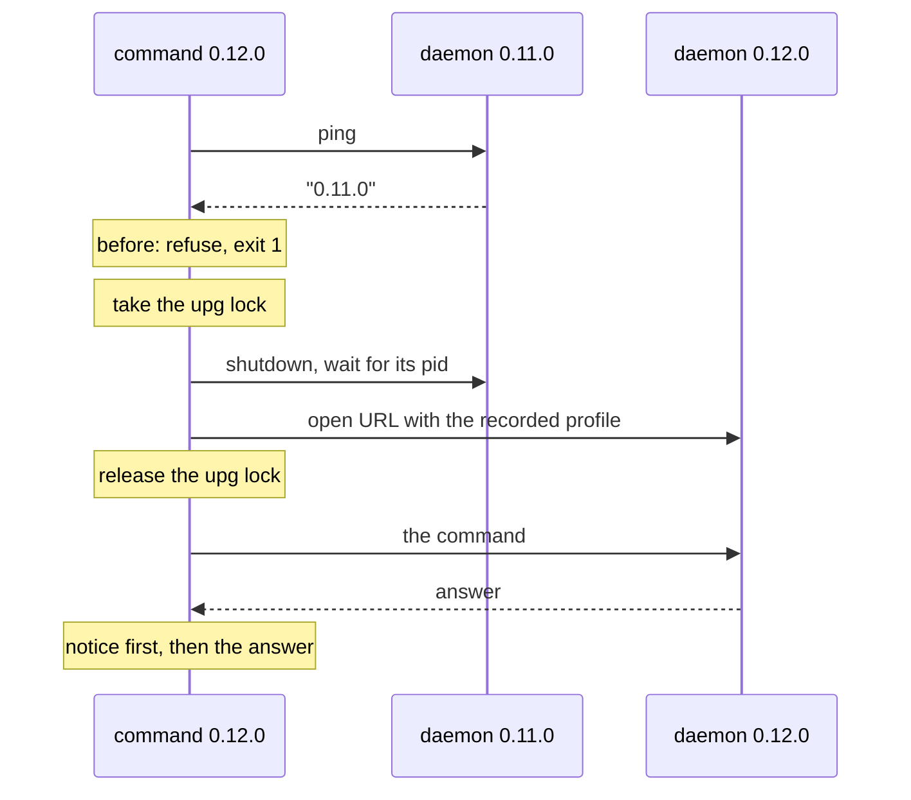

# Upgrade without manual restarts (#145)

## Problem

After `npm i -g @drakulavich/bowser-cli` installs a new version, every open session stops working:

- the new CLI meets the daemon the old version started, and every command but `close` and `list`
  refuses it: "session '<name>' is running bowser <v> (this is <w>); run 'bowser close -s <name>',
  then open it again" (`checked()`, `src/daemon/client.ts:200`, decision F2 in
  `2026-09-27-p2-fixes-design.md`);
- a running `bowser mcp` server keeps the old code in memory, spawns each new daemon from the new
  files on disk, then refuses it: "this bowser (<w>) differs from the installed bowser (<v>);
  restart the MCP server or re-run the command". Closing the session does not help (#79).

An agent in the middle of a task gets a failed command, and a human has to step in. F2 refused on
purpose: restarting quietly would drop the page. The decision for #145 (2026-10-14) is to restart
every session, persistent or not, and to say in the reply what was lost.

## Design

### 1. A command restarts an older daemon

`connectOrSpawn` keeps refusing a daemon of another version, but throws a typed error,
`OlderDaemon`, when all of these hold:

- the daemon is older: it answered `ping` with `"pong"` (bowser 0.7 or older) or with a version
  below this one (`Bun.semver.order`);
- this process is the installed bowser: `installedVersion()` equals `pkg.version`. Undefined (no
  `package.json` beside the code) keeps today's refusal.

A newer daemon (a downgrade), and a process whose code is older than the files on disk (an MCP
server started before the upgrade), keep today's messages. Section 2 keeps the MCP server from
getting that far. `close` and `list` keep `anyVersion` and never restart.

`withClient` (`src/commands/context.ts`) catches `OlderDaemon` and restarts the session. The
restart lives in the commands layer, because it reuses `close` and `open` from there; the daemon
client may not import commands (`biome.json` layering rules).

1. **Lock.** Claim `<session dir>/upg` with `claimSession` from `src/daemon/pidfile.ts`, given a
   holder check: today it counts a live pid as a holder only if `isOurDaemon` says so, and the
   restart passes "pid alive" instead, because the holder is a command or an MCP server. The rest
   is reused as is: `tryClaim` links a complete file holding this process's pid, and `removeStale`
   re-reads under its own lock, so two commands that see the same dead pid cannot both take it.
   The name `upg` is as long as `pid`, so its temp file (`upg.<pid>.tmp`) fits the path budget
   `maxSessionNameLength()` was sized for (`pid.99999.tmp`); `restart.lock.<pid>.tmp` would not,
   and would fail with `ENAMETOOLONG` for the longest names. If a live process holds the lock,
   wait for the file to go (polling), then connect from the top: the new daemon answers this
   version, and nothing restarts twice. If the op budget runs out first, fail with "session
   '<name>' is being restarted by pid <n> (<lock path>)" and leave the daemon alone. Without the
   lock, a second command's stop step can read the pidfile of the daemon the first one just
   started and end it.
2. **Read** `state.json`: the URL and the profile (`openCommand`'s fallback for state without a
   profile record: the default profile directory if it exists).
3. **Stop** the old daemon with the stop part of `closeOne` (`shutdown`, wait for its pid, `term` an
   identified daemon), moved into a function both use. The session directory and the profile stay.
4. **Open** with `cmdOpen(ctx, url, { profile })`, as `bowser open <url> --profile=<recorded>` would.
   It spawns the new daemon with the profile, navigates, and saves state with the profile, no refs
   and no `doc`. With no URL, or `about:blank`, it opens without one. If the navigation fails, the
   session stays open on the page it reached, and the notice says the page did not reload.
5. **Unlock**, then run the command on the new daemon. The lock is released on every way out of
   steps 2 to 4, a throw included: an MCP server outlives a failed restart, and a lock naming its
   live pid would hold every later command until its budget ran out.

A command with a ref read that ref before it connected (`cmdClick` calls `loadRef` first), so it
still finds it, but the new daemon has no document id for it (#105): it fails with "ref 'eN' is
from a page that is no longer loaded; take a new snapshot", and nothing is clicked.

The restart produces one notice line:

```
bowser: session 'shop' restarted for bowser 0.12.0 (was 0.11.0): page reloaded at https://example.com/cart; refs cleared, run 'bowser snapshot'
```

A session with no profile adds `; cookies and storage were lost (no --persistent)`. A daemon of
0.7 or older reads `(was an older version)`.

The notice has one path to each surface. `run(argv)` takes an optional `notices: string[]`, put on
the command context, and the restart pushes to it.

- CLI (`src/cli.ts`): each notice goes to stderr before the answer or the error, so `--json` and
  piped stdout stay as they are.
- MCP (`runToolCall`): the notices are the first lines of the tool result's text, on success and on
  `isError` alike.



### 2. A running MCP server hands over to the installed version

The read loop in `runMcpServer` checks every `tools/call` line before it accepts it: does
`installedVersion()` return a version newer than the server's own (`Bun.semver.order`)? While it does not, nothing
changes, and undefined (no `package.json` beside the code) never hands over, as in section 1. The
first time it does, the server hands over, once:

1. **Queue.** It stops accepting lines. This line, the rest of the read buffer and every later line
   go into a queue.
2. **Drain.** It waits until every response it has scheduled is written: the `tools/call` chains
   (`server.idle()`) and the other requests it answers at once (`tools/list`, `ping`, parse
   errors), which `idle()` does not track today. After that the old server writes nothing more.
3. **Start.** It spawns `process.execPath <installed package>/src/cli.ts mcp` (`bun` may not be on
   `PATH`) with the same environment and
   working directory, stdin and stdout piped, stderr inherited. It sends the child the `initialize`
   request it saved from the client, with the id `"bowser-handover"`, then
   `notifications/initialized`, and waits up to 10 s for the reply with that id, which it drops.
4. **Forward.** It writes the queue to the child, then every later stdin line. Every line from the
   child's stdout goes to stdout. The child is now the only writer.
5. **Close.** When stdin closes, it closes the child's stdin, waits for the child, and exits with
   its code.

If the child exits, or does not answer `initialize` in 10 s, the server answers every queued and
later request itself: a `tools/call` with `isError` and "bowser mcp could not hand over to the
installed bowser <v>: <reason>; restart the MCP server", any other request with JSON-RPC error
-32603 and the same text. `ping` and `tools/list` are the exception: it answers them as it did
before the handover (ET-41). A `tools/call` the child was running when it exited gets "bowser mcp:
the installed bowser <v> exited (code N) while running this call; restart the MCP server".

Until the child has answered `initialize`, the old server answers `ping` itself, at once, also
during the drain (ET-42).

An installed version older than the server's own (a downgrade) is not handed to. The server keeps
running its own version, and the first tool result it writes starts with "the installed bowser <v>
is older than this MCP server (<w>), which keeps running <w>; restart the MCP server to use <v>"
(ET-43).

The child then meets the old daemon and restarts it as in section 1, and its notice reaches the agent
in the tool result.

The client's tool list stays as it was when the client connected: a tool the new version added is
not listed until the client restarts the server. A call to a tool the new version dropped gets the
child's "unknown tool" answer.

Rejected: running each call as `bun <installed>/src/cli.ts <args>`. `fill` and `type` would then put
the typed text, passwords included, in a process's arguments, which `fill --stdin` exists to avoid.
Also rejected: handing the server's own stdin to the child. The old server has already read ahead
of the line that triggered the handover, and those bytes would be lost.

## Out of scope

- Telling the MCP client about new tools (`notifications/tools/list_changed`).
- A daemon newer than the CLI (a downgrade): it keeps today's refusal.

## Docs

- README "Upgrading": one paragraph on the restart and its notice, in place of the close-first
  advice and the MCP restart paragraph.
- `skills/bowser/SKILL.md`: the same, in one line.
- CHANGELOG `[Unreleased]`.

## Definition of Done

- `BOWSER_E2E=1 bun test ./tests/e2e-upgrade.test.ts` passes (today: no such file). The test
  copies the package to a temp directory with a lower `version` in its `package.json`, opens a
  session with that copy, then runs the checkout's CLI:
  - `snapshot` exits 0 and prints the page, and stderr has the notice with both versions and the
    URL;
  - for a `--profile=<dir>` session, a cookie set before the upgrade is still there after two
    upgrades in a row, and `state.json` still records `<dir>`; the notice has no "cookies and
    storage were lost";
  - for an in-memory session, the notice says the cookies and storage were lost;
  - `click <old ref>` as the first command after the upgrade fails with "is from a page that is no
    longer loaded", after the notice, and the page's click counter stays 0;
  - two `snapshot`s started together against one old daemon both exit 0; exactly one notice is
    printed between them, and one daemon pid is left for the session. The same holds with an
    `upg` lock left holding a dead pid, and with the longest session name the HOME allows;
  - after a restart whose reload fails (the old URL now answers with a connection refusal), the
    lock file is gone and the next `snapshot` answers at once;
  - an MCP server started from the copy, whose `package.json` version is then raised, answers two
    `tools/call` lines sent in one write through the installed version: each id gets exactly one
    response, every stdout line parses as JSON, and the first answer's text starts with the
    notice;
  - a call that was running when the version changed answers before any forwarded line, and so
    does a `tools/list` sent in the same write as the call that triggers the handover.
- `bun test tests/lifecycle.test.ts -t "restarts an older daemon"` passes (today: matches 0 tests).
  The refusal cases are rewritten: an older daemon is restarted, a newer daemon is still refused, a
  process older than the installed files is still refused, `installedVersion()` undefined still
  refuses, and `close` and `list` never restart. The whole file passes.
- `bun test tests/mcp.test.ts -t "handover"` passes (today: matches 0 tests): with a child that
  exits at once, a queued `tools/call` gets `isError` with "could not hand over"; with
  `installedVersion()` undefined, two `tools/call`s both run in the server and nothing is
  spawned.
- `bun run check` passes; `tests/docs-drift.test.ts` is unchanged.
- `rg -n "before you upgrade|Restart any running .bowser mcp|close --all\` before" README.md skills/bowser/SKILL.md`
  prints nothing (today: README.md lines 45 and 55, SKILL.md line 178).
