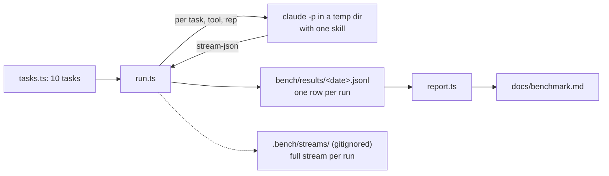

# Agent benchmark: bowser against playwright-cli (#146)

## Problem

The README says bowser is "token-efficient" and that "a skill description of a few hundred tokens
covers the whole API". Neither claim has a number behind it. The only measurement so far is the
one-off `markdown` comparison in #130 (snapshot 27.9k characters against 12.6k of Markdown on one
page). The skills point the other way: `skills/bowser/SKILL.md` is 21,335 bytes and playwright-cli
0.1.13's own skill is 11,263 bytes (`wc -c`, 2026-10-19). An agent that opens its skill reads about
twice as much with bowser before its first command.

Someone choosing between the two tools has nothing to compare, and neither do we when a change
to snapshot or the skill is meant to save tokens.

## Change

A `bench/` directory with ten browser tasks, a runner that gives each task to the same agent once
with bowser and once with playwright-cli, and a results page. Anyone with Claude Code and both
tools installed can rerun it.

### The agent

Each run is one `claude -p` process:

    claude -p "<task prompt>" --model claude-sonnet-5-5 --output-format stream-json --verbose \
      --setting-sources project --strict-mcp-config --tools Bash,Skill \
      --allowedTools "Bash(<tool>:*)" Skill --max-turns 40 --no-session-persistence

- It runs in a fresh temp dir whose `.claude/skills/<tool>/` is a copy of the tool's own skill
  directory (bowser's `skills/bowser/`, playwright-cli's from the path `playwright-cli --help`
  prints). The skill loads the way it does for a real user: its description up front, its body
  when the agent opens it.
- `--setting-sources project` keeps the user's plugins, skills, hooks and MCP servers out, and
  `--tools Bash,Skill` leaves the agent no other tool (no `WebFetch`, no `Read`). The stream's
  `init` message lists the tools, skills, plugins and MCP servers the run saw. The runner fails the
  run on a tool beyond Bash and Skill, an MCP server, a plugin not built into Claude Code, the
  other tool's skill, a skill from the user's `~/.claude/skills` or `~/.agents/skills`, or its own
  skill missing. Claude Code's bundled skills (`simplify`, `loop` and so on) are the same for both
  tools and stay.
- `Skill` is in `--allowedTools` because playwright-cli's skill declares `allowed-tools`, and in
  `-p` mode opening such a skill is otherwise denied. A run whose Skill call errors fails as
  "skill failed to load".
- Bash is pre-approved only for the tool under test, so the agent cannot fetch a page with `curl`.
  Claude Code still runs read-only commands such as `grep` and `head`, which playwright-cli's
  agents use on the snapshot files it writes; their output counts as tool output.
- The task prompt is the same for both tools and does not name either one. It says to use the
  browser skill, to pass `-s=bench-<task>-<rep>` to every browser command (both tools take this
  form), and to end with a line `ANSWER: <value>`.
- After each run the runner closes that run's session, and only that one. It refuses to start while
  either tool has a session open, and at the end it lists any session still open (one an agent
  opened without `-s`, or the user's) instead of closing it.
- A run that passes 5 minutes is killed (SIGTERM, then SIGKILL 10 s later) and fails as
  "timeout", even if it printed a result first. A row writes `null` for a field the run never
  produced, so every row has every field.

The user's global `CLAUDE.md` and rules do not reach these runs. In the pilot, asked whether its
instructions contain "Signals without noise", a phrase from the user's global rules, the agent
answered no; asked for the language its instructions set (the user's settings say Russian), it
answered NONE.

### The tasks

Sites built for automation practice, so the pages stay put and nobody's real site takes the
load. Expected values were read with `curl` on 2026-10-19.

| id | Task | Site | Pass when `ANSWER` matches |
|---|---|---|---|
| login | Log in as `tomsmith` / `SuperSecretPassword!` and report the flash message | the-internet.herokuapp.com/login | `/logged into a secure area/i` |
| search | Search Wikipedia for Ada Lovelace through the search box, open the article, report her birth year | en.wikipedia.org | `/\b1815\b/` |
| form | Fill the pizza form (name Ada, size large, toppings bacon and onion), submit, report the size and toppings the server echoed | httpbin.org/forms/post | `/large/i` and `/bacon/i` and `/onion/i` |
| read | Read the Locators page and report which locator Playwright recommends first | playwright.dev/docs/locators | `/getByRole/` |
| compare | Of "A Light in the Attic", "Tipping the Velvet" and "Soumission", report the cheapest and its price | books.toscrape.com | `/Soumission/` and `/50\.10/` |
| paginate | Count the quotes tagged "love" across all pages | quotes.toscrape.com/tag/love | `/\b14\b/` |
| todo | Add three todos, complete the second, report the items-left counter | demo.playwright.dev/todomvc | `/\b2 items? left\b/i` |
| dynamic | Start the hidden-element demo and report the text that appears | the-internet.herokuapp.com/dynamic_loading/2 | `/Hello World!/` |
| table | In the first table, report the last name of the person with the largest amount due | the-internet.herokuapp.com/tables | `/\bDoe\b/` |
| session | Log in with any username and password, then report the author of the first quote | quotes.toscrape.com/login | `/Albert Einstein/` |

A run passes when its last `ANSWER:` line matches. It fails when the line is missing or does not
match, the agent hits `--max-turns`, the run exceeds 5 minutes, or the isolation check fails.

### What is recorded

One JSONL row per run, from the stream's final `result` message plus the runner's own fields:

| Field | Source |
|---|---|
| `task`, `tool`, `rep`, `ts` | runner |
| `toolVersion`, `model`, `claudeVersion` | the `package.json` version and git SHA of the `bowser` on `PATH` (it has no `--version`; here it links to this checkout), `playwright-cli --version`, `init` message |
| `pass`, `answer`, `failReason` | runner's check |
| `inputTokens`, `cacheReadTokens`, `cacheCreationTokens`, `outputTokens` | `result.usage` |
| `costUsd`, `durationMs`, `numTurns` | `result.total_cost_usd`, `result.duration_ms`, `result.num_turns` |
| `bashCalls`, `toolOutputBytes` | counted from the stream's Bash tool results |

A row is 387 bytes in the pilot, so a full run (10 tasks × 2 tools × 3 reps = 60 rows) is about
23 KB and is committed. A pilot stream is 27 to 39 KB, so 60 of them (about 2 MB, more for longer
tasks) stay in the gitignored `.bench/streams/` for debugging and are not committed.

`toolOutputBytes` is the number the tool itself controls: what the agent read back from the
browser. Total tokens and cost also include the model's own reasoning and the skill, which is
what an agent actually pays.

### The report

`bun bench/report.ts bench/results/<date>.jsonl` writes `docs/benchmark.md`: per task and tool
the pass count out of 3, median total tokens, median tool output bytes, median time and median
cost, then totals across tasks. A task that passed fewer than 3 times with one tool is marked,
and its medians come from passing runs only, with the count shown. The page heads with the date,
model, Claude Code version and both tool versions. The README's "Token-efficient" line is
replaced by the measured totals and a link to the page, whatever they show.

### Repetitions and load

Three reps per task and tool, 60 runs. The two tools run side by side, one run at a time each, so
at most two browsers are open. The full run on 2026-10-21 took 11 minutes on this Mac and cost $2.75
(the estimate here was 45 to 90 minutes). A `--task`, `--tool` and `--reps` filter runs a subset, and
`--dry-run` prints the run plan without starting anything.

## Non-goals

- MCP mode (`bowser mcp`, `@playwright/mcp`). The README's claim is about shell commands.
- Other models, or several. One model, the default for agent work, named on the page.
- bowser's Chrome backend. On macOS bowser uses WebKit and playwright-cli uses Chromium; the page
  states this, and it is part of what a macOS user gets.
- Running in CI. Runs need Claude Code auth and cost tokens; they are run by hand before a release
  that claims a saving.
- Tasks behind a real login or on sites not made for automation.

## Tasks

- [x] Pilot: run `login` once per tool with `--reps 1`. Check from the stream that the isolation
  check works, whether the user's global rules reached the run (a phrase from them, asked for
  directly), and the row and stream sizes. Fix the runner before going on. The first pilot found
  two runner bugs, fixed above: playwright-cli's skill was denied, and the user's own
  `playwright-cli` skill name failed the isolation check.
- [x] `bench/tasks.ts`, `bench/check.ts` (answer check and isolation check) with unit tests on
  recorded `result` and `init` messages.
- [x] `bench/run.ts` (runner, filters, `--dry-run`) and `bench/report.ts`.
- [x] The full run, after the user agrees to the load.
- [x] `docs/benchmark.md`, the README line, `bench/README.md` and a CHANGELOG entry.

## Definition of Done

- `bun bench/run.ts --dry-run` prints 60 planned runs: 10 tasks × 2 tools × 3 reps.
- `bun test bench/` passes, and covers: an `ANSWER:` that matches, one that does not, a missing
  one, a run that hit max turns, and the isolation check failing on an `init` message with an extra
  MCP server, an extra skill, or a plugin, and on a Skill call that came back as an error.
- `bench/results/<date>.jsonl` holds 60 rows, each with every field in the table above.
- `docs/benchmark.md` exists, generated by `bun bench/report.ts` from that file, and names the
  date, model, Claude Code version and both tool versions.
- `grep -n "few hundred tokens" README.md` prints nothing, and the README links `docs/benchmark.md`.
- `bun run check` passes.
