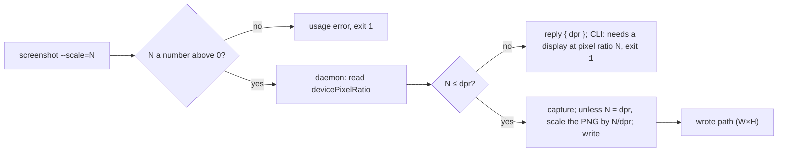

# screenshot --scale: a PNG of the size the caller asked for (#191)

## Problem

`bowser screenshot` writes the PNG at the pixel ratio the window happens to have. On a Retina Mac,
`bowser resize 1200 1200` then `bowser screenshot` wrote 2400×2400 (`devicePixelRatio` 2); on a screen at
ratio 1 the same two commands write 1200×1200. An agent that renders an image for a post asks for 2× and
gets whatever the machine gives, with nothing in the reply to say which.

`Bun.WebView` with the WebKit backend cannot render above the screen's ratio: neither the constructor nor
`view.resize(width, height)` takes a scale (`bun-types` 1.4.4), and `maxCaptureHeight`
(`src/commands/snapshot.ts`) already records that no option lowers it either. So bowser can scale a capture
down and can refuse, but cannot make one larger.

## Change

### The flag

`screenshot` takes `--scale=<N>`, a decimal number above 0, fractions allowed. The PNG is then the capture
scaled by `N / devicePixelRatio`, which is `innerWidth·N × innerHeight·N` up to rounding, or the command
fails. Without the flag the file is what it is today.

- `N` must match `^(\d+(\.\d*)?|\.\d+)$` and be above 0. Anything else (`0`, `-1`, `abc`, `0x2`, ` `, and
  the empty value of `--scale=`, which the parser passes through as `""` as it does for `--filename=`):
  `UserError` `screenshot: --scale must be a number above 0, got '<raw>'`, exit 1, before any request to the
  daemon.
- `N` above the window's `devicePixelRatio`: `UserError`
  `screenshot: --scale=<N> needs a display at pixel ratio <N> or more; this one is <dpr>`, exit 1, nothing
  written.
- `N` equal to the ratio: the capture as is, no re-encode.
- `N` below it: the capture scaled down with `Bun.Image`
  (`new Bun.Image(bytes).resize(w, h, { fit: "fill" }).png().bytes()`). No new dependency. Measured by hand
  on the #191 card: 2400×2400 to 1200×1200 in 124 ms, text sharp.
- A side that rounds below 1 pixel (a 1-pixel viewport at `--scale=0.4`) is kept at 1. `Bun.Image` turns
  `resize(0, 0)` into 1×1 on its own (checked on Bun 1.4.4); the spec makes it explicit with
  `Math.max(1, …)`, and the reply says the size the file really has.

The flag is declared `kind: "string"` like `--filename` and parsed in `cmdScreenshot`. MCP builds the
`screenshot` tool's properties from the command's flags (`src/mcp.ts:72`), so the tool gets `scale` with no
change there.

### Where each step runs

The CLI parses `N`; the daemon reads the ratio, captures, scales and writes, all in one `screenshot` op. The
ratio and the capture then come from the same moment: the daemon runs one op at a time per session, so no
`resize` or other command lands between them, and a page cannot change its own window size or pixel ratio.
The PNG still never crosses the socket.

- Protocol (`src/daemon/protocol.ts`): `screenshot` args become `[path?: string, scale?: number]`; the
  result gains one case, `{ path: string } | { dpr: number } | string`, where `{ dpr }` means `scale` is
  above the ratio and nothing was written. A daemon of an older version is restarted before it gets the new
  args (#145), so no version check is needed.
- Daemon (`src/daemon/server.ts`): with `scale`, evaluate `READ_VIEWPORT` (`src/page-scripts.ts`) for the
  ratio, refuse as above, capture, and if `scale` differs from the ratio scale the PNG to
  `max(1, round(pngWidth·scale/dpr)) × max(1, round(pngHeight·scale/dpr))`, where `pngWidth` and
  `pngHeight` come from the capture's IHDR. Taking the size from the capture rather than from `innerWidth`
  means the target always matches what was captured. A failed capture throws as today.
- CLI (`cmdScreenshot`): sends `[abs, scale]` (or `[abs]` without the flag), turns a `{ dpr }` reply into the
  `UserError`, then reads the width and height from the IHDR of the file it named (bytes 16 to 23) and
  prints them. The CLI and the daemon share the file system, so the reply needs no size of its own.
- The capture-limit path stays as it is: `cmdScreenshot` already catches a failed capture and asks
  `tooLargeToCapture` for the #69 advice. `--scale` cannot lower WebKit's limit, since the capture happens at
  the screen's ratio before any scaling, so the same viewport fails the same way with or without the flag and
  gets the same advice.
- The base64 path with no `path` argument is unchanged.

### The reply names the size, always

Every `screenshot`, with or without the flag, answers `wrote <abs> (<W>×<H>)` and, under `--json`,
`{ ok: true, filename, width, height }`. The agent then needs no `sips` or `file` to check the result.

Existing tests that change with it, since `bun run check` runs them all:

- `tests/commands.test.ts` (`describe("screenshot")`): the `wrote <abs>` lines and the exact `--json`
  object gain the size; every fake capture there is the real 1×1 `PNG_B64`, so they read `(1×1)`.
- `tests/mcp.test.ts:460` and `:472`: the expected `{ ok, filename }` gains `width: 1, height: 1`.
- `tests/e2e.test.ts:81`: `wrote ${file}` gains the size, read from the file in the test.
- `tests/protocol.test.ts:14`: the annotated result type gains `{ dpr: number }`.
- `tests/helpers/fake-client.ts:52`: today any non-string answer of a `screenshot` handler is dropped and an
  empty file is written. A `{ dpr }` answer is then returned as is and writes nothing; a string is still the
  PNG to write. Without this, test 4 below cannot fail. With no handler, the fake writes a real 1×1 PNG instead of an empty file, so the CLI has an IHDR
  to read; `tests/helpers/mcp-fake-daemon.ts`, which passes no handler, relies on that for the MCP tests above.

### Docs

The `screenshot` row of README's reference table and of `skills/bowser/SKILL.md` gain `[--scale=N]`. The
README section on screenshots gets two sentences: the default size follows the screen's pixel ratio, and
`--scale` fixes it or fails.

## Tests

Unit, in `tests/commands.test.ts` under `describe("screenshot --scale")`, with `fakeClient`:

1. **a scale that is not a number above 0 is a usage error.** `0`, `-1`, `abc`, `0x2`, ` ` and `""` each
   fail with the usage message, exit 1, and the fake records no request.
2. **`--scale=` reaches the command as an empty value.** `run(["screenshot", "--scale=", "-s", s])` prints
   `screenshot: --scale must be a number above 0, got ''`, exit 1. Guards the parser's pass-through.
3. **the scale goes to the daemon.** `--scale=1.5`: the `screenshot` request carries `[abs, 1.5]`.
4. **a scale the display cannot give is refused.** A fake `screenshot` answering `{ dpr: 1 }` to
   `--scale=2` gives `screenshot: --scale=2 needs a display at pixel ratio 2 or more; this one is 1`, exit 1.
5. **a viewport too large to capture keeps its advice under --scale.** The #69 case (failing capture,
   viewport `[16384, 16384, 2]`) with `--scale=1` gives the same `UserError` as without the flag.
6. **the reply names the file's size.** A fake `screenshot` answering a real 3×2 PNG (built with
   `Bun.Image`) gives `wrote <abs> (3×2)`, with and without `--scale`, and `--json` gives `width: 3,
   height: 2`.

Daemon, in `tests/daemon-handler.test.ts` under `describe("createHandler")`, with a fake browser whose
`screenshot` returns a real 4×4 PNG built with `Bun.Image` and whose `evaluate` answers `READ_VIEWPORT`
with ratio 2:

7. **screenshot --scale below the ratio writes the scaled PNG.** `[path, 1]` writes a PNG whose IHDR
   says 2×2 and replies `{ path }`. `[path, 0.1]` writes 1×1.
8. **screenshot --scale equal to the ratio writes the capture's bytes.** `[path, 2]` writes the
   capture byte for byte.
9. **screenshot --scale above the ratio writes nothing.** `[path, 3]` replies `{ dpr: 2 }`, the file
   does not exist, and the fake browser recorded no capture.
10. **screenshot --scale keeps a failed capture's error.** A fake browser whose capture throws
    `An unknown error occurred`: `[path, 1]` rejects with that message and writes nothing. With test 5, this
    covers the #69 path on both sides, since the #69 e2e test returns early below ratio 2
    (`tests/e2e.test.ts:114`).

E2E, in `tests/e2e.test.ts`, gated by `BOWSER_E2E=1` (CI runs it on `macos-latest`):

11. On a local page, `resize 300 200`, `screenshot --scale=1`: the file's IHDR says 300×200 and the reply
    says `(300×200)`.
12. `screenshot --scale=<dpr+1>`, with `dpr` read by `eval devicePixelRatio`: exit 1, the message above, no
    file.
13. Plain `screenshot`: the size in the reply equals the file's IHDR. The test logs `devicePixelRatio`, which
    answers #191's open question about the ratio of a window on a Mac without a Retina display (the CI
    runner).

## Out of scope

- A ratio above the screen's, by CSS `zoom` or any other emulation: the page would see twice its
  `innerWidth`.
- `open --scale` as a session setting: state in the daemon to save one flag.
- A scale on `resize`: it sets the viewport in CSS pixels; density belongs to the file.
- Changing the default: today's callers keep the screen's ratio.
- Formats other than PNG.

## Definition of Done

- `bun test tests/commands.test.ts -t 'screenshot --scale'`: tests 1 to 6 by name pass, none fail. Today:
  `regex "screenshot --scale" matched 0 tests`.
- `bun test tests/daemon-handler.test.ts -t 'screenshot --scale'`: tests 7 to 10 by name pass, none fail. Today: matched 0 tests.
- `bowser screenshot --scale=1` on an open session writes a PNG of the viewport's CSS size and prints its
  size. Today: `bowser: unknown flag: --scale`, exit 1.
- `grep -c -- "--scale" README.md skills/bowser/SKILL.md`: at least 1 for each file. Today: 0 and 0.
- `bun run check`: exit 0.
- `BOWSER_E2E=1 bun test`: exit 0, and the CI e2e log shows the runner's `devicePixelRatio`.
