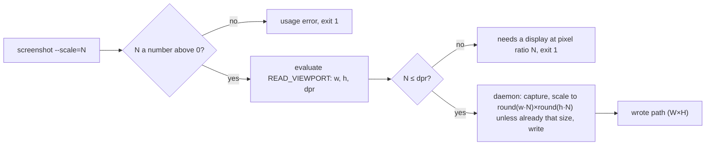

# screenshot --scale: a PNG of the size the caller asked for (#191)

## Problem

`bowser screenshot` writes the PNG at the pixel ratio the window happens to have. On a Retina Mac,
`bowser resize 1200 1200` then `bowser screenshot` wrote 2400×2400 (`devicePixelRatio` 2); on a screen at
ratio 1 the same two commands write 1200×1200. An agent that renders an image for a post asks for 2× and
gets whatever the machine gives, with nothing in the reply to say which.

`Bun.WebView` with the WebKit backend cannot render above the screen's ratio: neither the constructor nor
`view.resize(width, height)` takes a scale (`bun-types` 1.4.4), and `maxCaptureHeight`
(`src/commands/snapshot.ts`) already records that no option lowers it either. So bowser can scale a capture
down and can refuse, but cannot make one larger.

## Change

### The flag

`screenshot` takes `--scale=<N>`, a number above 0, fractions allowed. The PNG is then
`round(innerWidth·N) × round(innerHeight·N)` pixels, or the command fails. Without the flag the file is what
it is today.

- `N` that is not a finite number above 0 (`0`, `-1`, `abc`, empty): `UserError`
  `screenshot: --scale must be a number above 0, got '<raw>'`, exit 1, before any request to the daemon.
- `N` above the window's `devicePixelRatio`: `UserError`
  `screenshot: --scale=<N> needs a display at pixel ratio <N> or more; this one is <dpr>`, exit 1, nothing
  written.
- `N` equal to the ratio: the capture as is, no re-encode.
- `N` below it: the capture scaled down with `Bun.Image` (`resize(w, h, { fit: "fill" })`, then `.png()`).
  No new dependency. Measured by hand on the #191 card: 2400×2400 to 1200×1200 in 124 ms, text sharp.

The flag is declared `kind: "string"` like `--filename` and parsed in `cmdScreenshot`. MCP builds the
`screenshot` tool's properties from the command's flags (`src/mcp.ts:72`), so the tool gets `scale` with no
change there.

### Where each step runs

The CLI reads the viewport and decides; the daemon captures, scales and writes, so the PNG still never
crosses the socket.

- CLI (`cmdScreenshot`): with `--scale`, one `evaluate` of `READ_VIEWPORT` (the expression
  `tooLargeToCapture` already uses), the checks above, then `request("screenshot", [abs, width, height])`
  with the target size. Without `--scale`, `request("screenshot", [abs])` as today.
- Protocol (`src/daemon/protocol.ts`): `screenshot` args become `[path?: string, width?: number, height?:
  number]`; the result with a path becomes `{ path: string; width: number; height: number }`, the size of the
  file written. A daemon of an older version is restarted before it gets the new args (#145), so no
  version check is needed.
- Daemon (`src/daemon/server.ts`): after the capture, if a target size is given and differs from the PNG's,
  scale with `Bun.Image`; then write. The width and height in the reply come from the written PNG, so they
  are the file's real size and not the one asked for.
- The base64 path with no `path` argument is unchanged.

### The reply names the size, always

Every `screenshot`, with or without the flag, answers `wrote <abs> (<W>×<H>)` and, under `--json`,
`{ ok: true, filename, width, height }`. The agent then needs no `sips` or `file` to check the result.
The existing unit tests that expect the exact `wrote <abs>` line change with it.

### Docs

The `screenshot` row of README's reference table and of `skills/bowser/SKILL.md` gain `[--scale=N]`. The
README section on screenshots gets two sentences: the default size follows the screen's pixel ratio, and
`--scale` fixes it or fails.

## Tests

Unit, in `tests/commands.test.ts` under `describe("screenshot --scale")`, with `fakeClient`:

1. `--scale` of `0`, `-1`, `abc`: each fails with the usage message, exit 1, and the fake records no
   request.
2. `--scale=2` against a viewport `[800, 600, 1]`: fails with
   `screenshot: --scale=2 needs a display at pixel ratio 2 or more; this one is 1`, and the fake records no
   `screenshot` request.
3. `--scale=1.5` against `[800, 600, 2]`: the `screenshot` request carries `[abs, 1200, 900]`.
4. The reply: a fake `screenshot` answering `{ path, width: 1600, height: 1200 }` gives
   `wrote <abs> (1600×1200)`, and `--json` gives `width: 1600, height: 1200`.

Daemon, in `tests/daemon-handler.test.ts`, with a fake browser
whose `screenshot` returns a real 4×4 PNG built with `Bun.Image`:

5. `screenshot` with `[path, 2, 2]` writes a PNG whose IHDR says 2×2 and replies `{ path, width: 2,
   height: 2 }`.
6. `screenshot` with `[path, 4, 4]` writes the capture's bytes unchanged (no re-encode).

E2E, in `tests/e2e.test.ts`, gated by `BOWSER_E2E=1` (CI runs it on `macos-latest`):

7. On a local page, `resize 300 200`, `screenshot --scale=1`: the file's IHDR says 300×200 and the reply
   says `(300×200)`.
8. `screenshot --scale=<dpr+1>`, with `dpr` read by `eval devicePixelRatio`: exit 1, the message above, no
   file.
9. Plain `screenshot`: the size in the reply equals the file's IHDR. The test logs `devicePixelRatio`, which
   answers #191's open question about the ratio of a window on a Mac without a Retina display (the CI
   runner).

## Out of scope

- A ratio above the screen's, by CSS `zoom` or any other emulation: the page would see twice its
  `innerWidth`.
- `open --scale` as a session setting: state in the daemon to save one flag.
- A scale on `resize`: it sets the viewport in CSS pixels; density belongs to the file.
- Changing the default: today's callers keep the screen's ratio.
- Formats other than PNG.

## Definition of Done

- `bun test tests/commands.test.ts -t 'screenshot --scale'`: 4 pass, 0 fail. Today: `regex "screenshot
  --scale" matched 0 tests`.
- The daemon tests 5 and 6 pass under their own `-t` filter.
- `bowser screenshot --scale=1` on an open session writes a PNG of the viewport's CSS size and prints its
  size. Today: `bowser: unknown flag: --scale`, exit 1.
- `grep -c -- "--scale" README.md skills/bowser/SKILL.md`: at least 1 for each file. Today: 0 and 0.
- `bun run check`: exit 0.
- `BOWSER_E2E=1 bun test`: exit 0, and the CI e2e log shows the runner's `devicePixelRatio`.
