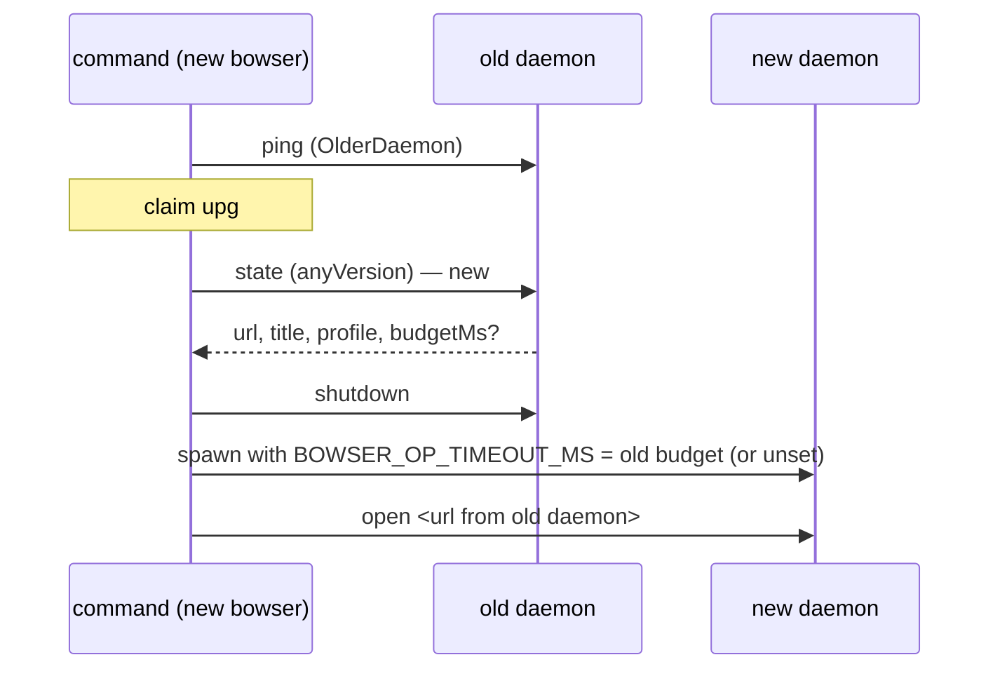

# The upgrade restart keeps the session's budget and page (ET-30, ET-31, ET-33, ET-35, ET-36, ET-34, #152)

## Problem

The 2026-10-14 campaign (`docs/superpowers/exploratory-testing/2026-10-14-session-log.md`, session S1) found
these in the restart after an upgrade. ET-32 and ET-29 were fixed in #159.

- **ET-30 (P2).** The command that triggers the restart spawns the new daemon with its own environment, and
  the daemon reads `BOWSER_OP_TIMEOUT_MS` once, at start (`src/daemon/server.ts`, `createGate(timeoutMs)` and
  `lane.timeoutMs`). From then on it caps every request's budget. A one-off `BOWSER_OP_TIMEOUT_MS=200 bowser
  eval 1` after the upgrade makes 200 ms the session's budget for good. A later `goto` with no variable set
  failed with `'goto' timed out after 200ms`, where the session had 30 s before (3 runs).
- **ET-31 (P2).** The restart runs outside the command's budget. With `BOWSER_OP_TIMEOUT_MS=3000` and a page
  slow to reload, `eval 1` took 6.1 to 6.3 s: the reload's 3 s, then the command's own 3 s, plus about 1 s to
  stop a persistent daemon (4 runs). README says the budget "covers the whole command".
- **ET-33 (P2).** The restart reloads the URL in `state.json`, which is the page of the last command that
  saved state, not the page the old daemon showed. A page that moved on by itself (a timer redirect,
  `history.pushState`) comes back at the older URL (2 runs, 3 sessions). The notice names the URL it loaded,
  so an agent can recover.
- **ET-35 (P3).** The `upg` lock counts any live pid as its holder (`claimRestartLock` passes
  `async () => true` as `holds`; `otherHolder` checks only `isAlive`). A lock left by a killed restart, whose
  pid the OS later gives to another process, makes every command on the session wait out its budget and fail
  with `is being restarted by pid <n>`. With budget 0 it waits for ever. Simulated with a `sleep 300` that
  held the pid, 2 runs.
- **ET-36 (observation).** That message gives no next step.
- **ET-34 (P3, docs).** README "Upgrading" says a running `bowser mcp` hands over to the installed version. A
  server started from 0.11.0 has no handover code, so it refuses every new session until it is restarted.

## Change

### 1. Ask the old daemon for its page and its budget before stopping it (ET-33, ET-30)

`restartSession` (`src/commands/restart.ts`) already connects to the old daemon to check that it is older.
After the claim, it connects with `anyVersion: true` and sends `state`, as `stopDaemon` already does for
`shutdown`. The reply's `url` replaces `state.json`'s as the page to reopen.

`state` is not urgent (`URGENT_OPS` holds only `ping` and `shutdown`), so it waits behind an op in
progress and behind the gate. At budget 0 the client sets no timer and `createGate(0)` never releases, so an
old daemon that is busy would hold the restart for ever. The request is therefore bounded by
`withTimeout(…, HEALTH_PING_MS)` (1 s), whatever the budget, and its client is closed before `stopDaemon`,
which sends `shutdown` on its own connection. If the request fails, times out, or answers something without
a string `url` (an older daemon's reply is not parsed beyond that), the restart falls back to `state.json`,
as today, and treats the budget as unknown.

`state` gains an optional field, `budgetMs`: the `BOWSER_OP_TIMEOUT_MS` value the daemon read at start (`0`
for none). `PageState` in `src/daemon/protocol.ts` gets `budgetMs?: number`. Daemons from this release on
send it. Older ones don't, and for them the field is absent.

The restart passes the budget to the spawn: `ConnectOptions` gets `daemonBudgetMs?: number | null`, which
`spawnDaemon` hands to `daemonEnv`. A number sets `BOWSER_OP_TIMEOUT_MS` in the daemon's environment, and
`null` deletes it, so the daemon takes the default 30 s. `0` is a number and sets `0` (no cap): the check is
`typeof === "number"`, never truthiness. Left out, the caller's environment goes through unchanged, as for
every spawn today. `cmdOpen` takes it through a new `OpenOptions` field and adds it to the options it already
passes to `withPageClient`. The restart sets it to the old daemon's `budgetMs`, or to `null` when the reply
has none. So a session restarted from 0.12 gets the default, not the caller's one-off value,
and from the next upgrade on it gets back the budget it was opened with.

**Data.** One optional number in the `state` reply, about 20 bytes, sent once per restart and on each
`state` request. Nothing is stored: `state.json` and the session directory don't change. I considered
recording the budget in `state.json` at `open`. It would store the same number on disk for every session,
and it would still be absent for every session opened before the change, so it would need the same fallback.
I also tried reading the old daemon's environment with `ps -E -ww`, but on this Mac it printed no
environment for another process (`env BOWSER_OP_TIMEOUT_MS=4321 sleep 30`, then `ps -E -ww -o command=`
showed only `sleep 30`).

**Cost.** One `state` request to the old daemon per restart: a local socket round trip plus `realUrl` and
`realTitle`. A restart happens once per session per upgrade.

### 2. Document that a restart takes its own budget (ET-31)

README "Upgrading", `BOWSER_OP_TIMEOUT_MS`, and `skills/bowser/references/troubleshooting.md` gain one
sentence: the first command after an upgrade restarts the session first, and the restart has its own budget.
So that command can take up to twice the budget, plus a few seconds to stop the old daemon. Since #159, a
command killed during the restart leaves the notice for the next command (ET-29), so a harness that enforces
the budget loses nothing.

**Rejected:** one deadline for the restart and the command. The restart runs `stopDaemon`, a spawn with its
5 s start wait, and `cmdOpen`, each on its own client with its own budget clock (`DaemonClient.start`). One
deadline means passing a start time through all of them and through `connectOrSpawn`, for a command that
runs once per upgrade.

### 3. The lock's holder must be a bowser process (ET-35, ET-36)

`claimRestartLock` and `otherHolder` (`src/commands/restart-lock.ts`) count a live pid as the holder only if
its `ps -o command=` line is a bowser command. That is a new `looksLikeBowser(line)` in
`src/daemon/pidfile.ts`, next to `looksLikeOurDaemon`. A line is bowser's when one of its words is
`src/cli.ts` or ends with `/src/cli.ts` (a checkout's `bun src/cli.ts` and `bun run src/cli.ts`, and the npm
bin, which `#!/usr/bin/env bun` runs with the absolute path of the `src/cli.ts` it links to), or has a basename
that matches `/^bowser([-.]|$)/` (`bun …/bin/bowser` as a link ran it, and an old release binary).

`otherHolder` is synchronous, and `takeNotice` (`src/commands/context.ts`) and `restartSession`'s wait loop
use it so. `isBowser(pid)` therefore reads the line with `Bun.spawnSync(["ps", "-o", "command=", "-p", pid])`,
which takes a few milliseconds, and the claim's `holds` callback uses the same function. Any other live pid
holding `upg` counts as stale. `claimSession` already removes a stale claim and takes it.

`beingRestarted` ends with `; retry in a moment` (ET-36).

### 4. Docs: handover from 0.12.0 on (ET-34)

README "Upgrading": a running `bowser mcp` hands over from 0.12.0 on, and a server started by 0.11 or
older has to be restarted once after the upgrade.

## Tests

In `tests/lifecycle.test.ts`, under the `#152` describe, with the fake daemons it already uses (`fakeDaemon`,
`daemonOf`):

- **ET-33.** The old fake daemon answers `state` with `url: "<base>/moved"`, and `state.json` holds
  `<base>/start`. After `eval 1`, the restart's `open` went to `/moved`, and the notice says
  `page reloaded at <base>/moved`. Fails today: it reopens `/start`.
- **ET-33, fallback.** The old fake daemon fails `state`. The restart reopens `state.json`'s URL. This guards
  today's behaviour and passes before the change.
- **A busy old daemon.** With `BOWSER_OP_TIMEOUT_MS=0`, the old fake daemon answers `ping` and `shutdown` and
  never answers `state`. The restart sends `shutdown` within 2 s of its claim and reopens `state.json`'s URL.
  Fails without the 1 s bound: it never reaches `shutdown`.
- **ET-30.** The old fake daemon answers `state` with `budgetMs: 45000`, and the command runs with
  `BOWSER_OP_TIMEOUT_MS=200`. The spawn gets `daemonBudgetMs: 45000`: a recording connector, as in the
  existing tests, sees it in the options. Fails today: no such option.
- **ET-30, from 0.12.** With no `budgetMs` in the reply, the spawn gets `daemonBudgetMs: null`.
- **ET-30, no cap.** The old fake daemon answers `budgetMs: 0` while the caller has `BOWSER_OP_TIMEOUT_MS=200`.
  The spawn gets `daemonBudgetMs: 0`.
- **`daemonEnv`.** In `tests/daemon.test.ts`: `45000` sets `BOWSER_OP_TIMEOUT_MS=45000` while the caller has
  `200`, `0` sets `0`, `null` deletes it, and with no option the caller's value stays (every other spawn is
  unchanged).
- **The daemon reports its budget.** In `tests/daemon-handler.test.ts`: `state` answers `budgetMs` equal to
  the timeout the handler was created with.
- **ET-35.** A lock holding the pid of a live process that is not bowser (a spawned `sleep 30`, killed
  after): a command on the session claims the lock at once and restarts, instead of failing with
  `is being restarted`. Fails today: it waits out the budget.
- **Existing holders.** The `#152` tests and the one at `tests/lifecycle.test.ts:322` write
  `process.ppid` into the lock as a live holder. The test runner's parent is not bowser, so after this change
  those locks would count as stale. They get a helper that spawns a process that looks like bowser:
  `bun <tmp>/src/cli.ts`, where that file is `await Bun.sleep(60_000)`, killed in `afterEach`.
- **`looksLikeBowser`.** In `tests/commands.test.ts`, next to the `looksLikeOurDaemon` cases. Accepted:
  `bun src/cli.ts eval 1`, `bun run src/cli.ts eval 1`, `/opt/bun /g/node_modules/@drakulavich/bowser-cli/src/cli.ts
  mcp`, `bun /Users/x/.bun/bin/bowser open`, `/usr/local/bin/bowser-macos-arm64 eval 1`. Refused: `sleep 300`,
  `bun test`, `bun /x/not-bowser.ts`, `bun /x/src/cli.tsx`, `/usr/bin/bowserx`.
- **ET-36.** `tests/exit-codes.test.ts` or the existing `beingRestarted` assertions gain `; retry in a moment`.
- **e2e.** `tests/e2e-upgrade.test.ts` gains one test: open on the old version, move the page with
  `history.pushState`, upgrade, `snapshot`. The notice names the pushed URL.

Each new test fails before the change, except the fallback test, which guards behaviour that must not change. The PR quotes one mutation per production line it names.

## Out of scope

- ET-37: `open <url>` as the first command after an upgrade reloads the old page first. The campaign
  proposed no change.
- ET-44 (two MCP clients, only one sees the notice). #159 left it out, and #152 still lists it under ET-29.
- One deadline for the restart and the command (see "Rejected").

## Definition of Done

| Command | Expected |
| --- | --- |
| `bun test tests/lifecycle.test.ts -t "ET-33"` | the new tests pass, the busy-daemon one included |
| `bun test tests/lifecycle.test.ts -t "ET-30"` | the new tests pass |
| `bun test tests/commands.test.ts -t "looksLikeBowser"` | the new tests pass |
| `bun test tests/lifecycle.test.ts -t "ET-35"` | the new test passes |
| `grep -c "retry in a moment" src/commands/restart-lock.ts` | `1` |
| `grep -c "twice the budget" README.md skills/bowser/references/troubleshooting.md` | at least `1` in each |
| `grep -c "from 0.12.0 on" README.md` | `1` |
| `bun run check` | 0 fail |
| `BOWSER_E2E=1 bun test tests/e2e-upgrade.test.ts` (CI) | 0 fail, including the pushState test |
