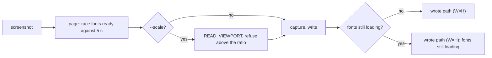

# screenshot waits for web fonts requested after load (#194)

## Problem

`bowser screenshot` captures at once. WebKit holds the `load` event for the fonts the first layout needs, so
`open` already waits for those: on a page whose font arrives after 3 s, `open` took 3.96 s and
`document.fonts.status` was `loaded`. A font first needed by text a script inserts after `load`, which is how
client-rendered pages work, is still loading when the next command runs. On such a page (text inserted
300 ms after `load`, font served after 3 s) a `screenshot` 500 ms after `open` wrote a blank white page:
`font-display: block` hides the text until its font arrives. With `swap` the text comes out in the fallback
font. Either way the command reports success. The only way round it today is to know about
`document.fonts.ready` and run `run-code 'await document.fonts.ready'` before every screenshot.

## Change

### The wait

The `screenshot` daemon op first evaluates a page script, `AWAIT_FONTS` in `src/page-scripts.ts`, that
resolves when `document.fonts.ready` does or after 5 s, whichever comes first, and answers whether fonts were
still loading:

```js
document.fonts
  ? Promise.race([
      document.fonts.ready.then(() => false),
      new Promise((r) => setTimeout(() => r(true), 5000)),
    ])
  : false
```

The 5 s timer runs in the page, not in the daemon. `browser.ts` queues every `evaluate` behind the one before
it (`inflight.then(...)`), so a daemon-side timeout would leave the font wait running, and the capture would
still queue behind it until the font came.

Then the op continues as today: with `--scale`, `READ_VIEWPORT`, the ratio check and the scaling; then the
capture and the write. Wait and capture are in one op, so no other command lands between them, as for
`--scale` in #192.



- 5 s is a constant. There is no flag and no environment variable: no case needs another number yet.
- The command budget (`BOWSER_OP_TIMEOUT_MS`, default 30 s) still covers the whole op. Set below 5 s, a
  font that never arrives makes `screenshot` time out with the usual message instead of capturing.
- A page whose evaluate fails (a crashed page, F34) fails the screenshot with that evaluate's error. A capture
  of a crashed page fails today anyway.
- Fonts the page has not requested yet when the script runs are not waited for, and neither are images,
  network or animations.

### The reply

The op's result gains a field: `{ path: string; fontsLoading?: true } | { dpr: number } | string`.
`fontsLoading` is present only when the 5 s ran out. The PNG is written either way.

`cmdScreenshot` prints `wrote <abs> (<W>×<H>); fonts still loading` and, under `--json`, adds
`fontsLoading: true`. Without it the reply is exactly today's, so the existing `screenshot` asserts in
`tests/commands.test.ts`, `tests/mcp.test.ts` and `tests/e2e.test.ts` stay as they are. The MCP tool returns
the same JSON, so it carries `fontsLoading` with no change in `src/mcp.ts`.

- Protocol (`src/daemon/protocol.ts`): the result type above; `tests/protocol.test.ts` gains it.
- Daemon (`src/daemon/server.ts`): `fontsLoading = (await browser.evaluate(AWAIT_FONTS)) === true` first;
  the strict `=== true` keeps every fake browser whose `evaluate` answers something else (`42`, `[2, 2, 2]`)
  on the no-note path, so the existing handler tests need no change.
- `tests/helpers/fake-client.ts`: a `screenshot` handler may answer `{ fontsLoading: true }`; the fake then
  writes its 1×1 PNG and replies `{ path, fontsLoading: true }`. A string is still the PNG to write and
  `{ dpr }` is still returned as is.

### Docs

The `screenshot` rows in README, `skills/bowser/SKILL.md` and `skills/bowser/references/commands.md` say
that it waits up to 5 s for web fonts the page has asked for, and what `; fonts still loading` means: the
image may show fallback or hidden text; retry, or check the font URL.

## Tests

Unit, `tests/commands.test.ts`, `describe("screenshot fonts")`, with `fakeClient`:

1. **a screenshot taken while fonts load says so.** A handler answering `{ fontsLoading: true }` gives
   `wrote <abs> (1×1); fonts still loading`, exit 0; `--json` gives
   `{ ok: true, filename, width: 1, height: 1, fontsLoading: true }`.
2. **a screenshot after fonts loaded has no note.** No handler: `wrote <abs> (1×1)` exactly, and the
   `--json` object has no `fontsLoading` key.

Daemon, `tests/daemon-handler.test.ts`, `describe("screenshot fonts")`, with `fakeBrowser`:

3. **screenshot waits for fonts before it captures.** The recorded calls are `evaluate(AWAIT_FONTS)` then
   `screenshot`, in that order, with and without `--scale` (`READ_VIEWPORT` in between with it).
4. **fonts still loading are reported and the file is still written.** `evaluate` answering `true` to
   `AWAIT_FONTS`: the reply is `{ path, fontsLoading: true }` and the file exists.
5. **a failed font wait fails the screenshot.** `evaluate` throwing: the op rejects with that error and
   no capture is recorded.

E2E, `tests/e2e.test.ts`, gated by `BOWSER_E2E=1`, with a `Bun.serve` page that inserts its text 300 ms
after `load` in a font served from the test's own route:

6. **screenshot waits for a late font.** The font route answers after 1.5 s. After `open` and an `eval`
   that waits 500 ms and returns `document.fonts.status` (`loading`), `screenshot` replies without the note,
   and an `eval document.fonts.status` straight after it answers `loaded`. Without the wait the second
   `eval` still answers `loading`, which is the mutation this test kills.
7. **a font that never arrives is reported after 5 s.** The font route never answers. `screenshot` exits 0
   within 8 s, its reply ends with `; fonts still loading`, and the file exists.

## Cost

One more evaluate per screenshot. On a page without web fonts `document.fonts.ready` is already resolved;
the PR gives the median of 10 `screenshot` runs on such a page before and after the change, by hand. Test 7
adds about 5 s to the e2e run.

## Out of scope

- A general `wait` command; the readiness of a client-side route change is #114.
- Waiting in `open` or `goto`: fonts only matter to the image, and WebKit already waits for the first
  layout's fonts.
- Waiting for images, network or animations.
- A flag or variable for the 5 s, or to turn the wait off.

## Definition of Done

- `bun test tests/commands.test.ts -t 'screenshot fonts'`: tests 1 and 2 by name pass. Today: matched 0
  tests.
- `bun test tests/daemon-handler.test.ts -t 'screenshot fonts'`: tests 3 to 5 by name pass. Today: matched
  0 tests.
- `grep -c "fonts still loading" README.md skills/bowser/SKILL.md skills/bowser/references/commands.md`: at
  least 1 for each file. Today: 0, 0, 0.
- `bun run check`: exit 0.
- `BOWSER_E2E=1 bun test`: exit 0 with tests 6 and 7; CI's e2e job is green.
- Test 6 goes red with the `AWAIT_FONTS` evaluate removed from the op; the PR quotes the run.
