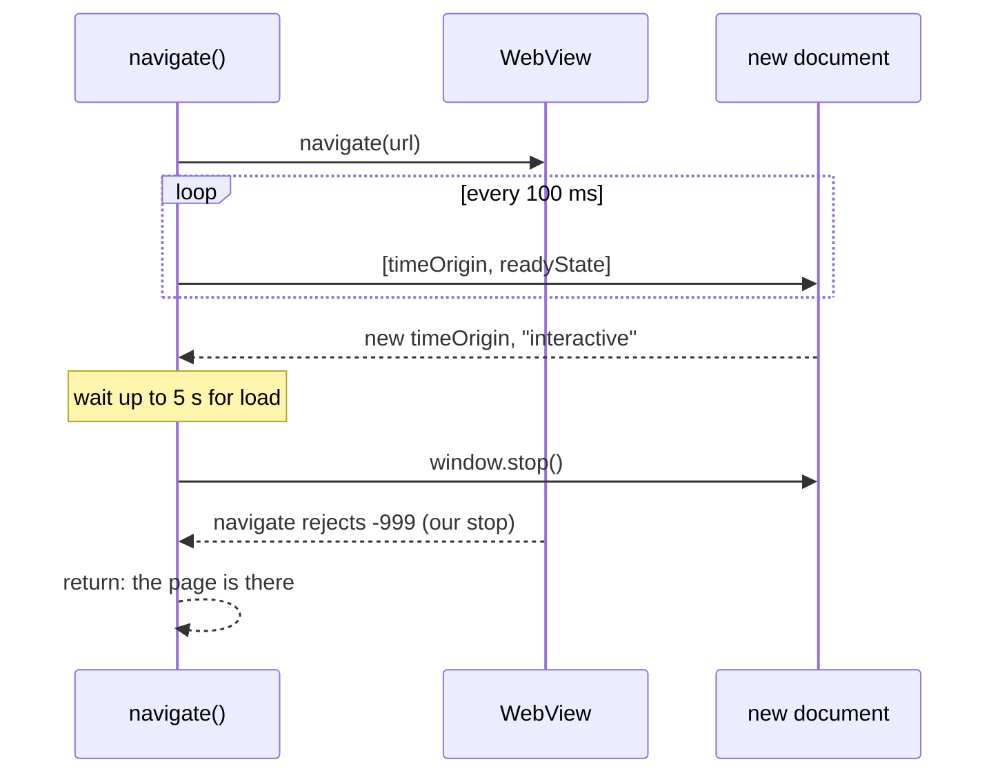

# open and goto stop waiting for `load` 5 s after the page is parsed (ET-52, #155)

## Problem

`open <url>` and `goto <url>` resolve when WebKit fires `load`. A subresource that never finishes (an image,
a font, a tracking script) holds `load` back for good, so the command waits out its budget even though the
page's text has been there since DOMContentLoaded. In the 2026-10-14 campaign `open https://www.bbc.com/news`
timed out after 30 s in 3 of 4 runs, and the session then answered every command with
`session is stuck: 'open' is still running after a reload`. A local page whose `` never answers
reproduces the `open` half: `'goto' timed out … (in its 'navigate' step)`, with `readyState` `interactive` and
the text on screen.

Two measurements on a bare `Bun.WebView` (Bun 1.4.4, a page with `<h1>` and an `` whose server never
answers):

- During the load, `evaluate` answers at once: the new document reports `readyState` `interactive` about 360 ms
  in, while `navigate()` stays pending and `view.url` stays `""`.
- `evaluate("window.stop()")` ends the load: `navigate()` rejects with NSURLErrorDomain -999 about 20 ms later,
  `onNavigationFailed` fires, `view.loading` turns false, and a following `navigate()` works. Without the stop
  that following `navigate()` throws `ERR_INVALID_STATE: a navigation is already pending`, so the command
  cannot simply return early and leave the load running.

After the stop `view.url` and `view.title` stay `""` (they change only on a completed navigation);
`location.href` and `document.title` are right. bowser already reads both through `evaluate` (`realUrl`,
`realTitle`).

## Change

### The cap

`navigationWatch.navigate` (`src/browser.ts`) runs a watcher next to `go()`:

1. Before `go()`, read `performance.timeOrigin` of the current document (`ask`, bounded by `graceMs`).
2. Every 100 ms, `ask` for `[performance.timeOrigin, document.readyState]`, each read bounded by 1 s. A new
   document is one whose `timeOrigin` differs from step 1, so the same URL (a `goto` to the page already
   open) and a redirect both count.
3. Once a new document reports anything but `loading`, wait `LOAD_CAP_MS` (5000) more for `go()`.
4. If `go()` is still pending, `evaluate("window.stop()")`, and mark the navigation stopped.

`go()` settling (resolved or rejected) ends the watcher at any step. When the navigation was stopped, the -999
that `go()` rejects with is the stop's own and `navigate` returns as if the page had loaded: the command
answers with the page's URL and title.

A page that loads within the cap is untouched: no stop, the same `load` wait as today, plus the reads of step
2. A document that never reaches `interactive` (a server that never answers, the F9 case) is not stopped
either: the budget and the recovery reload handle it as today. A page whose `evaluate` does not answer while it
loads (the BBC wedge, unexplained) reads as "no new document yet", so it also behaves as today.

5 s matches the fixed cap `markdown` gives a Markdown alternate (ET-61, #204). It is not tied to the budget: a
budget shorter than DOMContentLoaded plus 5 s times out as today.

### Recovery after a stopped load

`interrupt()` takes `view.url === ""` to mean "nothing has committed yet" and leaves the document with
`location.replace('about:blank')` (#48). After a stopped first load `view.url` is still `""`, so a later
recovery would throw the page away. The watch keeps a `committed` flag, set when a stopped navigation returns
or `onNavigated` fires, and `interrupt()` takes the initial-document branch only when `view.url === ""` and
`committed` is false.

### Docs

The README `open` and `goto` rows, and the `open`/`goto` lines in `skills/bowser/references/commands.md`: the
command waits for the page's `load` event, and when the page is parsed but `load` has not come 5 s later, it
stops the loads still running (images, frames, scripts) and answers with the page as it is.

## Cost

No stored data changes: one boolean (`committed`) and one per-navigation flag (`stopped`) in memory. The
reads of step 2 are one `evaluate` per 100 ms while a navigation is in flight: about 10 for a page that
loads in 1 s. On a stopped page, images and frames that had not finished stay missing (a `screenshot` shows
them broken), which is the trade for the command answering at all.

## Not in scope

- The BBC wedge (no `evaluate` answers during that load, CPU idle): needs a look at Bun.WebView first.
- `click` on a link to such a page, `reload`, `go-back` and `go-forward`: they wait on the same `load` through
  `act()`. If the cap proves out on `open`/`goto`, a follow-up issue carries it there.

## Definition of Done

- `tests/browser.test.ts`, with a fake view and a manual clock:
  - `navigate` whose `go()` never settles, whose page reports a new `timeOrigin` and `interactive`, evaluates
    `window.stop()` 5 s later and resolves when `go()` then rejects with -999;
  - a `go()` that resolves within the cap: `window.stop()` is never evaluated;
  - a document that stays `loading`: no stop, `navigate` keeps waiting;
  - after a stopped load with `view.url === ""`, `interrupt()` reloads instead of evaluating
    `LEAVE_INITIAL_DOCUMENT`.
- `tests/e2e-hangs.test.ts`, "ET-52": on a page whose `` never answers, `open` and then `goto` both
  answer exit 0 within 8 s with the page's title; `eval document.querySelector('h1').textContent` answers;
  a `goto` to another page then works. Today: `BOWSER_E2E=1 bun test tests/e2e-hangs.test.ts -t ET-52` fails
  (the test does not exist yet; the behaviour it checks times out at the budget, measured above).
- Each new test goes red under one mutation of the line it names, quoted in the PR.
- `bun run check` and `BOWSER_E2E=1 bun test` pass; README and `commands.md` describe the cap.
