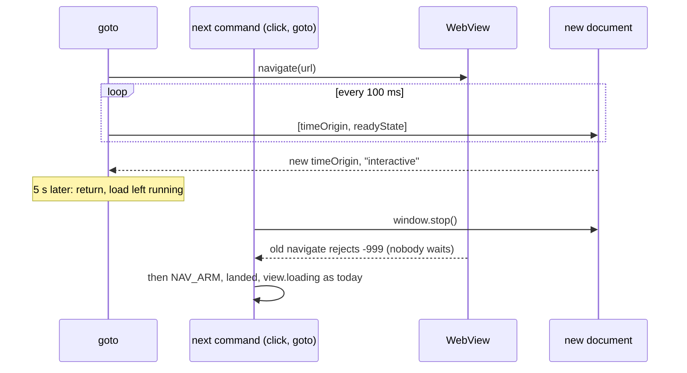

# open and goto stop waiting for `load` 5 s after the page is parsed (ET-52, #155)

Revised 2026-10-29: the stop moved from the cap to the next command (see "Revision" below).

## Problem

`open <url>` and `goto <url>` resolve when WebKit fires `load`. A subresource that never finishes (an image,
a font, a tracking script) holds `load` back for good, so the command waits out its budget even though the
page's text has been there since DOMContentLoaded. In the 2026-10-14 campaign `open https://www.bbc.com/news`
timed out after 30 s in 3 of 4 runs, and the session then answered every command with
`session is stuck: 'open' is still running after a reload`. A local page whose `` never answers
reproduces the `open` half: `'goto' timed out … (in its 'navigate' step)`, with `readyState` `interactive` and
the text on screen.

Two measurements on a bare `Bun.WebView` (Bun 1.4.4, a page with `<h1>` and an `` whose server never
answers):

- During the load, `evaluate` answers at once: the new document reports `readyState` `interactive` about 360 ms
  in, while `navigate()` stays pending and `view.url` stays `""`.
- `evaluate("window.stop()")` ends the load: `navigate()` rejects with NSURLErrorDomain -999 about 20 ms later,
  `onNavigationFailed` fires, `view.loading` turns false, and a following `navigate()` works. Without the stop
  that following `navigate()` throws `ERR_INVALID_STATE: a navigation is already pending`, so a command
  that returns early and leaves the load running must stop it before the next navigation.

After the stop `view.url` and `view.title` stay `""` (they change only on a completed navigation);
`location.href` and `document.title` are right. bowser already reads both through `evaluate` (`realUrl`,
`realTitle`).

## Change

### Revision 2026-10-29: the stop moves to the next command

The first version stopped the load at the cap and then had to tell its own -999 from any other: it read
`NAV_COUNT` after the stop to see whether the page had started a navigation of its own. Greptile found a P1 in
that attribution three times on #214 (a replacement navigation lost the cap; an expired command still changed
pages; a document created after the stop read a count of 0 and passed as "our stop"). This version takes the
attribution out: at the cap `navigate` returns and leaves the load running, and the stop happens at the start
of the next command that acts on the page or navigates, which waits for the stop's landing before it reads any
of its own baselines. Nothing waits for the old `navigate()` promise any more, so whose -999 ends it does not
matter.

Measured on a bare `Bun.WebView` (Bun 1.4.4, the `` page above), with the first `navigate()` left pending
1.5 s in:

| Call while the first `navigate()` is pending | Result |
|---|---|
| `evaluate` | answers; `readyState` `interactive`, `view.loading` true |
| `navigate()` | throws `ERR_INVALID_STATE: a navigation is already pending` at once |
| `reload()` | resolves, but the first `navigate()` stays pending, and a `navigate()` after it still throws |
| `goBack()` | resolves; the first `navigate()` then rejects with -999 |
| `evaluate("window.stop()")` | the first `navigate()` rejects with -999 5 ms later; a `navigate()` after it lands 9 ms later |

So the load cannot simply be left alone (the next `goto` would throw), and a later action that cancels it
(`go-back` above, a link `click`) would get its -999 in the middle of that action's own wait. Stopping first
and waiting for that landing keeps both out.

### The cap

`navigationWatch.navigate` (`src/browser.ts`) runs a watcher next to `go()`:

1. Before `go()`, read `performance.timeOrigin` of the current document (`ask`, bounded by 3 s: a new view's
   first evaluate waits for WebKit's web process, past 100 ms in CI run 40415723808 and past 1 s in run 40834466493). If
   that read gives no number, there is no baseline to compare with, and the watcher does not run: the
   navigation waits for `load` as today. If the command's budget ran out during the read, `navigate` fails
   without calling `go()`.
2. Read `[performance.timeOrigin, document.readyState]`, one read at a time: the next read starts 100 ms
   after the previous one settled, never while one is still in `wrapView`'s evaluate queue. A new document is
   one whose `timeOrigin` differs from step 1, so the same URL (a `goto` to the page already open) and a
   redirect both count.
3. Once a new document reports anything but `loading`, wait `LOAD_CAP_MS` (5000) more. If a later read shows
   yet another `timeOrigin` (a document that navigated on), the 5 s start again from it, and a document that
   is still `loading` does not count.
4. At the cap, `navigate` returns as if the page had loaded and marks the view as having a load left running.
   The command answers with the page's URL and title, read through `evaluate` as today.

The watcher runs for the whole `navigate`, including the #116 wait for a second landing, and ends when
`navigate` settles either way. When `navigate` returns at the cap, its wait for `go()` and for that second
landing ends too, so no loop polls in the background; the old `go()` promise's later rejection is caught and
dropped.

### The next command stops it

`act()`, for every kind (the ops in `ACTS`, and `back`, `forward` and `reload`, which reach it as `history` and
`navigates`), `navigate()`, and `close`'s `navigate("about:blank")` on a profile session start with one step: if a load was left running and
`view.loading` is still true, evaluate `window.stop()` (bounded by `graceMs`) and wait for the next landing
(bounded by `settleMs`, through the existing `settle`). Then the flag is cleared and the command goes on as
today, reading `view.loading`, `NAV_ARM` and `landed` after the stop. If the page finished loading by itself
in between (`view.loading` false), there is nothing to stop. Without the step, `go-back` would take the old
load's -999 as its own landing (the table above), and `close` on a profile would have its `about:blank` hop
thrown out with `ERR_INVALID_STATE`. `reload` after a capped first load still sees `view.url` `""` and is sent
as a plain action: once the stop has run, the native reload does nothing there, as on any uncommitted page. Commands that only read (`snapshot`, `markdown`,
`eval` outside `ACTS`, `screenshot`) do not stop it: they read the page as it is, the load still running.

A page that loads within the cap is untouched: the same `load` wait as today, plus the reads of step 2. A
document that never reaches `interactive` (a server that never answers, the F9 case) is not capped either: the
budget and the recovery reload handle it as today. A page whose `evaluate` does not answer while it loads (the
BBC wedge, unexplained) reads as "no new document yet", so it also behaves as today, with one difference: a
single read stays in the evaluate queue, so a recovery's `LEAVE_INITIAL_DOCUMENT` there is refused and
`interrupt()` takes its existing fallback, `navigate("about:blank")` (#67).

5 s matches the fixed cap `markdown` gives a Markdown alternate (ET-61, #204). It is not tied to the budget: a
budget shorter than DOMContentLoaded plus 5 s times out as today.

### Recovery while the watcher reads

WebKit refuses a direct `evaluate` while another is pending, and `interrupt()` evaluates
`LEAVE_INITIAL_DOCUMENT` directly. A recovery that lands while a step 2 read is in flight then falls back to
`navigate("about:blank")`, which is refused too while the stuck navigation is pending (#48 failed this way in
CI run 40415723808). So `interrupt()` first ends the watcher and waits for its read to settle, up to 1 s. The baseline read of step
1 is not waited for: a recovery that lands while it is still pending (up to 3 s, only on a page that does not
answer) takes the `navigate("about:blank")` fallback (#67), as the BBC wedge does.

### Recovery on a page whose load was left running

`view.url` and `view.title` change only on a completed navigation, so after a capped first load they are still
`""`. `interrupt()` takes `view.url === ""` to mean "nothing has committed yet" and leaves the document with
`location.replace('about:blank')` (#48), so a recovery on that page (an op that timed out on it) leaves it for
`about:blank`, as on a fresh session. That is unchanged code and an edge of an edge; it is documented, not
fixed: the next `goto` or `open` loads the page again.

### Docs

The README `open` and `goto` rows, and the `open`/`goto` lines in `skills/bowser/references/commands.md`: the
command waits for the page's `load` event, and when the page is parsed but `load` has not come 5 s later, it
answers with the page as it is; the next command that acts on the page or navigates stops the loads still
running (images, frames, scripts) first.

## Cost

No stored data changes: one per-view flag (a load left running) in memory. The reads of step 2 are at most one
`evaluate` per 100 ms while a navigation is in flight, and never two queued: about 10 for a page that loads
in 1 s. After a capped load, the next acting command pays one `evaluate` and a landing (about 15 ms measured).
On a page whose loads were stopped, images and frames that had not finished stay missing (a `screenshot` shows
them broken); before the stop they may still arrive.

## Not in scope

- The BBC wedge (no `evaluate` answers during that load, CPU idle): needs a look at Bun.WebView first.
- The cap itself on `click` on a link to such a page, `reload`, `go-back` and `go-forward`: their own wait for
  `load` through `act()` stays uncapped. If the cap proves out on `open`/`goto`, a follow-up issue carries it
  there. They do stop a load an earlier `open` or `goto` left running (above).
- `wait-for` does not stop a load left running: it only reads the page.

## Definition of Done

- `tests/browser.test.ts`, with a fake view and a manual clock:
  - `navigate` whose `go()` never settles, whose page reports a new `timeOrigin` and `interactive`, resolves
    5 s later without evaluating `window.stop()`;
  - after that, the next `act()` evaluates `window.stop()` before `NAV_ARM`, and its click's navigation is
    waited for even though the stop's -999 lands first;
  - after that, the next `navigate()` evaluates `window.stop()` before calling `go()`;
  - after that, `back` evaluates `window.stop()` before `goBack()`, and does not return on the stop's -999:
    it waits for the history page's landing;
  - after that, `close` on a profile session evaluates `window.stop()` before `navigate("about:blank")`;
  - a load that finished by itself (`view.loading` false) is not stopped by the next command;
  - a `go()` that resolves within the cap: nothing is left running, the next command evaluates no stop;
  - a document that stays `loading`: at a time past `LOAD_CAP_MS` the `navigate` promise is still pending;
  - a document that navigates on after it was parsed: the 5 s start again from the new document, and a new
    document still `loading` holds `navigate` (the third Greptile P1);
  - a `go()` rejected by an older navigation's -999 (#116) whose own page then hangs on an image: `navigate`
    resolves at the cap (the first Greptile P1);
  - a baseline read that outlasts the budget: `go()` is never called (the second Greptile P1);
  - a baseline read that gives no number: no read of step 2, `navigate` waits for `go()`;
  - a read that never settles: no second read is queued behind it;
  - a baseline read that takes 1.5 s still starts the watcher (past the old 1 s bound, CI run 40834466493);
  - a recovery during a read evaluates `LEAVE_INITIAL_DOCUMENT` after the read settles, not `navigate("about:blank")`.
- `tests/e2e-hangs.test.ts`, "ET-52": on a page whose `` never answers, `open` and then `goto` both
  answer exit 0 within 8 s with the page's title; `eval document.querySelector('h1').textContent` answers;
  a `goto` to another page then works, and so does a `click` on a link to another page.
  Today the test has no `click` step and the image page no link; with them added it must pass.
- Each new test goes red under one mutation of the line it names, quoted in the PR.
- `bun run check` and `BOWSER_E2E=1 bun test` pass; README and `commands.md` describe the cap and the stop on
  the next command, and `troubleshooting.md` the recovery on a page whose load was left running.
