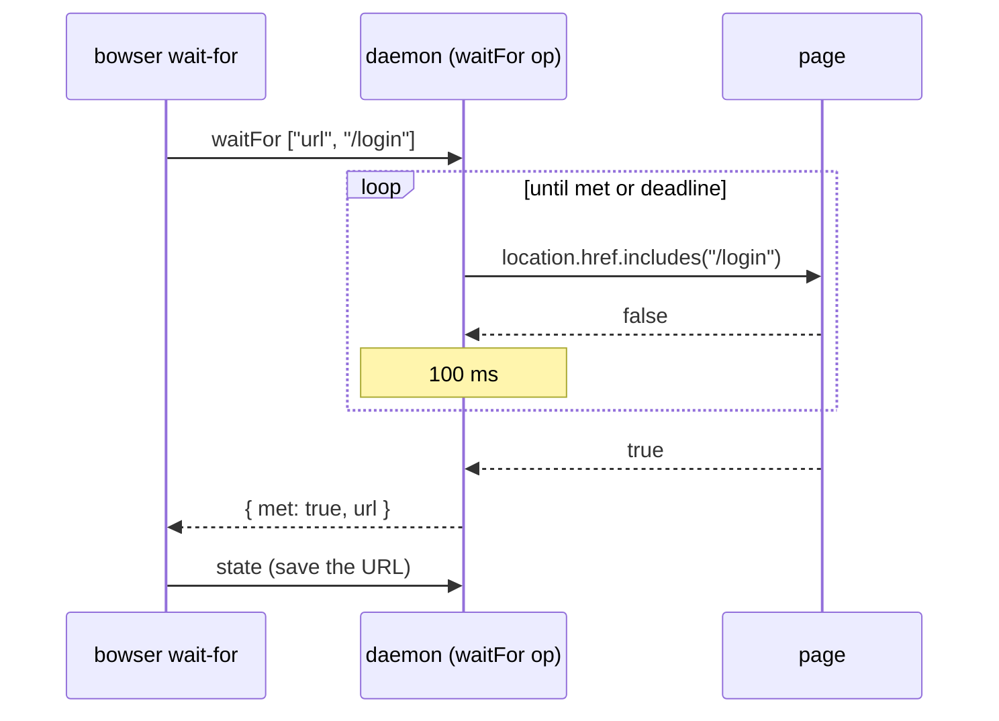

# wait-for: wait until the URL or the text an action leads to is there (#114)

## Problem

On a client-side app an action's result often arrives after the command that caused it has answered. In the
2026-10-02 session on carrefouruae.com (a Next.js app), `click` on "Login & Register" answered in 0.1 s; the
route changed to `/login/phone` about a second later, by `pushState` after a fetch, past the 100 ms window in
which `click` waits for a navigation to begin. A `snapshot` right after the click still showed the home page.
bowser has no way to wait for that: an agent sleeps, or polls with `eval`. The same gap shows on any page that
renders text after a fetch.

`playwright-cli` 0.1.13 has no wait command (`playwright-cli --help`). Playwright MCP has `browser_wait_for`
(text, textGone, time), so the name `wait-for` is the one agents already know.

## Change

### The command

```
bowser wait-for --url <part>     # until location.href contains <part>
bowser wait-for --text <text>    # until the page's visible text (document.body.innerText) contains <text>
```

Exactly one of the two flags; both or neither is a usage error (exit 1). The match is a plain substring,
case-sensitive: `--url /login` matches `https://www.carrefouruae.com/mafuae/en/login/phone`.

On success it prints the page's URL (`--json`: `{ "ok": true, "url": "…" }`) and saves it to the session
state, as `click` does, so a later ref command sees the page it is on. When the condition is already true it
answers at once.

The wait is bounded by the command's budget (`BOWSER_OP_TIMEOUT_MS`, default 30 s). When it runs out:

```
wait-for: no URL containing '/login' after 30000ms; the page is at https://www.carrefouruae.com/mafuae/en/
wait-for: no text "Order placed" after 30000ms; the page is at https://shop.example/checkout
```

exit 2, as other timeouts. With `BOWSER_OP_TIMEOUT_MS=0` it waits until the condition holds.

### Where the loop runs

A new daemon op, `waitFor` (`args: [kind: "url" | "text", value: string]`, result `{ met: boolean; url: string }`),
loops in the daemon: evaluate the check, and when it is false wait 100 ms and evaluate again. One read at a time:
the next evaluate starts only after the previous one settled, so a page that does not answer queues nothing
behind it (the same rule as the ET-52 load cap). A read that throws (the document is being replaced) counts as
"not yet". The op stops at the `deadline` `dispatch` already hands every handler (50 ms before the request's
timer) and answers `{ met: false, url }`, so the command can print its own message instead of the generic
`'wait-for' timed out`. It is not in `ACTS`: it does not act on the page.



A loop in the CLI (one `evaluate` request per check) was the alternative. Each request would carry the budget
left, and the last one would fail with the daemon's `'wait-for' timed out … (in its 'evaluate' step)`, which
does not say what was awaited. It also costs a socket round trip per check.

Because the loop is a daemon op, `bowser mcp` gets a `wait-for` tool from the command registry with no MCP
code.

## Cost

No stored data changes. While waiting, one `evaluate` per 100 ms plus the time the read takes: up to 300 reads
in a 30 s budget, each a `String.includes` over `location.href` or `document.body.innerText`. `innerText`
forces a layout, so on a very large page (the 2 MB ECMAScript spec of ET-53) each read costs that layout; not
measured, since no case waits for text on such a page.

## Not in scope

- `--text-gone`, `--time`, a ref or a selector, regular expressions: no case asked for them yet.
- `snapshot` waiting for the page to settle (the issue's other option): it would change every snapshot's timing
  to fix the case `wait-for` covers.
- Text inside iframes or shadow roots (`innerText` does not cross them).

## Definition of Done

- `tests/daemon-handler.test.ts`, with a fake browser and a manual deadline:
  - a check that turns true on the third read answers `{ met: true, url }` after two 100 ms waits;
  - a check that never turns true answers `{ met: false, url }` at the deadline, not after it;
  - a read that throws counts as "not yet";
  - a read that does not answer: no second read is sent.
- `tests/commands.test.ts`, with a fake client: `wait-for` with both flags or neither exits 1 with a usage line;
  `{ met: false }` gives the message above, exit 2; `{ met: true }` prints the URL and saves it to state.
- `tests/e2e-actions.test.ts` (or a new e2e file), on a fixture page whose button does `pushState('/moved')`
  after 1 s and adds the text "Moved" after 1.5 s: `click` then `wait-for --url /moved` prints `<base>/moved`
  within 3 s; `wait-for --text Moved` answers; with `BOWSER_OP_TIMEOUT_MS=1500`, `wait-for --text Never` exits 2
  with the message above within 2.5 s. Today: `bun src/cli.ts wait-for --url /x` exits 1 with
  `bowser: unknown command: wait-for`.
- `docs-drift` passes: README command table, `skills/bowser/SKILL.md`, `skills/bowser/references/commands.md`.
- Each new test goes red under one mutation of the line it names, quoted in the PR.
