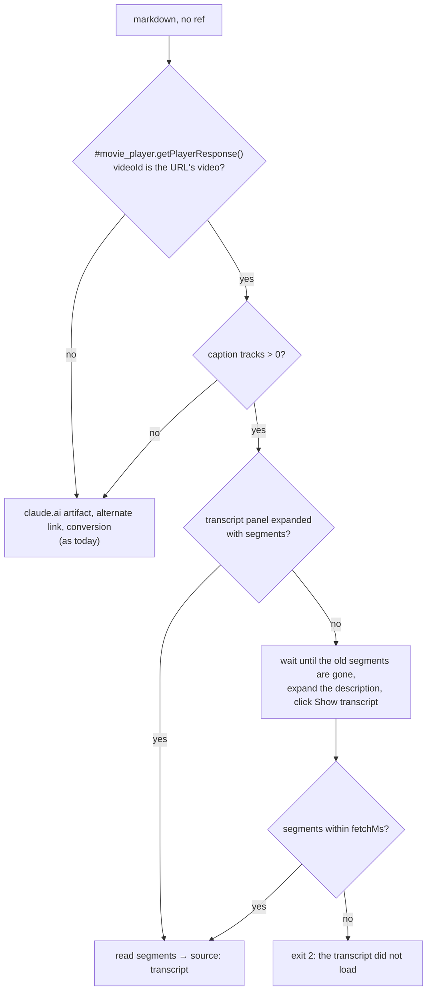

# `markdown` on a YouTube video gives its transcript (#223)

**Issue:** #223.
**Status:** draft for review.

## Problem

Sora reads a link with `bowser open <url>` and `bowser markdown`. On a YouTube video that gives the page around
the video: on https://www.youtube.com/watch?v=4UtrRVtUN_g today, `markdown --json` answers
`source: "converted"` with 4,707 bytes of description and comments. What the speaker says is not there.

How YouTube hands out the text, checked on 2026-10-28 in a fresh session, no login, WebKit:

| Path | Result |
|---|---|
| `fetch(captionTrack.baseUrl + '&fmt=json3')` from the page | `200`, empty body (YouTube wants a PO token; `yt-dlp` hits the same) |
| `POST /youtubei/v1/get_transcript` with `getTranscriptEndpoint.params` from `ytInitialData` | `400` |
| Expand the description, click "Show transcript", read `ytd-transcript-segment-renderer` | 1,188 segments |

So the only working path clicks in the page.

The click path on five URLs:

| URL | Segments | Click to segments | Panel language |
|---|---|---|---|
| `watch?v=4UtrRVtUN_g` (18 min) | 1,188 | 817 ms | English (auto-generated) |
| `watch?v=aO4Mnz485uM` (8 min) | 460 | 621 ms | Russian (auto-generated) |
| `watch?v=lYz_BpEgQ6E` (31 min) | 239 | 509 ms | Russian (auto-generated) |
| `youtu.be/4UtrRVtUN_g` | 1,188 | 1,769 ms | English (auto-generated) |
| `shorts/zPxQjuFoUBc` | no button, 0 caption tracks | gave up after 5 s | |

Two traps showed up:

- **After an in-page navigation** (a click on a related video), `ytInitialPlayerResponse` still describes the
  first video. `document.querySelector('#movie_player').getPlayerResponse()` describes the current one.
- **The old video's segments stay in the DOM** for a moment after that navigation: 1,188, then 0, with the
  transcript panel at `ENGAGEMENT_PANEL_VISIBILITY_HIDDEN`. A read in that window would return the wrong
  video's text.

## Change

### Output

```
# How to Build an AI Code Review Agent - Daksh Gupta, Greptile
https://youtu.be/4UtrRVtUN_g · English (auto-generated)

[0:01] text of the segments from 0:01 to before 0:31 …

[0:31] …
```

- The title is `document.title` without the trailing ` - YouTube`.
- The second line is the short link and the panel's language label.
- One paragraph per 30 seconds: a new paragraph starts at the first segment 30 s or more after the current
  paragraph's start, and carries that segment's timestamp as YouTube prints it (`m:ss` or `h:mm:ss`). The
  agent cites a moment as `https://youtu.be/<id>?t=<seconds>`, built from the header link.
- Each paragraph goes through `escapeStarts`, so a segment starting with `# ` or `- ` stays text.
- `--json` gives `source: "transcript"`; `url` and `title` are the page's, as for any source.
- `--filename` writes the same text, as for any source.

The format was picked by size, measured on `4UtrRVtUN_g` (1,188 segments, 18 min; tokens ≈ bytes / 4):

| Format | Bytes | ≈ tokens |
|---|---|---|
| Segment text only, no timestamps | 44,471 | 11k |
| A link per segment, `[0:01](https://youtu.be/<id>?t=1) text` (what #223 proposed) | 96,109 | 24k |
| `[0:01] text`, one line per segment | 53,329 | 13k |
| `[0:01] text`, one paragraph per 30 s (chosen: 36 paragraphs) | 44,774 | 11k |

A link per segment repeats the same 30-byte URL 1,188 times and doubles the size. Paragraphs cost 0.7% over bare
text, and a timestamp every 30 s is enough to point at a moment.

### Picking the source

The YouTube step comes first in `markdownScript`'s no-ref branch (`src/page-scripts.ts:1123`), before the
claude.ai artifact step. `markdown <ref>` is unchanged.



- **Detection is by the page, not the host.** The step runs when `#movie_player` has `getPlayerResponse` and
  its `videoDetails.videoId` is the URL's video (`v=` on `/watch`, the last path segment on `/shorts/` and
  `youtu.be`). No other site has that element, and the e2e fixture on `localhost` can then take the step.
- **No caption tracks** (the Shorts above): the step falls through at once to the usual sources, without the
  5 s wait for a button that never comes. The result is `source: "converted"`, no error.
- **An expanded panel with segments** is the current video's (an in-page navigation hides the panel), so it is
  read as is.
- **Otherwise** the script waits until no `ytd-transcript-segment-renderer` is left in the DOM (the previous
  video's), expands the description (`ytd-watch-metadata #expand`), clicks the button in
  `ytd-video-description-transcript-section-renderer`, and polls every 250 ms for segments.
- **The wait** shares `fetchMs` with the other page sources: `min(5000, budget / 2)`, as `cmdMarkdown` computes
  it today (`src/commands/snapshot.ts:64`). The slowest load measured was 1,769 ms.
- **Captions exist but nothing loaded in time**: `markdown` exits 2 with
  `markdown: the transcript of https://www.youtube.com/watch?v=… did not load within 5000ms`. A silent fall back
  to the page would hide a markup change on YouTube's side, and Sora would summarise the comments believing
  they were the video.

The clicks are `element.click()` inside the same `evaluate` that reads the page. They open a side panel and do
not navigate, so `markdown` stays out of `ACTS`: that set is for native action ops that wait for a navigation
afterwards (`src/daemon/server.ts:622`). #223 said otherwise; that was wrong.

## Cost

No stored data changes. On a video page with captions, `markdown` takes the click and the load: 0.5 to 1.8 s on
the five URLs, up to `fetchMs`. The output for 18 minutes is 44,774 bytes (≈11k tokens); for an hour, at the same
rate, about 150 KB (≈37k tokens). `--filename` keeps it out of the context, as for any long page.

## Not in scope

- Picking the language (`--lang`): the panel's default is the video's own language on the three videos above.
- A separate `transcript` command: `markdown` is where Sora already looks, and a new command is outside
  `playwright-cli` parity.
- Speech-to-text for a video without captions.
- YouTube Music, live streams in progress, embeds on other sites.

## Definition of Done

- `tests/fixtures/youtube-watch.html`, a page shaped like YouTube's watch page as of 2026-10-28: `#movie_player`
  with `getPlayerResponse()`, `ytd-watch-metadata #expand`, a transcript button that adds
  `ytd-transcript-segment-renderer` nodes (`.segment-timestamp`, `.segment-text`) 300 ms after the click. Query
  parameters choose the case: no tracks, segments never load, stale segments present at load that leave after
  500 ms, and a segment text starting with `# `.
- `tests/e2e-markdown.test.ts`, on that fixture at `/watch?v=abc123def45`:
  - `markdown --json` answers `source: "transcript"` and a `markdown` string written out in the test: the
    header, the link line, and two paragraphs split at 30 s;
  - with no tracks it answers `source: "converted"` in under 1 s;
  - with segments that never load and `BOWSER_OP_TIMEOUT_MS=2000`, it exits 2 with
    `markdown: the transcript of <url> did not load within 1000ms`;
  - with stale segments, none of their text is in the result;
  - `# ` at a segment's start comes out as `\# `.
- `BOWSER_E2E=1 BOWSER_E2E_NET=1 bun test tests/e2e-markdown.test.ts` on `4UtrRVtUN_g`: `source` is
  `"transcript"`, the first line is `# How to Build an AI Code Review Agent - Daksh Gupta, Greptile`, and there
  are at least 30 paragraphs starting with `[`. Today: `source` is `"converted"`, 4,707 bytes.
- The README row for `markdown` and `skills/bowser/references/commands.md` name the YouTube case; `docs-drift`
  passes.
- `bun run check` and `BOWSER_E2E=1 bun test` pass.
- Each new fixture test goes red under one mutation of the line it names, quoted in the PR.

## Open Issues

- The panel's visibility attribute is read from
  `ytd-engagement-panel-section-list-renderer[target-id=engagement-panel-searchable-transcript]`. After an
  in-page navigation it read `ENGAGEMENT_PANEL_VISIBILITY_HIDDEN`; the expanded value was not read. The
  implementation checks it on a live page before relying on it.
- The fixture goes stale when YouTube changes its markup; only the network test notices. The network test is
  the one to run after a report that `markdown` stopped giving transcripts.
