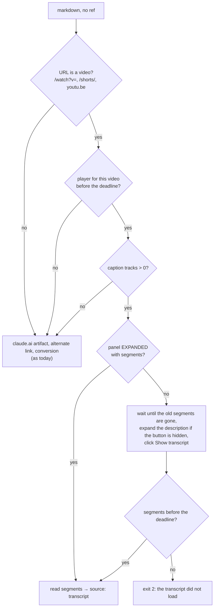

# `markdown` on a YouTube video gives its transcript (#223)

**Issue:** #223.
**Status:** draft for review.

## Problem

Sora reads a link with `bowser open <url>` and `bowser markdown`. On a YouTube video that gives the page around
the video: on https://www.youtube.com/watch?v=4UtrRVtUN_g today, `markdown --json` answers
`source: "converted"` with 4,707 bytes of description and comments. What the speaker says is not there.

How YouTube hands out the text, checked on 2026-10-28 in a fresh session, no login, WebKit:

| Path | Result |
|---|---|
| `fetch(captionTrack.baseUrl + '&fmt=json3')` from the page | `200`, empty body (YouTube wants a PO token; `yt-dlp` hits the same) |
| `POST /youtubei/v1/get_transcript` with `getTranscriptEndpoint.params` from `ytInitialData` | `400` |
| Expand the description, click "Show transcript", read `ytd-transcript-segment-renderer` | 594 segments |

So the only working path clicks in the page.

The click path on five URLs (segment counts here were taken across both transcript panels, see #225, so they are twice the real number):

| URL | Segments | Click to segments | Panel language |
|---|---|---|---|
| `watch?v=4UtrRVtUN_g` (18 min) | 1,188 | 817 ms | English (auto-generated) |
| `watch?v=aO4Mnz485uM` (8 min) | 460 | 621 ms | Russian (auto-generated) |
| `watch?v=lYz_BpEgQ6E` (31 min) | 239 | 509 ms | Russian (auto-generated) |
| `youtu.be/4UtrRVtUN_g` | 1,188 | 1,769 ms | English (auto-generated) |
| `shorts/zPxQjuFoUBc` | no button, 0 caption tracks | gave up after 5 s | |

Two traps showed up:

- **After an in-page navigation** (a click on a related video), `ytInitialPlayerResponse` still describes the
  first video. `document.querySelector('#movie_player').getPlayerResponse()` describes the current one.
- **The old video's segments stay in the DOM** for a moment after that navigation: 1,188 across both panels, then 0, with the
  transcript panel at `ENGAGEMENT_PANEL_VISIBILITY_HIDDEN`. A read in that window would return the wrong
  video's text.

## Change

### Output

```
# How to Build an AI Code Review Agent - Daksh Gupta, Greptile
https://youtu.be/4UtrRVtUN_g · English (auto-generated)

[0:01] text of the segments from 0:01 to before 0:31 …

[0:31] …
```

- The title is `document.title` without the trailing ` - YouTube`.
- The second line is the short link and the panel's language label.
- One paragraph per 30 seconds: a new paragraph starts at the first segment 30 s or more after the current
  paragraph's start, and carries that segment's timestamp as YouTube prints it (`m:ss` or `h:mm:ss`). The
  agent cites a moment as `https://youtu.be/<id>?t=<seconds>`, built from the header link.
- Whitespace inside a segment's text, newlines included, collapses to one space, so the only line starts in the
  transcript are the `[m:ss]` ones and a segment's `# ` or `- ` stays inline text.
- `--json` gives `source: "transcript"`; `url` and `title` are the page's, as for any source.
- `--filename` writes the same text, as for any source.

The format was picked by size, measured on `4UtrRVtUN_g` (594 segments, 18 min; tokens ≈ bytes / 4; remeasured after #225):

| Format | Bytes | ≈ tokens |
|---|---|---|
| Segment text only, no timestamps | 22,235 | 5.6k |
| A link per segment, `[0:01](https://youtu.be/<id>?t=1) text` (what #223 proposed) | 48,054 | 12k |
| `[0:01] text`, one line per segment | 26,664 | 6.7k |
| `[0:01] text`, one paragraph per 30 s (chosen: 36 paragraphs) | 22,659 | 5.7k |

A link per segment repeats the same 30-byte URL 594 times and doubles the size. Paragraphs cost 2% over bare
text, and a timestamp every 30 s is enough to point at a moment.

### Picking the source

The YouTube step comes first in `markdownScript`'s no-ref branch (`src/page-scripts.ts:1123`), before the
claude.ai artifact step. `markdown <ref>` is unchanged.



- **One deadline for the whole step**: `fetchMs` from the step's start, `min(5000, budget / 2)`, and 5000 at
  budget 0, as `cmdMarkdown` computes it today (`src/commands/snapshot.ts:64`). Every wait below (the player,
  the old segments leaving, the new segments) polls every 250 ms against that one deadline, so no wait in the
  step can outlive it (ET-61). The slowest load measured was 1,769 ms.
- **Detection.** The step runs when the URL is a video's: `v=` on a `/watch` path, the last path segment on
  `/shorts/` or on a `youtu.be` host. The host is not checked, so the e2e fixture on `localhost` takes the step.
  The script then waits for `#movie_player.getPlayerResponse()` whose `videoDetails.videoId` is the URL's video;
  `ytInitialPlayerResponse` is not used, since it keeps the first video after an in-page navigation. No such
  player before the deadline: the step falls through to the usual sources.
- **No caption tracks** (the Shorts above): the step falls through at once, without waiting for a button that
  never comes. The result is `source: "converted"`, no error.
- **The panel is current only when expanded.** When
  `ytd-engagement-panel-section-list-renderer[target-id=engagement-panel-searchable-transcript]` has
  `visibility="ENGAGEMENT_PANEL_VISIBILITY_EXPANDED"` and holds segments, they are read as is (read on the live
  page on 2026-10-28 after opening it: 594 segments). An in-page navigation sets it to
  `ENGAGEMENT_PANEL_VISIBILITY_HIDDEN`; segments under a hidden panel are the previous video's and are never read.
  The page also keeps a hidden twin of the panel holding the same segments, so segments are read only from
  inside the expanded panel, never across the document (#225).
- **A timestamp lower than the current paragraph's start** opens a new paragraph instead of joining it (#225).
- **Otherwise** the script waits until no `ytd-transcript-segment-renderer` is left in the DOM. It clicks
  `ytd-watch-metadata #expand` only when the transcript button in
  `ytd-video-description-transcript-section-renderer` is not visible (at load the button is in the DOM but
  hidden), then clicks that button and waits for segments.
- **Captions exist but nothing loaded by the deadline** (old segments that never left count too): `markdown`
  exits 2 with `markdown: the transcript of https://www.youtube.com/watch?v=… did not load within 5000ms`. A
  silent fall back to the page would hide a markup change on YouTube's side, and Sora would summarise the
  comments believing they were the video.

The clicks are `element.click()` inside the same `evaluate` that reads the page. They open a side panel and do
not navigate, so `markdown` stays out of `ACTS`: that set is for native action ops, and membership waits out a
pending navigation and syncs the dialog shim around them (`src/daemon/server.ts:447`, `:622`), which an
`evaluate` already does for itself. #223 said otherwise; that was wrong.

This breaks one rule of the 2026-10-05 `markdown` design: reading leaves the page as it was. Here the
description stays expanded and the transcript panel stays open, so refs from an earlier snapshot can report
the page changed. That is accepted: Sora reads a video page to read it, not to act on it afterwards.

## Cost

No stored data changes. On a video page with captions, `markdown` takes the click and the load: 0.5 to 1.8 s on
the five URLs, up to `fetchMs`. The output for 18 minutes is 22,659 bytes (≈5.7k tokens); for an hour, at the same
rate, about 75 KB (≈19k tokens). `--filename` keeps it out of the context, as for any long page.

## Not in scope

- Picking the language (`--lang`): the panel's default is the video's own language on the three videos above.
- A separate `transcript` command: `markdown` is where Sora already looks, and a new command is outside
  `playwright-cli` parity.
- Speech-to-text for a video without captions.
- YouTube Music, live streams in progress, embeds on other sites.

## Definition of Done

- `tests/fixtures/youtube-watch.html`, a page shaped like YouTube's watch page as of 2026-10-28: `#movie_player`
  with `getPlayerResponse()`, `ytd-watch-metadata #expand`, a transcript button that adds
  `ytd-transcript-segment-renderer` nodes (`.segment-timestamp`, `.segment-text`) 300 ms after the click, and the
  engagement panel's `visibility` attribute. Query parameters choose the case.
- `tests/e2e-markdown.test.ts`, on that fixture at `/watch?v=abc123def45`:
  - `markdown --json` answers `source: "transcript"` and a `markdown` string written out in the test: the
    header, the link line, and two paragraphs split at 30 s;
  - with no tracks it answers `source: "converted"` in under 1 s;
  - with segments that never load and `BOWSER_OP_TIMEOUT_MS=2000`, it exits 2 with
    `markdown: the transcript of <url> did not load within 1000ms`;
  - with `BOWSER_OP_TIMEOUT_MS=0` and segments that never load, it exits 2 within 6 s, naming 5000ms;
  - a hidden panel with segments `PREVIOUS VIDEO` that leave after 500 ms: the result has the new segments and
    not `PREVIOUS VIDEO`;
  - a hidden panel with segments `PREVIOUS VIDEO` that never leave: exit 2 by the deadline, and
    `PREVIOUS VIDEO` is in no output;
  - an expanded panel already holding segments: those are the result, and the transcript button is not clicked;
  - a description already expanded at load: the transcript loads, and `#expand` is not clicked;
  - a player that appears 400 ms after load: `source: "transcript"`;
  - a segment `# boom` that is not first in its paragraph, and a segment `a\n- b`: the paragraph reads
    `… # boom …` and `a - b` on its one line.
- `BOWSER_E2E=1 BOWSER_E2E_NET=1 bun test tests/e2e-markdown.test.ts` on `4UtrRVtUN_g`: `source` is
  `"transcript"`, the first line is `# How to Build an AI Code Review Agent - Daksh Gupta, Greptile`, and there
  are at least 30 paragraphs starting with `[`. Today: `source` is `"converted"`, 4,707 bytes.
- The README row for `markdown` and `skills/bowser/references/commands.md` name the YouTube case; `docs-drift`
  passes.
- `bun run check` and `BOWSER_E2E=1 bun test` pass.
- Each new fixture test goes red under one mutation of the line it names, quoted in the PR.

## Open Issues

- The fixture goes stale when YouTube changes its markup; only the network test notices. The network test is
  the one to run after a report that `markdown` stopped giving transcripts.
