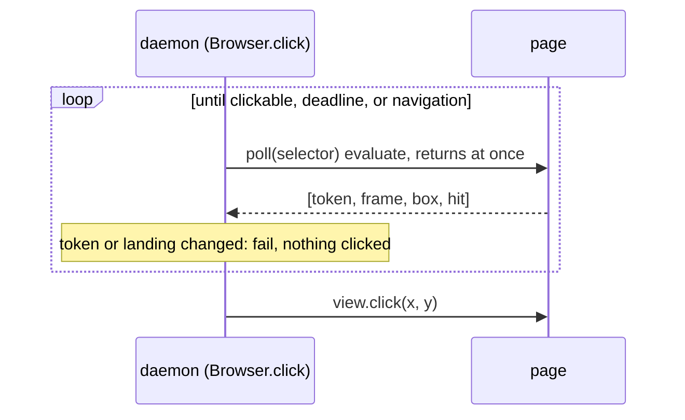

# click waits for actionability itself and clicks by coordinates (#267)

Issue: #267. Touches the same native click as the #111 spec (PR #268).
Status: draft, waiting for review.

## Goal

When the page navigates while `click` waits for its target, the command fails within its budget with a message that names the navigation, exit 2. Nothing is clicked on the new page, and the next command works without `bowser close`.

## What happens today

`Browser.click` calls Bun's `view.click(selector, { timeout })` (`src/browser.ts:595`). Bun runs its actionability check page side through WebKit's `callAsyncJavaScript` and clicks natively at the centre it returns (`WebViewHost.cpp`, `kActionabilityJS`, `clickSelectorIPC` and `onSelectorComplete`, [oven-sh/bun@f7607a3](https://github.com/oven-sh/bun/blob/f7607a3d350b9c9488d41eab6a18d6cac74794e6/src/runtime/webview/WebViewHost.cpp#L355-L463); the same script is in the 1.4.4 binary bowser runs). The script, once per animation frame until it returns or its deadline passes:

1. `document.querySelector(sel)` finds the element;
2. its bounding box has non-zero width and height, and its centre is inside the viewport (`0 <= cx < innerWidth`, `0 <= cy < innerHeight`);
3. the box is the same as in the previous frame (left, top, width, height);
4. `document.elementFromPoint(cx, cy)` is the element or a descendant.

A failed step 1 or 2 forgets the previous box. `bun-types` describes the same predicate (`node_modules/bun-types/bun.d.ts`, `click(selector: string, …)`: "stable (bounding box unchanged for 2 consecutive frames)").

When the document is replaced during that wait, WebKit keeps the old document in its back-forward cache, where `requestAnimationFrame` never fires, so the script's own deadline is never checked and the call never settles. Bun's host then refuses every later input call on that view.

### Probes

Bun 1.4.4-canary.1+000ef5037, Darwin 27.0.0 arm64, scripts in the session scratchpad (`probe267/`). Page A has a `#b` that moves every frame and navigates to B after 300 ms; B has its own `#b`.

- `probe2.ts`, `repro.ts`: with the click pending on A, `evaluate`, `navigate` and `screenshot` work. `click(selector)`, `click(x, y)`, `press`, `type` and `scrollTo` throw `ERR_INVALID_STATE: a simple operation is already pending`, and `reload()` and `goBack()` throw `a navigation is already pending`. B's `#b` is never clicked. Same in every run (6 runs).
- `probe4.ts`: `history.back()` from the page restores A (`pageshow` with `persisted: true`), and the click then rejects with `timeout waiting for '#b' to be actionable`. So A was suspended in the back-forward cache, not destroyed.
- `probe2.ts`, `probe3.ts`: nothing short of evicting A from that cache frees the call. A second `Bun.WebView`, one `navigate()` (same origin or another), eight `navigate()` calls to B's URL, `Cache-Control: no-store` on A over http, an `unload` listener, and an RTCPeerConnection, WebSocket, Web Lock, IndexedDB connection or BroadcastChannel opened on A before the click all left it pending. Five loads of new pages evicted A, and the click rejected with `Completion handler for function call is no longer reachable` (2 runs of 2).
- `probe5.ts`: an `evaluate` whose promise awaits `requestAnimationFrame` hangs the same way (`an evaluate() is already pending` afterwards, also after a reload). A replacement may only use evaluates that return without awaiting.
- `probe5.ts`: a first version of the design below that judged stability by time (two polls 16 ms apart) clicked A's moving button in 3 runs of 3: two polls fell in the same frame. The frame counter below fixes that.
- `probe6.ts`: the design below, measured; results under Cost.

An upstream report is drafted (not filed) with `repro.ts` as its reproduction.

## Options

### A. Wait in bowser, click by coordinates (chosen)

bowser polls a synchronous page script that runs Bun's four checks and reads a frame counter and a document token. When two samples from different frames agree, it calls `view.click(x, y)`. A changed token, or a landing seen by the navigation watch, ends the wait with an error before anything is clicked. No call is left pending on a suspended document, because no poll awaits anything page side.

### B. Keep Bun's click, fail fast on a landing

The command would fail quickly, but the view keeps refusing `click`, `press` and `type` until WebKit evicts the old page (about five page loads in the probe). The next input command fails, which the issue rules out.

### C. B, then free the call with `history.back()` and `history.forward()`

The restored A runs Bun's script again and may click A's element; A's and B's `pageshow` handlers run again. It acts on pages the user did not ask to act on.

### D. Wait for a Bun fix

Leaves the hang and the stuck session in place until then. The upstream report is drafted either way.

## Design

Today the loop is Bun's script inside one `view.click(selector)` call, which never returns if P is replaced mid-loop.

### 1. The poll script

`clickPollScript(selector, doc?)` in `src/page-scripts.ts` is one synchronous expression. It:

- keeps a frame counter on the window under `Symbol.for('bowser.frames')`, `{ f, armed }`: if no rAF is armed it arms one that increments `f` and clears `armed`. The counter therefore counts frames between polls, and a new document starts at 0;
- reads the document token. With `doc` (a ref's saved document, see Interplay) it is `window[Symbol.for('bowser.aria-refs')]?.doc`. Without it, it is `DOC_ID` (`src/page-scripts.ts:797`), the per-document random number navigate already uses;
- runs Bun's steps 1, 2 and 4 on the current box and returns `[token, f]` when step 1 or 2 fails, else `[token, f, left, top, width, height, hit]`.

Step 3 needs two samples, so it is done in the daemon.

### 2. The decision

A pure function, `clickStep(prev, sample, expected, landed)` in `src/browser.ts`, decides each poll. It returns one of:

- `navigated` when the sample's token differs from `expected`, or the watch's `arrived` count changed since the wait began. `expected` is `doc` when given, else the token of the first sample;
- `click` with the centre `(left + width / 2, top + height / 2)` when the sample has a box, `prev` has a box from an earlier frame (`sample.f > prev.f`) with the same left, top, width and height, and `hit` is true;
- `wait` otherwise. A sample from the same frame as `prev` keeps `prev`; a sample without a box clears it; a sample with a box from a later frame replaces it.

Comparing `arrived` as well as the token covers a page where `DOC_ID` answers `"sealed"` (the document refuses the symbol), whose token is the same in both documents. `arrived` counts only successful landings, so a cancelled navigation (-999) does not end the wait.

### 3. The loop

`Browser.click(selector, timeoutMs)` keeps its signature. Inside the `nav.act` callback, where `view.click(selector)` is today, it polls through wrapView's queued `evaluate`, calls `clickStep`, and on `wait` sleeps 4 ms on the injected clock before the next poll. On `click` it calls `view.click(x, y)` with no options (left button, one click, as today). The phase stays `acting` for the whole wait, as today, so a budget timeout during it still reads "the click may have been delivered".

The wait ends at `timeoutMs` after it began, 30000 ms when absent (Bun's default, `bun.d.ts`). The daemon already passes the request's time left as `timeoutMs` (`src/daemon/server.ts:553`), so the budget is unchanged.

### 4. Messages

- Wait over: `timeout waiting for '<selector>' to be actionable`, the text Bun throws today, so `dispatch`'s mapping to the acting timeout (`src/daemon/server.ts:260`) and its tests stay as they are.
- Navigation: `click: the page navigated before the click; nothing was clicked, run 'bowser snapshot' to see the new page`. It is a daemon error, so the CLI exits 2. For `fill`, whose first step is `click`, the same message comes back from that step.

`fill`'s `type` step and the `type` command call `view.type`, which inserts text natively without an actionability wait, so they do not hang this way and do not change.

### 5. Interplay

- #111 (PR #268) adds a saved `doc` to `Browser.click` and one evaluate of the store's `doc` right before the native click. With this design that check is the poll itself: `Browser.click(selector, timeoutMs, doc?)` passes `doc` to `clickPollScript`, and `clickStep` compares the token with it on every poll. A mismatch on the first poll is #111's `{ gone: true }` (the ref is from another document); a mismatch on a later poll is this navigation error. There is one document comparison per poll and no separate pre-check evaluate. Whichever change lands second adapts: if this lands first, #111's click part is passing `doc` through; if #111 lands first, this replaces its pre-check with the poll.
- The hop: between the last poll and `view.click(x, y)` there is one daemon to page message (the poll's median is 0.49 ms, below). A document that commits in that hop is clicked at those coordinates. With Bun's selector click a commit in the same hop either clicks the new document's element at the same CSS path or hangs (#267). Neither can be closed without a check inside the native call, which Bun does not offer.
- Recovery: with no call pending in Bun, the daemon's recovery reload works on the view again, so a click that overruns its budget for another reason (a page busy in a loop) no longer has to end in `session is stuck` because of the click itself.
- ACTS, the dialog sync before and after, `NAV_ARM`, and the wait for a navigation the click starts all run as today.
- `#112` (`hit: true` in `resolve`) and `#122` (actionability timeout message) are unchanged.

## Data and cost

- Per poll, daemon to page: the script, about 1 KB with the selector inlined. Page to daemon: an array of 2 or 7 values, under 100 bytes of JSON.
- In the page: one object `{ f, armed }` per document under a symbol key, and at most one armed rAF callback. Nothing is written to `state.json` or disk.
- Polls: up to about 3 per frame at 60 frames a second (`probe6.ts`: 182 to 185 polls in about one second of waiting on a button that moved for 1 s, 5 runs). A poll took 0.49 ms median, 1.08 ms p95, 3.61 ms max (1240 polls). That is roughly 90 ms of evaluate time per second of waiting, spent only while the target is not yet clickable.
- A target that is clickable at once: 11 to 17 ms and 2 to 4 polls, against 7 to 14 ms for Bun's `click(selector)` on the same page (10 runs each).
- Correctness in `probe6.ts`: the moving button was clicked only after it stopped (5 of 5); with a navigation mid-wait the click failed after 309 to 314 ms, A and B were not clicked, and a following click on B worked at once (5 of 5).

## Out of scope

- `scrollTo`, which has the same page-side wait in Bun; bowser does not call it.
- The hop described under Interplay.
- The wording of the acting-phase timeout message, which stays "may have been delivered" although bowser now knows whether `view.click(x, y)` was sent.

## Definition of done

1. E2E: `tests/e2e-click-nav.test.ts` serves A, whose button moves every frame and which navigates to B 300 ms after load, and B, whose button sets `document.body.dataset.clicked`. With `BOWSER_OP_TIMEOUT_MS=3000`, `click` on A's button fails in under 3000 ms with the navigation message and exit code 2; on B, `eval document.body.dataset.clicked` prints `undefined`; then `snapshot` and `click` on B's button succeed and the mark reads `yes`, with no `bowser close` in between. On main the click times out and the next command reports `session is stuck`.
2. Unit, decision: `tests/browser.test.ts` covers `clickStep`: a same-frame sample waits and keeps `prev`; the next frame with the same box and `hit` clicks at the centre; a changed box waits; `hit: false` waits; a missing box clears `prev`; a changed token returns `navigated`; a changed `arrived` with the same token returns `navigated`; a first-sample token that differs from a given `doc` returns `navigated`.
3. Unit, loop: with a fake view and the fake clock, `Browser.click` calls `view.click(x, y)` with the centre and never `view.click(selector)`; a token change between polls rejects with the navigation message and the fake records no click; a box that never settles rejects with `timeout waiting for '<selector>' to be actionable` at `timeoutMs`.
4. Every test in items 1 to 3 fails when the production line behind its checked value is broken (one mutation each), and the PR body quotes one red line per test.
5. Existing behaviour: `tests/e2e-covered.test.ts`, `tests/e2e-hangs.test.ts`, `tests/e2e-actions.test.ts`, `tests/e2e-far-element.test.ts` and the #122 test in `tests/browser.test.ts` pass unchanged.
6. `bun run check` passes; `BOWSER_E2E=1 bun test` passes in CI.
7. CHANGELOG `[Unreleased]` has a `Fixed` entry naming #267.
8. A Codex review ends with no open Critical or Required finding, and the PR closes #267.

### Run before the code (2026-10-30, worktree at 8832762)

- Item 1: `BOWSER_E2E=1 bun test ./tests/e2e-click-nav.test.ts` prints `Test filter "./tests/e2e-click-nav.test.ts" had no matches`; the file does not exist yet.
- Items 2 and 3: `git grep -n clickStep -- src tests` matches nothing (exit 1).
- Items 5 and 6 pass on main today and guard against regressions; they are checked after the code.
