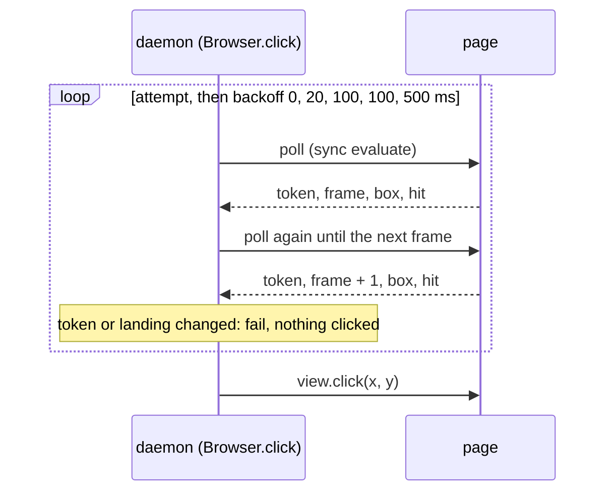

# click waits for actionability the way Playwright does, and clicks by coordinates (#267)

Issue: #267. Touches the same native click as the #111 spec (PR #268).
Status: draft, waiting for review.

## Goal

When the page navigates while `click` waits for its target, the command fails within its budget with a message that names the navigation, exit 2. Nothing is clicked on the new page, and the next command works without `bowser close`. The wait itself follows Playwright's actionability model.

## What happens today

`Browser.click` calls Bun's `view.click(selector, { timeout })` (`src/browser.ts:595`). Bun runs its actionability check page side through WebKit's `callAsyncJavaScript` and clicks natively at the centre the check returns (`WebViewHost.cpp`, `kActionabilityJS`, `clickSelectorIPC` and `onSelectorComplete`, [oven-sh/bun@f7607a3](https://github.com/oven-sh/bun/blob/f7607a3d350b9c9488d41eab6a18d6cac74794e6/src/runtime/webview/WebViewHost.cpp#L355-L463); the same script is in the 1.4.4 binary bowser runs). Once per animation frame, until it returns or its deadline passes, the script:

1. finds the element with `document.querySelector(sel)`;
2. checks that its bounding box has non-zero width and height and that its centre is inside the viewport;
3. checks that the box is the same as in the previous frame;
4. checks that `document.elementFromPoint(cx, cy)` is the element or a descendant.

`bun-types` describes the same predicate (`node_modules/bun-types/bun.d.ts`, `click(selector: string, …)`).

When the document is replaced during that wait, WebKit keeps the old document in its back-forward cache, where `requestAnimationFrame` never fires. The script never reaches its deadline check, the call never settles, and Bun's host then refuses every later input call on that view.

### Probes

Bun 1.4.4-canary.1+000ef5037, Darwin 27.0.0 arm64, scripts in the session scratchpad (`probe267/`). Page A has a `#b` that moves every frame and navigates to B after 300 ms; B has its own `#b`.

- `probe2.ts`, `repro.ts`: with the click pending on A, `evaluate`, `navigate` and `screenshot` work. `click(selector)`, `click(x, y)`, `press`, `type` and `scrollTo` throw `ERR_INVALID_STATE: a simple operation is already pending`; `reload()` and `goBack()` throw `a navigation is already pending`. B's `#b` is never clicked. Same in every run (6 runs).
- `probe4.ts`: `history.back()` from the page restores A (`pageshow` with `persisted: true`), and the click then rejects with `timeout waiting for '#b' to be actionable`. A was suspended in the back-forward cache, not destroyed.
- `probe2.ts`, `probe3.ts`: nothing short of evicting A from that cache frees the call. These all left it pending: a second `Bun.WebView`; one `navigate()` to the same origin or another; eight `navigate()` calls to B's URL; `Cache-Control: no-store` on A over http; an `unload` listener; an RTCPeerConnection, WebSocket, Web Lock, IndexedDB connection or BroadcastChannel opened on A before the click. Five loads of new pages evicted A, and the click rejected with `Completion handler for function call is no longer reachable` (2 runs of 2).
- `probe5.ts`: an `evaluate` whose promise awaits `requestAnimationFrame` hangs the same way (`an evaluate() is already pending` afterwards, also after a reload). The wait may only use evaluates that return without awaiting.
- `probe5.ts`: a version that judged stability by time (two polls 16 ms apart) clicked A's moving button in 3 runs of 3, because two polls fell in the same frame. Stability has to be counted in frames.
- `probe7.ts`: the design below, measured; results under Cost.

An upstream report is drafted (not filed) with `repro.ts` as its reproduction.

## Playwright's model

Read from Playwright v1.64.1 ([`cfe490d`](https://github.com/microsoft/playwright/tree/cfe490d941f992655948eee8fd4fd94e1c4234bf)): `docs/src/actionability.md`, `packages/playwright-core/src/server/dom.ts`, `packages/playwright-core/src/server/frames.ts`, `packages/injected/src/injectedScript.ts`, `packages/injected/src/domUtils.ts`, `packages/playwright-core/src/server/webkit/wkPage.ts`. There is no `_checkHitTargetAt` in this version; the hit target check is `_checkFrameIsHitTarget` (`dom.ts:940`) plus `injected.expectHitTarget` (`injectedScript.ts:1023`) and `setupHitTargetInterceptor` (`injectedScript.ts:1139`).

### The checks

From `actionability.md`:

- Attached: the element is connected (`checkElementStates` returns `error:notconnected` otherwise, `injectedScript.ts:693`).
- Visible: a non-empty bounding box and no `visibility:hidden` computed style (`computeBox`, `domUtils.ts:125`). `display:none` and zero size are not visible; `opacity:0` is.
- Stable: the same bounding box for two consecutive animation frames (`_checkElementIsStable`, `injectedScript.ts:712`). The count is `rafCountForStablePosition()`, which is 1 on WebKit outside Windows (`wkPage.ts:974`): the first rAF records the box, the next one compares. The 15 ms frame filter applies only when the count is above 1.
- Receives Events: the element is the hit target at the action point. `expectHitTarget` runs `elementsFromPoint` in each shadow root on the way to the element; then `setupHitTargetInterceptor` checks the target again inside the page while the real pointer events arrive, and blocks them if another element would get them.
- Enabled: not a disabled form control, not inside a disabled `<fieldset>`, not under `[aria-disabled=true]`.
- Editable: enabled and not readonly.

### Which action checks what

| bowser command | Playwright method | Playwright checks | bowser today | bowser after this change |
| --- | --- | --- | --- | --- |
| `click` | `click` | Visible, Stable, Receives Events, Enabled | `resolve` refuses a disabled or covered target and scrolls; Bun waits for Attached, Visible (size only), Stable, Receives Events | `resolve` unchanged; bowser waits for Attached, Visible, Stable, Receives Events (below) |
| `hover` | `hover` | Visible, Stable, Receives Events | `resolve` scrolls; a page script dispatches mouse events, no wait | unchanged |
| `fill` | `fill` | Visible, Enabled, Editable | `resolve` refuses a covered target and scrolls; its `click` step waits as `click` does; `fillScript` refuses disabled or readonly | its `click` step gets the new wait |
| `type` | `pressSequentially` | none | none: Bun's `type` inserts into the focused element | unchanged |
| `check`, `uncheck` | `check`, `uncheck` | Visible, Stable, Receives Events, Enabled | `resolve` refuses a disabled target and scrolls; a page script sets the state, no wait | unchanged |
| `select` | `selectOption` | Visible, Enabled | `resolve` scrolls; a page script picks the option, no wait | unchanged |
| `press` | `press` | none | none | unchanged |

Only `click` (and `fill` through it) has a page-side wait that can hang, so only it changes. The other gaps (no waits for `hover`, `check`, `uncheck`, `select`; Enabled refused at once instead of awaited) are listed under Out of scope.

### The retry loop

`_retryAction` (`dom.ts:328`) runs one attempt; if it fails for a reason that can pass (not visible, outside the viewport, hit by another element, a missing state), it waits and runs another. The waits before attempts 2, 3, 4, 5, 6 and later are 0, 20, 100, 100 and 500 ms (`waitTime = [0, 20, 100, 100, 500]`), the last repeating. A pointer action's attempt (`_performPointerAction`, `dom.ts:397`), in order:

1. waits for Visible, Enabled (click only) and Stable, page side (`checkElementStates`), which takes two rAF callbacks;
2. scrolls the element into view if needed (`scrollRectIntoViewIfNeeded`). On later attempts it cycles `scrollIntoView` through `block: 'end'`, `'center'` and `'start'` (`_retryPointerAction`, `dom.ts:380`) to get out from under sticky overlays;
3. computes the clickable point: the middle of the first content quad that intersects the viewport, or `error:notinviewport`;
4. checks the hit target at that point and installs the interceptor;
5. performs the native mouse action.

The whole loop runs under the action's timeout (`progress`); there is no budget per attempt.

### Locator and ElementHandle

A `Locator` resolves its selector again on every retry: `_retryWithProgressIfNotConnected` (`frames.ts:1197`) treats `error:notconnected` as "element was detached from the DOM, retrying" and queries anew, so after a navigation it acts on the new page's match. An `ElementHandle` is bound to one element; when that element is gone it fails with `Element is not attached to the DOM` (`throwElementIsNotAttached`, `dom.ts:990`).

A bowser ref is bound to the document its snapshot came from (#105, #111). So bowser follows `Locator` inside one document (the CSS path is queried again on every poll, as Bun does today) and `ElementHandle` across documents: when the document changes, the click fails with the navigation message and nothing on the new page is clicked.

## Options

### A. Wait in bowser, Playwright's way, and click by coordinates (chosen)

bowser runs Playwright's attempts with synchronous page polls and calls `view.click(x, y)`. A changed document ends the wait before anything is clicked. No call is ever left pending on a suspended document, because no poll awaits anything page side.

### B. Keep Bun's click, fail fast on a landing

The command fails quickly, but the view keeps refusing `click`, `press` and `type` until WebKit evicts the old page (about five page loads in the probe). The next input command fails, which the issue rules out.

### C. B, then free the call with `history.back()` and `history.forward()`

The restored A runs Bun's script again and may click A's element, and A's and B's `pageshow` handlers run again. It acts on pages the user did not ask to act on.

### D. Wait for a Bun fix

Leaves the hang and the stuck session in place until then. The upstream report is drafted either way.

## Design

Today the loop is Bun's script inside one `view.click(selector)` call, which never returns if P is replaced mid-loop.

### 1. The poll script

`clickPollScript(selector, doc?)` in `src/page-scripts.ts` is one synchronous expression (895 bytes with a typical CSS path). It:

- keeps a frame counter on the window under `Symbol.for('bowser.frames')`, `{ f, armed, polled }`. Each poll writes `polled = performance.now()` and, if no rAF loop is armed, starts one whose callback increments `f` and re-arms itself while the last poll is under 100 ms old. While bowser polls, `f` therefore counts every frame; afterwards the loop stops within 100 ms. A new document starts at `f = 0`;
- reads the document token. With `doc` (a ref's saved document, see Interplay) the token is `window[Symbol.for('bowser.aria-refs')]?.doc`. Without it, it is `DOC_ID` (`src/page-scripts.ts:797`), the per-document random number `navigate` already uses;
- finds the element with `document.querySelector(selector)`;
- if it is found, its box has non-zero width and height, and its centre is inside the viewport (Bun's bounds), returns `[token, f, left, top, width, height, hit]`, where `hit` is whether `document.elementFromPoint` at the centre is the element or a descendant. Otherwise it returns `[token, f]`.

It does not await, so a document that is suspended between two polls leaves nothing pending.

### 2. One attempt

An attempt takes a first sample, then polls every 4 ms until a sample from a later frame arrives. It succeeds when:

- the second sample's frame is exactly the first's plus one (Playwright's two consecutive frames on WebKit);
- both have a box, and the boxes are equal in left, top, width and height (Stable; Visible as far as Bun checks it);
- the second sample's `hit` is true (Receives Events; a `visibility:hidden` element is never the hit target, so Visible's style rule is covered too).

On success bowser calls `view.click(left + width / 2, top + height / 2)` with no options (left button, one click, as today). Attached is checked by `querySelector` in every poll.

The decision is a pure function, `clickStep(first, second, expected, arrivedChanged)` in `src/browser.ts`, returning `navigated`, `click` with the point, or `retry`. It is what the unit tests check.

### 3. Retries, scrolling and the budget

A failed attempt is followed by the next one after Playwright's waits: 0, 20, 100, 100 ms, then 500 ms each time. The wait ends early when the navigation watch's `arrived` count changes, as Playwright races its wait against frame detach (`frames.ts:1163`).

Scrolling stays where it is today: `resolve` scrolls the element to the centre when it is outside the viewport or covered there (`resolveRefScript`, `src/page-scripts.ts:1301`), before the click request. The wait does not scroll; Bun's did not either. Playwright's per-attempt scroll and its alignment cycling are under Out of scope.

The whole wait ends at `timeoutMs` after it began: 30000 ms when absent (Bun's default, `bun.d.ts`). The daemon passes the request's time left (`src/daemon/server.ts:553`), so the budget is the command's, as today. A backoff wait is cut to the time left. The phase stays `acting` for the whole wait, as today.

### 4. Navigation

A poll whose token differs from the expected one, or an `arrived` count that changed since the wait began, ends the wait with `navigated`. The expected token is `doc` when given, else the first poll's token. `arrived` also covers a page whose `DOC_ID` answers `"sealed"` (the document refuses the symbol), where the token is the same in both documents. It counts only successful landings, so a cancelled navigation (-999) does not end the wait. A same-document navigation (`pushState`, a hash change) keeps the document, so the wait goes on, as a `Locator` would.

### 5. Messages and exit codes

- Wait over: `timeout waiting for '<selector>' to be actionable`, the text Bun throws today, so `dispatch`'s mapping to the acting timeout (`src/daemon/server.ts:260`) and its tests stay as they are.
- Navigation: `click: the page navigated before the click; nothing was clicked, run 'bowser snapshot' to see the new page`. It is a daemon error, so the CLI exits 2. `fill`'s `click` step gives the same message.

`fill`'s `type` step and the `type` command call `view.type`, which inserts text natively without a page-side wait; they cannot hang this way and do not change.

### 6. Interplay

- #111 (PR #268) gives `Browser.click` the ref's saved `doc` and adds one evaluate of the store's `doc` right before the native click. With this design that check is the poll: `Browser.click(selector, timeoutMs, doc?)` passes `doc` to `clickPollScript`, and the token is compared with it on every poll. A mismatch on the first poll is #111's `{ gone: true }` (the ref is from another document); a mismatch on a later poll is the navigation error above. One document comparison per poll, and no separate pre-check evaluate. If this lands first, #111's click part is passing `doc` through; if #111 lands first, this replaces its pre-check with the poll.
- The hop: between the last poll and `view.click(x, y)` there is one daemon to page message (a poll takes 0.09 ms median, below). A document that commits in that hop is clicked at those coordinates. With Bun's selector click a commit in the same hop either clicks the new document's element at the same CSS path or hangs (#267). Playwright closes it with the in-page interceptor of step 4; bowser has no interceptor, and a new document would not carry one anyway.
- Recovery: with no call pending in Bun, the daemon's recovery reload works on the view again after a click that overran its budget for another reason.
- ACTS, the dialog sync before and after the op, `NAV_ARM`, and the wait for a navigation the click itself starts run as today.
- `resolve`'s refusals (#112 covered, disabled) and the #122 timeout message are unchanged.

## Data and cost

Measured with `probe7.ts` (Bun 1.4.4, 60 frames a second in the view):

- Per poll: about 0.9 KB of script to the page, and an array of 2 or 7 values back, under 100 bytes of JSON. A poll takes 0.092 ms median, 0.188 ms p95, 1.448 ms max (1000 polls).
- In the page: one object `{ f, armed, polled }` per document under a symbol key, and an rAF callback per frame while bowser polls and for up to 100 ms after. Nothing is written to `state.json` or to disk.
- A target that is clickable at once: one attempt, 3 or 4 polls, 11 to 17 ms to the click (9 runs of 10; the first run of the process took 133 ms). Bun's `click(selector)` took 7 to 14 ms on the same page (`probe6.ts`, 10 runs).
- A button that moves for the first second after load: clicked after 1318 to 1324 ms, in 7 attempts and 22 or 23 polls (5 of 5), never before it stopped. The extra 300 ms over 1 s is the 500 ms backoff.
- A navigation 300 ms after load: the click failed with `navigated` after 793 to 805 ms, 17 to 19 polls (5 of 5). At 2000 ms: after 2343 to 2353 ms (5 of 5). Neither A nor B was clicked, and a following click on B worked at once (10 of 10). These runs had no early end of the backoff wait on `arrived`; with it the navigation is reported at the landing.
- So the wait costs about 0.3 ms of page time per attempt, and after the first second about two attempts per second, against about 60 frames of Bun's script per second today.

## Out of scope

- Playwright's waits for `hover`, `check`, `uncheck` and `select`, awaiting Enabled instead of refusing a disabled target at once, and scrolling on every attempt with alignment cycling: #270.
- `scrollTo`, which has the same page-side wait in Bun; bowser does not call it.
- The hop described under Interplay.
- The wording of the acting timeout, which stays "may have been delivered" although bowser now knows whether `view.click(x, y)` was sent.

## Definition of done

1. E2E: `tests/e2e-click-nav.test.ts` serves A, whose button moves every frame and which navigates to B 300 ms after load, and B, whose button sets `document.body.dataset.clicked`. With `BOWSER_OP_TIMEOUT_MS=3000`, `click` on A's button fails in under 3000 ms with the navigation message and exit code 2; on B, `eval document.body.dataset.clicked` prints `undefined`; then `snapshot` and `click` on B's button succeed and the mark reads `yes`, with no `bowser close` in between. On main the click times out and the next command reports `session is stuck`.
2. Unit, decision: `tests/browser.test.ts` covers `clickStep`: frames n and n + 1 with the same box and `hit` click at the centre; frames n and n + 2 retry; a changed box retries; `hit: false` retries; a missing box retries; a changed token is `navigated`; a changed `arrived` with the same token is `navigated`; a first token that differs from a given `doc` is `navigated`.
3. Unit, loop: with a fake view and the fake clock, `Browser.click` calls `view.click(x, y)` with the centre and never `view.click(selector)`; failed attempts are spaced 0, 20, 100, 100, 500, 500 ms; a change of `arrived` during a backoff wait ends it at once with the navigation message and the fake records no click; a box that never settles rejects with `timeout waiting for '<selector>' to be actionable` at `timeoutMs`.
4. Every test in items 1 to 3 fails when the production line behind its checked value is broken (one mutation each), and the PR body quotes one red line per test.
5. Existing behaviour: `tests/e2e-covered.test.ts`, `tests/e2e-hangs.test.ts`, `tests/e2e-actions.test.ts`, `tests/e2e-far-element.test.ts` and the #122 test in `tests/browser.test.ts` pass unchanged.
6. `bun run check` passes; `BOWSER_E2E=1 bun test` passes in CI.
7. CHANGELOG `[Unreleased]` has a `Fixed` entry naming #267.
8. A Codex review ends with no open Critical or Required finding, and the PR closes #267.

### Run before the code (2026-10-30, worktree at 8832762)

- Item 1: `BOWSER_E2E=1 bun test ./tests/e2e-click-nav.test.ts` prints `Test filter "./tests/e2e-click-nav.test.ts" had no matches`; the file does not exist yet.
- Items 2 and 3: `git grep -n clickStep -- src tests` matches nothing (exit 1).
- Items 5 and 6 pass on main today and guard against regressions; they are checked after the code.
