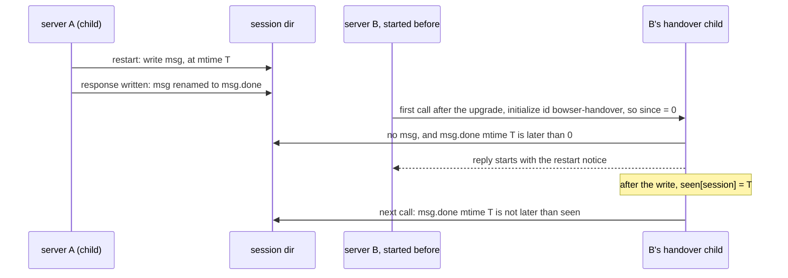

# An MCP server that was running during a restart gets its notice on its next call (#261)

Amends `2026-10-14-restart-close-notice-design.md` (ET-29) and its ET-44 change in PR #260.

## Problem

After an upgrade restart of a session opened without `--persistent` or `--profile`, the cookies and storage are
gone, and the restart notice is the only place that says so. Today three readers get it:

- the command that ran the restart (it reads `msg`, and its surface renames `msg` to `msg.done` once printed);
- a command that waited on that restart (it reads `msg`, else `msg.done`, and leaves both as they are, ET-44);
- any command at all while `msg` is still there, that is, before a surface has printed it (ET-29).

`takeNotice` (`src/commands/context.ts`) reads `msg.done` only for a command that waited. A second `bowser mcp`
server B on the same session, idle while server A's call restarts it, makes its next call after A has printed the
notice. B finds `msg` gone, did not wait, and reads `localStorage` as `null` with no word that it was lost. Not
seen in a run yet; it follows from the code.

In the usual case B is not even the process that runs the call. B was started by the old bowser, so its first tool
call after the upgrade hands over (`startHandover`, `src/mcp.ts`) to a child of the installed version, a process
that starts after the restart and knows nothing of B's past. B may also be a release without this change, so B
cannot be asked to pass anything on.

A one-shot CLI command keeps today's rule: it has no memory between runs, and nothing tells it which restart it has
already heard about.

## What identifies a restart for one MCP server

Three ways to tell "this restart is news to me". None adds a file that outlives what `close` removes. Sizes are for
this machine today: 31 session directories under `~/.bowser/sessions`, names 12 characters on average.

| Option | Kept per `bowser mcp` process | Handover child | Server that never called the session before the restart |
|---|---|---|---|
| 1. The daemon's pid it last talked to | `Map<session, pid>`: one entry per session it called, about 12 B name + 8 B number; 31 sessions, under 1 KB | needs the parent's map, as JSON in an env var (31 × about 20 B = about 620 B); a parent without this change has none | no entry, so no notice |
| 2. A start time, and the mtime of the last notice it printed | one number (8 B), plus `Map<session, mtimeMs>`: one entry per session it printed a notice in, same size as above | nothing passed: a child takes start time 0 (below) | gets the notice: the restart is newer than the server |
| 3. A restart counter in the session directory | `Map<session, counter>`, as option 1 | as option 1 | no entry, so no notice; and a new file `gen` per session (a few bytes on disk), written under `upg`, reset when `close` removes the directory |

Option 1 also fires on a daemon that changed for another reason (killed and spawned again by `open`), and a reused
pid hides a change (`src/daemon/pidfile.ts` already guards against reuse for the pidfile). Option 3 needs a new
write in the restart and its own rules for a missing or corrupt file.

Chosen: option 2. It keeps the least state, passes nothing across the handover, works with a parent of any release
that can hand over, and covers the case the issue names, a server whose first call to the session comes after the
restart. The notice file already records when the
restart finished: `writeNotice` writes `msg.<pid>.tmp` and renames it, and `markDelivered`'s rename to `msg.done`
keeps the file's mtime (checked on APFS: `mtimeMs` before and after `renameSync` both `1793333934579.2495`).

## Change

### 1. The rule

A `bowser mcp` process has a start time `since` (0 for a handover child, below) and a map `seen` from session name to
the mtime of the last notice it put in a response for that session. A tool call that neither restarted nor waited
reads `msg.done` as well as `msg`, and takes the notice from `msg.done` when that file's mtime is later than
`seen.get(session) ?? since`.

In an MCP call `seen` also filters `msg`, on every path: a notice whose file's mtime is not later than
`seen.get(session)` is not taken again. A waiter that printed a still-pending `msg` (its ack leaves the file in place)
would otherwise take it once more on its next call, as an ET-29 reader, before the restarter's ack renames it.

- `msg.done` is cleared as today: the next restart's `writeNotice`, a failed restart's `removeNotice`, and `close`,
  which removes the session directory. Nothing new clears it. A stale `msg.done` reaches only a server that was
  running when that restart finished, once per server.
- Every notice an MCP call puts in its response records its file's mtime in `seen`, on every path: the restarter's
  `msg`, a waiter's `msg` or `msg.done`, a pending `msg` (ET-29), and the late `msg.done` above. Without that, the
  call after a restart or a wait would print the same notice again, since its mtime is later than `since`.
- The record is made by an ack, after the response is written, as `markDelivered` is today
  (`if (!token.cancelled && (await send(res)))`, `src/mcp.ts`). A response that was not written leaves `seen` as it
  was, and the next call gets the notice again.
- Only the restarter's ack and the pending-`msg` ack call `markDelivered`, as today. The waiter's ack and the late
  ack only record the mtime: they leave `msg` and `msg.done` as they are, so a waiter that reads before the
  restarter printed does not take the notice away from it (ET-44).
- The CLI sets neither field, so `takeNotice` behaves as today: `msg.done` for a waiter only.

### 2. Where the state lives

- `CommandContext` gets `restarts?: { since: number; seen: Map<string, number> }`. `takeNotice` uses it as above.
  `readNotice` returns the file's `mtimeMs` with the text, so the comparison and the record use the file the text
  came from.
- `createMcpServer` holds one such object for the process, with `since` set to `Date.now()` when it is created, and
  passes it to `deps.run` with `notices` and `acks`.
- A handover child sets `since` to 0 when it accepts an `initialize` whose id is `bowser-handover`
  (`HANDOVER_ID`, `src/mcp.ts`). Every release that can hand over (0.12.0 on, #149) sends that id. Its parent runs
  an older bowser than the installed one, so it started before the install, and every restart to the installed
  version came after it; a notice the parent printed was for a restart to its own version, which a later restart
  replaced, since the child meets that daemon as older and restarts it. Nothing goes through the environment, and
  `seen` starts empty.

### 3. The flow it changes

### 4. What stays out

- A client that never sent `initialize` gets a handover child with no `initialize` to see, so that child keeps its
  own start time and misses a restart that came before it.
- A server started after the restart finished gets no notice, as a CLI command does: its client cannot have relied
  on what the session held before.
- A clock stepped back between the restart and the call can hide the notice; one stepped forward can show it to a
  server started just after. Both need a clock change within the few seconds of a restart.

## Cost

No new file, no new write in the restart. Per MCP process one 8-byte number and at most one map entry per session it
printed a notice in (31 sessions here, under 1 KB). Per tool call that neither restarted nor waited, one more file
read (`msg.done`, absent on most calls) and one `stat` when it exists. Nothing per handover.

## Definition of Done

- `tests/lifecycle.test.ts`, test "a late MCP call gets the last restart's delivered notice once (#261)", with
  `run(argv, { notices, acks, restarts })` against a fake daemon of this version and a `msg.done` written in the
  test:
  - `restarts.since` before the file's mtime: `notices` equals the file's text, and `msg.done` still holds it after
    the acks run; a second call with the same `restarts` gets `[]`;
  - `restarts.since` after the file's mtime: `[]`;
  - without `restarts` (the CLI): `[]`, and `acks` is `[]`.
- `tests/lifecycle.test.ts`, test "every notice an MCP call printed is recorded, so the next call does not repeat
  it (#261)", each case followed by a second call with the same `restarts` (`since` before the notice) that gets
  `[]`:
  - the restarter: its call restarts a fake older daemon, its notice is in `notices`, its acks rename `msg` to
    `msg.done`;
  - a pending `msg` (ET-29) read by a call that reached a daemon of this version, acks run;
  - the ET-44 waiter, both variants: `acks` holds one ack, and after it runs `msg` (or `msg.done`) still holds the
    text, as the ET-44 test expects today.
  - the ET-44 waiter that read a still-pending `msg`: its second call runs before the restarter's ack, with `msg`
    still in place.
- `tests/mcp.test.ts`, test "a handover child counts every restart as news (#261)": a server that accepted an
  `initialize` with id `bowser-handover` passes `restarts.since` 0 to `deps.run`; one that accepted another id
  passes a `since` no earlier than the time taken before `createMcpServer`.
- `tests/e2e-upgrade.test.ts`, test "an MCP server idle during another's restart gets its notice on its next call
  (#261)": two `bowser mcp` servers from `copyAt("old-mcp", "0.0.1")`, both initialized before the upgrade, on one
  ephemeral session with `localStorage` `tok` set; after the version bump, A's call restarts it and its reply
  carries the notice; then B's first call, `localstorage-get tok`, runs in B's handover child and answers text that
  starts with the restart notice and holds `cookies and storage were lost`; B's second call has no notice; a CLI
  `eval 1` after that prints `1` and nothing on stderr.
- `bun test tests/lifecycle.test.ts -t "#261"` and `bun test tests/mcp.test.ts -t "#261"` each run at least one
  test, all passing. Today both print `error: regex "#261" matched 0 tests`.
- README "Upgrading" says that a `bowser mcp` server that was running when the restart finished gets the line on
  its next call to that session, and that a CLI command started after the restart does not.
  `grep -n "was running when the restart finished" README.md` prints one line (today: nothing), and
  `grep -n "does not get it (#261)" README.md` prints nothing (today: line 62).
- CHANGELOG's unreleased section has a line for #261: `grep -n "was running when the restart finished" CHANGELOG.md`
  prints it (today: nothing), and the ET-44 entry no longer says a later call gets no notice:
  `grep -n "still gets no notice (#261)" CHANGELOG.md` prints nothing (today: line 29).
- `bun run check` passes, and `BOWSER_E2E=1 bun test` passes in CI.
- Each new test goes red under one mutation of the line it names, quoted in the PR as one line per test.
