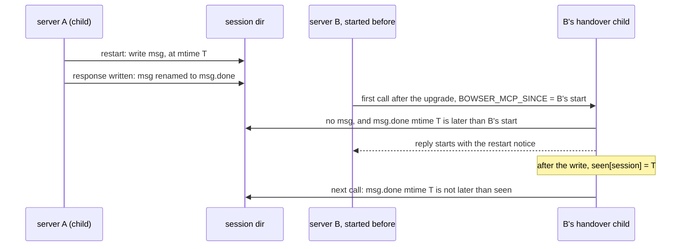

# An MCP server that was running during a restart gets its notice on its next call (#261)

Amends `2026-10-14-restart-close-notice-design.md` (ET-29) and its ET-44 change in PR #260.

## Problem

After an upgrade restart of a session opened without `--persistent` or `--profile`, the cookies and storage are
gone, and the restart notice is the only place that says so. Today three readers get it:

- the command that ran the restart (it reads `msg`, and its surface renames `msg` to `msg.done` once printed);
- a command that waited on that restart (it reads `msg`, else `msg.done`, and leaves both as they are, ET-44);
- any command at all while `msg` is still there, that is, before a surface has printed it (ET-29).

`takeNotice` (`src/commands/context.ts`) reads `msg.done` only for a command that waited. A second `bowser mcp`
server B on the same session, idle while server A's call restarts it, makes its next call after A has printed the
notice. B finds `msg` gone, did not wait, and reads `localStorage` as `null` with no word that it was lost. Not
seen in a run yet; it follows from the code.

In the usual case B is not even the process that runs the call. B was started by the old bowser, so its first tool
call after the upgrade hands over (`startHandover`, `src/mcp.ts`) to a child of the installed version, a process
that starts after the restart and knows nothing of B's past. Whatever B knows has to reach that child.

A one-shot CLI command keeps today's rule: it has no memory between runs, and nothing tells it which restart it has
already heard about.

## What identifies a restart for one MCP server

Three ways to tell "this restart is news to me". None adds a file that outlives what `close` removes. Sizes are for
this machine today: 31 session directories under `~/.bowser/sessions`, names 12 characters on average.

| Option | Kept per `bowser mcp` process | Handed to a handover child | Server that never called the session before the restart |
|---|---|---|---|
| 1. The daemon's pid it last talked to | `Map<session, pid>`: one entry per session it called, about 12 B name + 8 B number; 31 sessions, under 1 KB | the whole map, as JSON in an env var (31 × about 20 B = about 620 B) | no entry, so no notice |
| 2. Its own start time, and the mtime of the last notice it printed | one number (8 B), plus `Map<session, mtimeMs>`: one entry per session it printed a notice in, same size as above | one number, `BOWSER_MCP_SINCE=<ms>`, 13 digits | gets the notice: the restart is newer than the server |
| 3. A restart counter in the session directory | `Map<session, counter>`, as option 1 | the map, as option 1 | no entry, so no notice; and a new file `gen` per session (a few bytes on disk), written under `upg`, reset when `close` removes the directory |

Option 1 also fires on a daemon that changed for another reason (killed and spawned again by `open`), and a reused
pid hides a change (`src/daemon/pidfile.ts` already guards against reuse for the pidfile). Option 3 needs a new
write in the restart and its own rules for a missing or corrupt file.

Chosen: option 2. It keeps the least state, passes one number across the handover, and covers the case the issue
names, a server whose first call to the session comes after the restart. The notice file already records when the
restart finished: `writeNotice` writes `msg.<pid>.tmp` and renames it, and `markDelivered`'s rename to `msg.done`
keeps the file's mtime (checked on APFS: `mtimeMs` before and after `renameSync` both `1793333934579.2495`).

## Change

### 1. The rule

A `bowser mcp` process has a start time `since` and a map `seen` from session name to the mtime of the last notice
it put in a response for that session. A tool call that neither restarted nor waited reads `msg.done` as well as
`msg`, and takes the notice from `msg.done` when that file's mtime is later than `seen.get(session) ?? since`.

- `msg.done` is cleared as today: the next restart's `writeNotice`, a failed restart's `removeNotice`, and `close`,
  which removes the session directory. Nothing new clears it. A stale `msg.done` reaches only a server that was
  running when that restart finished, once per server.
- Every notice an MCP call puts in its response records its file's mtime in `seen`, on every path: the restarter's
  `msg`, a waiter's `msg` or `msg.done`, a pending `msg` (ET-29), and the late `msg.done` above. Without that, the
  call after a restart or a wait would print the same notice again, since its mtime is later than `since`.
- The record is made by an ack, after the response is written, as `markDelivered` is today
  (`if (!token.cancelled && (await send(res)))`, `src/mcp.ts`). A response that was not written leaves `seen` as it
  was, and the next call gets the notice again.
- The CLI sets neither field, so `takeNotice` behaves as today: `msg.done` for a waiter only.

### 2. Where the state lives

- `CommandContext` gets `restarts?: { since: number; seen: Map<string, number> }`. `takeNotice` uses it as above.
  `readNotice` returns the file's `mtimeMs` with the text, so the comparison and the record use the file the text
  came from.
- `createMcpServer` holds one such object for the process and passes it to `deps.run` with `notices` and `acks`.
  `McpDeps` gets `since: number`.
- `runMcpServer` takes `since` from `BOWSER_MCP_SINCE` when it is a positive integer, else `Date.now()`, and deletes
  the variable from `process.env`, so daemons the server spawns do not carry it.
- `startHandover` spawns the child with `env: { ...process.env, BOWSER_MCP_SINCE: String(since) }`. A grandchild,
  after a second upgrade, gets the same value from the child. `seen` is not passed: an old server hands over before
  it runs a call against the new daemon, so it has printed no notice of a restart to the installed version.

### 3. The flow it changes

### 4. What stays out

- A server started by a bowser without this change passes no `BOWSER_MCP_SINCE`, so its handover child uses its own
  start time, which is after the restart: the first upgrade to the version with this change behaves as today.
- A server started after the restart finished gets no notice, as a CLI command does: its client cannot have relied
  on what the session held before.
- A clock stepped back between the restart and the call can hide the notice; one stepped forward can show it to a
  server started just after. Both need a clock change within the few seconds of a restart.

## Cost

No new file, no new write in the restart. Per MCP process one 8-byte number and at most one map entry per session it
printed a notice in (31 sessions here, under 1 KB). Per tool call that neither restarted nor waited, one more file
read (`msg.done`, absent on most calls) and one `stat` when it exists. Per handover, one 13-digit env var.

## Definition of Done

- `tests/lifecycle.test.ts`, test "a late MCP call gets the last restart's delivered notice once (#261)", with
  `run(argv, { notices, acks, restarts })` against a fake daemon of this version and a `msg.done` written in the
  test:
  - `restarts.since` before the file's mtime: `notices` equals the file's text; after the acks run, a second call
    gets `[]`;
  - `restarts.since` after the file's mtime: `[]`;
  - without `restarts` (the CLI): `[]`, and `acks` is `[]`.
- `tests/lifecycle.test.ts`: the existing ET-44 waiter test, run with `restarts`, records the notice's mtime in
  `seen` once its acks run, and a second call gets `[]`.
- `tests/mcp.test.ts`: `serveLines` spawns its handover child with `BOWSER_MCP_SINCE` set to the server's `since`.
- `tests/e2e-upgrade.test.ts`, test "an MCP server idle during another's restart gets its notice on its next call
  (#261)": two `bowser mcp` servers from `copyAt("old-mcp", "0.0.1")`, both initialized, on one ephemeral session
  with `localStorage` `tok` set; A's call restarts it and its reply carries the notice; then B's first call
  `localstorage-get tok` answers text that starts with the restart notice and holds `cookies and storage were lost`;
  B's second call has no notice; a CLI `eval 1` after that prints `1` and nothing on stderr.
- `bun test tests/lifecycle.test.ts -t "#261"` runs at least one test, all passing. Today:
  `error: regex "#261" matched 0 tests`.
- README "Upgrading" says that a `bowser mcp` server running when the restart finished gets the line on its next
  call to that session, and that a CLI command started after the restart does not. `grep -n "does not get it (#261)"
  README.md` prints nothing; today it prints `62:has finished and its line was printed does not get it (#261). …`.
- CHANGELOG has an entry for #261.
- `bun run check` passes, and `BOWSER_E2E=1 bun test` passes in CI.
- Each new test goes red under one mutation of the line it names, quoted in the PR as one line per test.
