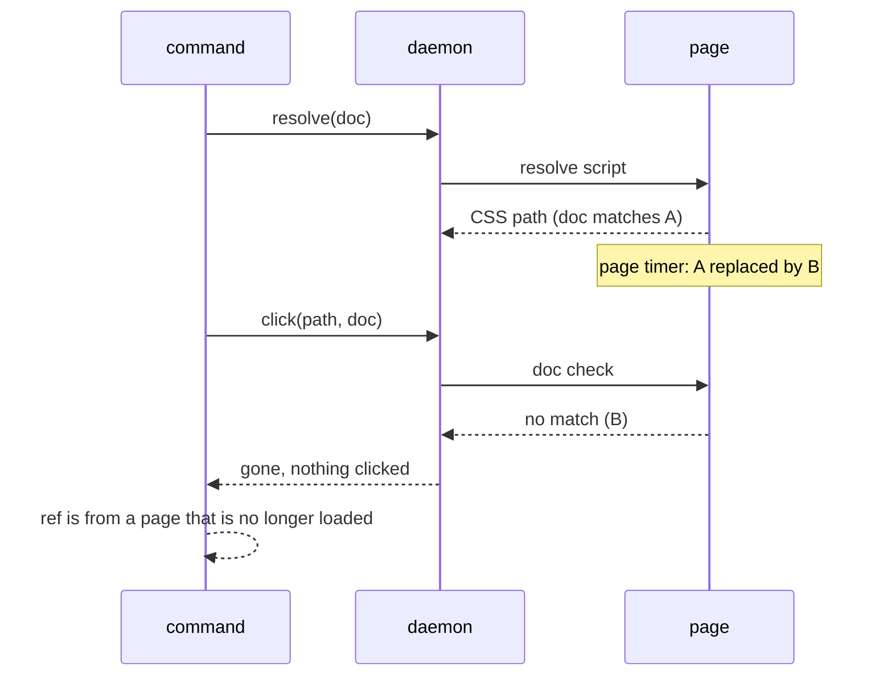

# Each ref action checks the document it acts on (#111)

Issue: #111. It follows the #105 spec (`2026-10-02-refs-document-identity-design.md`), which left this window out of scope.
Status: draft, waiting for review.

## Goal

A ref command acts only on the document its snapshot came from, also when the page navigates after `resolve` answered and before the action request runs. On any other document the action does nothing and the command fails with the #105 message, exit 1:

```
ref 'e2' is from a page that is no longer loaded; take a new snapshot
```

## The window today

A ref command sends two requests. `liveSelector` sends `resolve`, whose page script compares the saved `doc` with the store's and returns a CSS path (`src/commands/context.ts:137-167`, `src/page-scripts.ts:1316`). The command then sends the action with that path alone (`src/commands/interaction.ts:35`, `95`, `179`, `188`, `198`, `207`). Nothing in the action request names the document.

Between the two, the daemon waits only for a navigation an earlier action started (`server.ts:449`, `browser.ts:576-578`). A navigation the page starts itself (a timer, a `scroll` handler that the resolve's scroll-into-view fires) is not waited for. What happens next depends on when the new document commits:

1. Before the action reaches the page: The action finds the old CSS path in the new document and acts there. For `hover`, `select`, `check` and `uncheck` the action is a page script that runs `document.querySelector(selector)` (`page-scripts.ts:860`, `875`, `897`). For `click` it is Bun's native `click(selector)` (`browser.ts:802`). `fill` sends three requests after `resolve`: `click`, an `evaluate` of `fillScript` (`page-scripts.ts:933`) and, for a contenteditable target, `type`, so it has a window before each.
2. During Bun's actionability wait (only `click`). `view.click(selector)` waits page-side at rAF rate until the element is stable and on top. Measured on raw Bun 1.4.4 (probe below): when the document is replaced during that wait, the call never settles and ignores its own `timeout`; the new page's button is not clicked. Through bowser this is a 30 s timeout and a stuck session. That is #267, out of scope here.
3. After the action ran: The action hit the right document. Nothing to fix.

Measured with `commit.ts` (Probes, below): after the page starts a navigation to a local server and frees its main thread, the old document still answered 23 evaluates over about 5 ms before the new one committed (3 runs: 23/5.0 ms, 23/4.7 ms, 23/4.6 ms). A `click` request reaches Bun's wait within that time, which is why the two bowser runs ended in case 2, not case 1. Case 1 needs a commit that lands in the gap between two requests; it is rare for `click` and more likely for the page-script actions, which have no wait.

No run reproduced case 1 through the CLI; the tests in the Definition of Done place the navigation in the window by hand.

### Probes

Files in the session scratchpad, run from the main checkout (bowser 8832762, Bun 1.4.4):

- `probe.ts`: `view.click("#b", { timeout: 5000 })` on A while a timer moves the page to B with the same `#b`. `{"mode":"unstable","navAfter":300,"outcome":"no answer in 8 s","url":".../b","title":"/b"}`; same for A without `#b`. Control without navigation: `rejected: timeout waiting for '#b' to be actionable` after 5087 ms.
- `server.ts` + CLI: A's button has an `id` getter that starts `location.href = '/b'` and holds the thread 300 ms when bowser's resolve reads it. `click e2`, twice: `'click' timed out after 30000ms`, exit 2, then `session is stuck`.
- `commit.ts`: the evaluate count above.
- `cost.ts`: 1000 evaluates of `window[Symbol.for('bowser.aria-refs')]?.doc === '<32 hex>'` on WebKit: median 0.081 ms, p95 0.118 ms, max 3.97 ms.

## Options

Each option lists the data it adds and the window it leaves. "Hop" below means one message from the daemon to the page after the last check, the order of one evaluate round trip (0.08 ms median, measured above).

### A. The action request carries `doc`, and the action checks it in the page (chosen)

Each ref action request gets the saved `doc` as one more argument. Where the action is a page script (`hover`, `select`, `check`, `uncheck`, `fillScript`), the script compares it with the store's `doc` before `querySelector` and answers `{ gone: true }` without acting. Where the action is native (`click`, and `type` when `fill` sends it), the daemon evaluates the same comparison inside `act`, after `NAV_ARM` (`browser.ts:597`) and right before `view.click` or `view.type`, and returns `{ gone: true }` without calling them.

- Data: one 32-character hex string per action request, about 35 bytes of JSON. `fill` sends it on up to two requests and embeds it in `fillScript` (about 80 bytes of script). `state.json` does not change: `doc` is already saved (#105).
- Time: one extra evaluate for `click` and for `fill`'s `type`, 0.08 ms median. None for the page-script actions. A refused action still runs `act`'s grace window (100 ms) after the refusal, on the failure path only.
- Window left: none for the page-script actions, since the check and the lookup are one evaluate. For `click` and `type`, the hop after the check, plus case 2 (#267), which hangs and does not act on the new page.

### B. A marker in the DOM that the selector requires

`resolve` writes an attribute (say `data-bowser-doc="<id>"`) on the element and returns a selector that requires it. A new document has no marker, so no selector can match there.

- Data: one attribute per resolved element, left in the page's DOM.
- Window left: none before Bun's lookup. A swap before the lookup makes Bun wait for an element that never comes, which ends in its timeout or in #267.
- Cost: the page sees the attribute. `MutationObserver`s fire, a framework that re-renders the node can drop it, and the attribute shows in what `markdown` or a page script reads. It also needs a cleanup, which is another write.

It narrows `click`'s window by one hop compared with A and changes the page for every ref command. Not worth it at a 0.08 ms hop.

### C. Check the document after the action and report

The command compares the document before and after the action and warns when they differ.

- Data: one more evaluate per action.
- It cannot tell the action's own navigation (a link click, a form submit) from one that came before it, so it would warn on every click that navigates, or miss the case it is for. The action has also already run.

### D. Count landings in the daemon instead of asking the page

`resolve` records the navigation watch's landing count (`browser.ts:386-390`), and the action refuses if it changed.

- Data: one number in the daemon's handler state; no page call.
- `onNavigated` fires when the load completes, after the commit. A new document that has committed and not finished loading leaves the count unchanged, and the action runs there. The page's own store is the only source that is right in that gap.

### E. Page-script click instead of native click

`click` becomes `el.click()` in the same evaluate as the check, which closes the window.

- It changes every click: `isTrusted` is false, no pointer or mouse-down sequence runs, and sites that check either stop working. bowser uses native input on purpose.

### F. Coordinate click

One evaluate checks `doc` and returns the element's centre; then `view.click(x, y)`.

- Window left: the hop after the evaluate, the same as A. A swap in that hop clicks whatever is at those coordinates on the new page, where with A Bun's selector lookup or its wait (#267) stands between.
- It drops Bun's stability and topmost waits, which bowser would have to rebuild.

Native actions cannot be guarded past the hop: Bun.WebView has no API to run a check inside `click` or `type`, and no way to add a script to a document before it loads (`node_modules/bun-types/bun.d.ts`, `class WebView`, Bun 1.4.2 types: `navigate`, `evaluate`, `click`, `type`, `press`, `scroll`, `scrollTo`, `resize`, history, `cdp` for Chrome only). A closes everything else at a cost of one evaluate.

## Design



Today the action request carries no `doc`, so the daemon calls `view.click(path)` on B.

### 1. Protocol

The ref action ops take `doc` as their last client argument (`src/daemon/protocol.ts:56-65`) and may answer `{ gone: true }`:

| op | args | result |
| --- | --- | --- |
| `click` | `[selector, doc?, timeoutMs?]` | `void \| Gone` |
| `type` | `[text, doc?]` | `void \| Gone` |
| `hover` | `[selector, doc?]` | `void \| Gone` |
| `select` | `[selector, value, doc?]` | `boolean \| Gone` |
| `check` | `[selector, doc?]` | `void \| Gone` |
| `uncheck` | `[selector, doc?]` | `boolean \| Gone` |

`Gone` is `{ gone: true }`. `doc` comes before `timeoutMs` in `click` because the daemon sets the timeout itself (`server.ts:553`); that line keeps `args[1]` and writes `args[2]`, and the handler maps the wire order to the method: `click: (browser, selector, doc, timeoutMs) => browser.click(selector, timeoutMs, doc)` (`server.ts:348`). Spreading the wire args straight into `browser.click` would pass `doc` as the timeout and bring back the #112 hang. Without `doc` (plain `type`, `press`, and any caller that has no ref) an op behaves as today. A client never talks to an older daemon: `connect` restarts it first (`OlderDaemon`, `src/commands/context.ts:80`).

### 2. The check in the page

One page-script fragment, `docMatches(doc)`, reads `window[Symbol.for('bowser.aria-refs')]?.doc === <doc>`. `resolveRefScript` keeps its own comparison (`page-scripts.ts:1316`) and is not changed.

- `hoverScript`, `selectScript`, `setCheckedScript` take `doc` and return `{ gone: true }` before `querySelector` when it does not match.
- The `Browser` methods pass that object through before their own conversions: today `hover` drops the evaluate result, `select` keeps `=== true` and `setChecked` keeps `!== false` (`browser.ts:839-846`), and the `check` handler drops the return (`server.ts:353-355`). Without this, a refused `select` reads as `has no option` and a refused `uncheck` as success.
- `fillScript` takes `doc` and returns `{ outcome: 'gone' }`. `FillOutcome` (`page-scripts.ts:920`) and `FILL_OUTCOMES` (`interaction.ts:75`) gain `gone`, so `readFillAnswer` does not read it as `type`.

### 3. The check before a native call

`Browser.click(selector, timeoutMs, doc?)` and `Browser.type(text, doc?)` run the check as the first step of the function they pass to `nav.act`, after `NAV_ARM`: if `doc` is given and `evaluate(docMatches(doc))` is not `true`, they return `GONE` without calling `view.click` or `view.type`. An evaluate that throws propagates as today, so a crashed page keeps its own error. `type`'s line-by-line path (#243) checks once, before the first line. After each Enter it already reads `TYPE_TARGET_FOCUSED` (`browser.ts:813-816`), whose mark lives on the old window, so an Enter that moves the page stops the loop with the existing `focus left the editor` error before the next line. The hop after that read is the same window as for `click`.

### 4. What the command does

A helper in `context.ts` takes the action's result and throws the #105 `UserError` when it is `{ gone: true }`, with the same text `liveSelector` uses (one constant for both). `cmdClick`, `cmdHover`, `cmdSelect`, `cmdCheck`, `cmdUncheck` pass `doc` and call it. `cmdFill` passes `doc` to `click`, `fillScript` and `type`, and maps `outcome: 'gone'` to the same error. `cmdType` and `cmdPress` are unchanged: they take no ref.

A `fill` refused after its `click` landed has clicked the old document's field already; that click went to the right document, so nothing more is reported.

### 5. Interplay

- ACTS: the ops stay in `ACTS`; the dialog sync, the pending-navigation wait and the navigation watch run as today. The check runs after all of them, so it sees the document the action would use.
- #105: `resolve` still refuses first. This check covers only the time after it.
- #91 and #112 checks: they run in `resolve` and are unchanged. A role or name change in the same document between resolve and action is not covered, as today.
- #267: a swap during Bun's actionability wait still hangs. A does not make it worse: the check runs before the wait.
- MCP: the error becomes a tool result with `isError: true`, as for #105 (`runToolCall`'s catch, `src/mcp.ts:213`).
- Docs: the message is the #105 one, already in README and `skills/bowser/SKILL.md`. CHANGELOG `[Unreleased]` gets a `Fixed` line.

## Out of scope

- #267: `click` hanging when the document is replaced during Bun's actionability wait.
- The hop between the daemon's check and the native call for `click` and `type`.
- `type` and `press` without a ref: they act on whatever has focus, by design.

## Definition of done

1. Page-script actions refuse a new document: an e2e test, `tests/e2e-ref-window.test.ts`, serves A and B with the same markup (a checkbox, a `<select>`, a button with a hover handler, each at the same CSS path). It runs `snapshot` on A, then each of `check`, `uncheck`, `select` and `hover` with a `ctx.connect` that wraps the real connection and, after the `resolve` reply, sends `navigate` to B before passing the action on. Each fails with `ref '<id>' is from a page that is no longer loaded; take a new snapshot`, and B's state is unchanged (the box for `check` stays unchecked, the box for `uncheck` starts checked and stays checked, the option is unchanged, no hover mark). On main each acts on B.
2. `click` refuses a new document: the same test for `click` on the button: the command fails with the message and B's title is not `B clicked`. On main B's title reads `B clicked`.
3. `fill` refuses at each step: the same wrapper navigates after `resolve`, after `click`, and (for a contenteditable target) after the `fillScript` evaluate. Each fails with the message, and B's field is empty. On main B's field holds the text.
4. Daemon side: `tests/browser.test.ts`: with a fake view whose evaluate answers the doc check `false`, `click(selector, undefined, doc)` and `type(text, doc)` return `{ gone: true }` and the fake's `click` and `type` record no call; `hover`, `select` and `setChecked`, whose evaluate answers `{ gone: true }`, return `{ gone: true }`. With a matching answer they call through as today. `tests/daemon-handler.test.ts`: a `click` request `["#a", "<doc>"]` with a budget reaches `browser.click` as `("#a", <time left>, "<doc>")`, and `check`, `uncheck` and `select` return a browser answer of `{ gone: true }` as their result.
5. Client side: `tests/commands.test.ts`: each ref command sends its saved `doc` on the action request (and in `fillScript`), and an action answer of `{ gone: true }` gives the message. `tests/exit-codes.test.ts`: a `click e1` whose `click` answers `{ gone: true }` exits 1 with the message on stderr.
6. No change without a ref: `type` and `press` send no `doc`, and the existing tests for them pass unchanged.
7. Existing behaviour: the #105, #91, #112 and ET-10 tests (`tests/e2e-stale-ref.test.ts`, `tests/e2e-covered.test.ts`, `tests/e2e-known-state.test.ts`, `tests/e2e-hangs.test.ts`) and the MCP tests pass.
8. Tests seen failing: items 1 to 5 fail on main (or with the check line removed) and pass after; one red line each in the PR body.
9. Checks: `bun run check` passes; `BOWSER_E2E=1 bun test` passes in CI.
10. Changelog: CHANGELOG `[Unreleased]` has a `Fixed` entry naming #111.
11. Review and issue: a Codex review ends with no open Critical or Required finding, and the PR closes #111.

### Run before the code (2026-10-30, worktree at 8832762)

- Items 1 to 3: `BOWSER_E2E=1 bun test ./tests/e2e-ref-window.test.ts` prints `Test filter "./tests/e2e-ref-window.test.ts" had no matches` (exit 1); the file does not exist yet.
- Items 4 and 5: the tests are not written yet. `git grep -n doc src/daemon/protocol.ts` and `git grep -n gone src/commands/interaction.ts` both match nothing (exit 1).
- Items 6, 7 and 9 pass on main today and guard against regressions; they are checked after the code.
